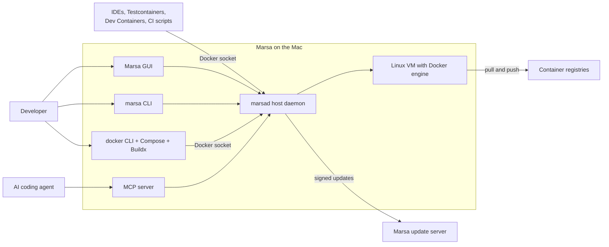
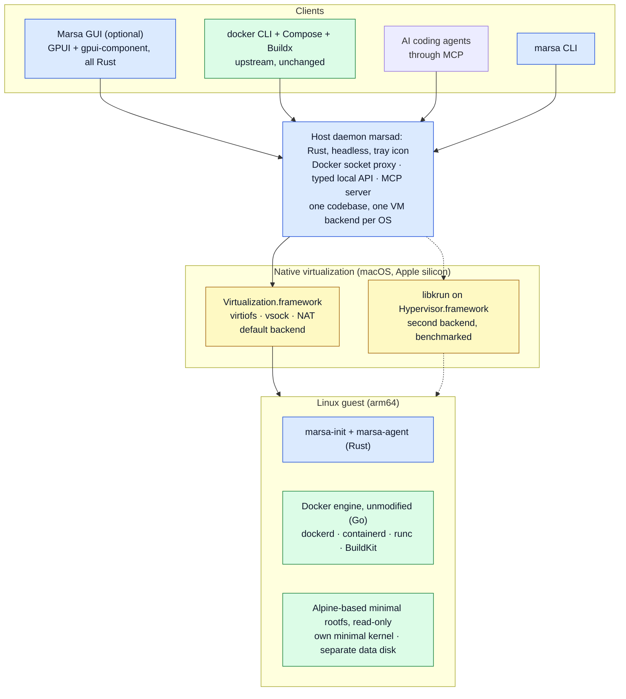
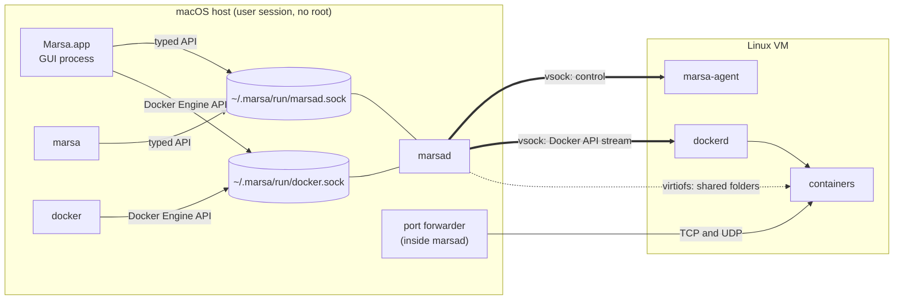
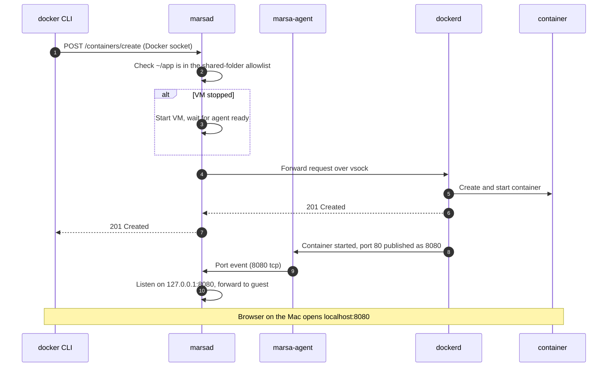
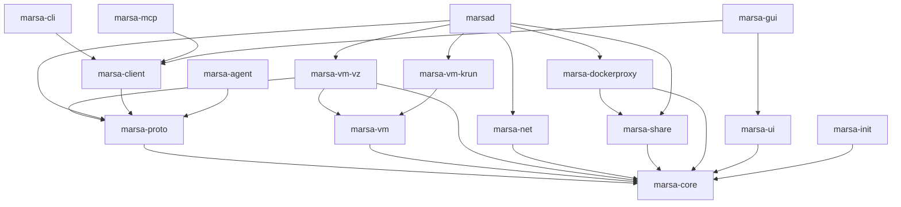

# 02 Architecture overview

This page shows the whole system. Each box has its own design doc.

## 1. System context

Who and what talks to Marsa.



## 2. Layered architecture

This is the diagram from the planning whiteboard, narrowed to the macOS release. Colours follow the whiteboard: blue is new code, green is reused upstream, yellow is the native OS layer.



## 3. Processes and channels

What actually runs on the machine, and how the pieces talk.



| Channel | Transport | Carries |
|---|---|---|
| Typed API | Unix socket, gRPC | VM lifecycle, settings, sharing, diagnostics, events |
| Docker socket | Unix socket, HTTP | The standard Docker Engine API, proxied byte-for-byte to dockerd |
| Control | vsock | Time sync, port events, mounts, certificates, shutdown, stats |
| Docker API stream | vsock | The proxied Docker Engine API |
| Shared folders | virtiofs | Bind-mounted host directories |
| Published ports | TCP and UDP | Traffic from `localhost` on the Mac to containers |

## 4. Key flow: `docker run -p 8080:80 -v ~/app:/app nginx`



## 5. Component map

| Component | Language | Runs on | Doc |
|---|---|---|---|
| `marsad` | Rust | Host | [03](03-host-daemon.md) |
| VM backends (`vz`, `krun`) | Rust, with a thin Apple bridge | Host | [04](04-virtualization-macos.md) |
| Guest image (kernel, rootfs) | Build scripts | Guest | [05](05-guest-image.md) |
| `marsa-init`, `marsa-agent` | Rust | Guest | [05](05-guest-image.md) |
| Networking and port forwarder | Rust | Host and guest | [06](06-networking.md) |
| File sharing and data disk | Rust | Host and guest | [07](07-file-sharing-and-storage.md) |
| Marsa GUI | Rust (GPUI) | Host | [08](08-gui.md) |
| `marsa` CLI and Docker compatibility | Rust, bundled upstream binaries | Host | [09](09-cli-and-docker-compat.md) |
| MCP server | Rust | Host | [10](10-mcp-server.md) |
| Docker engine | Go, upstream | Guest | [05](05-guest-image.md) |

## 6. Repository layout

**Proposed.** A single Cargo workspace.

```text
marsa/
├── AGENTS.md
├── README.md
├── Cargo.toml                  # workspace
├── crates/
│   ├── marsa-core/             # shared types, config, errors, paths
│   ├── marsa-proto/            # protobuf: host API and guest control protocol
│   ├── marsa-vm/               # Hypervisor trait and VM model
│   ├── marsa-vm-vz/            # Virtualization.framework backend
│   ├── marsa-vm-krun/          # libkrun backend
│   ├── marsa-net/              # port forwarder, DNS, network modes
│   ├── marsa-share/            # shared-folder allowlist, virtiofs mapping
│   ├── marsa-dockerproxy/      # Docker socket proxy and policy hooks
│   ├── marsad/                 # host daemon binary
│   ├── marsa-client/           # typed API client used by GUI, CLI, MCP
│   ├── marsa-cli/              # `marsa` binary
│   ├── marsa-mcp/              # MCP server
│   ├── marsa-ui/               # design tokens, direction, i18n, components
│   ├── marsa-gui/              # GUI binary
│   ├── marsa-agent/            # guest agent (linux/arm64, musl)
│   └── marsa-init/             # guest init (linux/arm64, musl)
├── guest/
│   ├── kernel/                 # kernel config and build
│   ├── rootfs/                 # Alpine-based rootfs recipe
│   └── image/                  # disk image assembly
├── packaging/
│   └── macos/                  # app bundle, entitlements, signing, notarization
├── locales/                    # en-US and ar translation files
├── xtask/                      # build, package and release automation
├── tests/                      # integration, conformance, benchmarks
└── docs/
```

## 7. Crate dependencies



Rules the dependency graph enforces:

- The GUI, CLI and MCP server depend only on `marsa-client`. They never link VM, network or proxy code.
- Guest crates (`marsa-agent`, `marsa-init`) never depend on host-only crates.
- `marsa-vm` defines the trait. Backends depend on it, never the reverse.

## 8. Technology choices

| Area | Choice | Status |
|---|---|---|
| Host language | Rust | Decided |
| Engine | Upstream Docker engine, unmodified | Decided |
| GUI framework | GPUI with gpui-component | Decided in [D-023](15-decisions.md#d-023-choose-gpui-for-the-desktop) |
| Hypervisor (macOS) | Virtualization.framework by default; libkrun benchmarked | Decided |
| Guest base | Alpine Linux | Decided |
| Host API | gRPC over a Unix socket (tonic, prost) | Proposed |
| Guest control protocol | Protobuf messages over vsock | Proposed |
| Async runtime | Tokio | Proposed |
| Docker API client | bollard | Proposed |
| Translations | Fluent, for Arabic plural rules | Proposed; verify against gpui-component's i18n |
