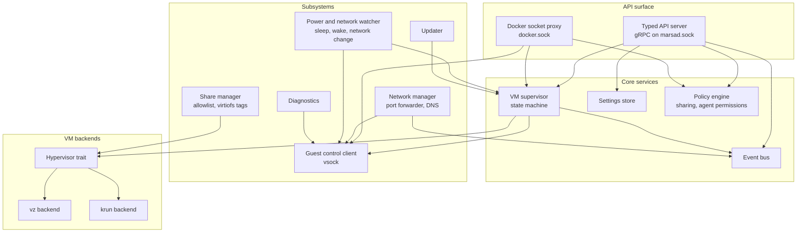
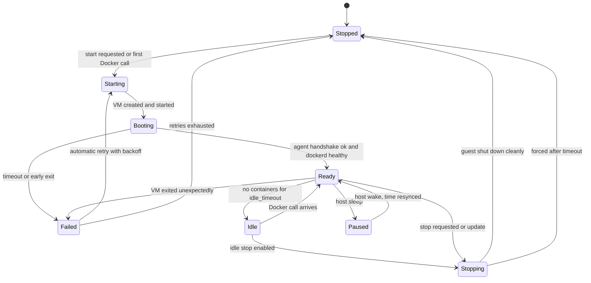
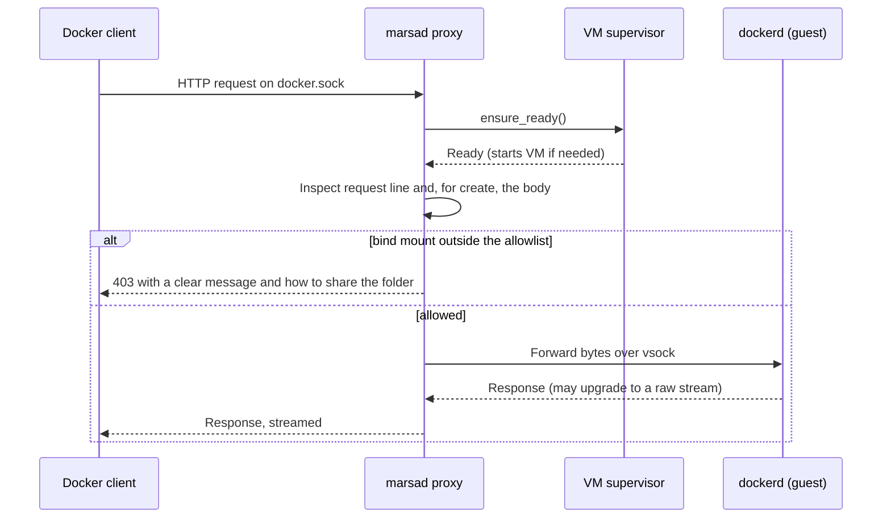

# 03 Host daemon (`marsad`)

`marsad` is the centre of Marsa. It is a headless Rust process that runs in the user's session, without root, and owns everything on the host: the VM, the Docker socket, networking, shared folders, settings and updates.

## Responsibilities

| Area | What `marsad` does |
|---|---|
| VM lifecycle | Creates, starts, pauses, stops and monitors the Linux VM through a backend |
| Docker socket | Serves the Docker Engine API on a host Unix socket and proxies it to dockerd in the guest |
| Typed API | Serves the Marsa API to the GUI, CLI and MCP server |
| Networking | Forwards published ports, provides DNS names, switches network mode |
| File sharing | Enforces the shared-folder allowlist and attaches folders to the VM |
| Guest control | Talks to `marsa-agent` over vsock: time, ports, certificates, stats, shutdown |
| Settings | Persists configuration and applies it |
| Events | Publishes a single event stream that every client subscribes to |
| Updates | Checks, verifies and applies signed updates |
| Diagnostics | Collects logs and state into a support bundle |

## Internal structure



## The Hypervisor trait

Every VM backend implements the `marsa-vm` contract using platform-neutral types.

```rust
/// A single Linux VM managed by one backend.
#[async_trait]
pub trait Hypervisor: Send + Sync {
    /// Static facts about this backend (name, features it supports).
    fn capabilities(&self) -> Capabilities;

    /// Build a VM from a spec. Does not start it.
    async fn create(&self, spec: VmSpec) -> Result<Box<dyn Vm>, VmError>;
}

#[async_trait]
pub trait Vm: Send + Sync {
    async fn start(&mut self) -> Result<(), VmError>;
    async fn pause(&mut self) -> Result<(), VmError>;
    async fn resume(&mut self) -> Result<(), VmError>;
    /// Ask the guest to shut down, then force after `timeout`.
    async fn stop(&mut self, timeout: Duration) -> Result<(), VmError>;
    fn state(&self) -> VmState;
    /// Stream of state changes, including unexpected exits.
    fn events(&self) -> VmEventStream;
    /// Open a vsock connection to a guest port.
    async fn connect_vsock(&self, port: u32) -> Result<VsockStream, VmError>;
    /// Set the guest's target memory, if the backend supports ballooning.
    async fn set_memory_target(&self, bytes: u64) -> Result<(), VmError>;
    /// Guest network facts (IP, gateway) for the current network mode.
    fn network_info(&self) -> Option<NetworkInfo>;
}

pub struct VmSpec {
    pub cpus: u32,
    pub memory_bytes: u64,
    pub kernel: PathBuf,
    pub initramfs: Option<PathBuf>,
    pub cmdline: String,
    pub root_disk: DiskSpec,      // read-only
    pub data_disk: DiskSpec,      // read-write
    pub shares: Vec<ShareSpec>,   // virtiofs tags and host paths
    pub network: NetworkSpec,     // Nat or UserSpace
    pub console_log: PathBuf,
}

pub struct Capabilities {
    pub name: &'static str,
    pub memory_balloon: bool,
    pub pause_resume: bool,
    pub dynamic_shares: bool,     // add a share without restarting
    pub userspace_network: bool,
}
```

The backend reports its features through `Capabilities`. The daemon can restart the VM to add a share when `dynamic_shares` is false. Backend `Running` reports guest execution. The supervisor promotes the engine to `Ready` after the agent handshake and Docker health check. Tests can enable the `fake` feature to replay guest protocol bytes over an in-memory vsock stream and inject lifecycle failures.

## VM lifecycle

When launched from `Marsa.app/Contents/MacOS`, the daemon resolves the guest
and the signed network helper from that bundle. A cold activation checks the
bundle and the guest manifest on a blocking worker before it opens private VM
storage. It snapshots the current settings for the whole activation, including
both attempts when automatic network selection tries the user-space helper.

The first valid activation creates the sparse data image in the user's private
VM directory. Stop and restart reuse that image. A successful restart records
which settings took effect and clears the restart flag only for that
configuration. Guest health and statistics flow through the local daemon API.
The packaged runtime requires an empty folder-share list until M4-05
provides the protected-path allowlist.




Rules:

- **Start on demand.** The VM starts when the user asks or when the first Docker API call arrives. A call that arrives during `Starting` or `Booting` waits, up to a timeout, and then proceeds.
- **Ready means usable.** `Ready` requires protocol negotiation, a successful guest clock update, an agent health report of `Ready`, and an independent successful `GET /_ping` over the Docker API vsock port.
- **Idle behaviour is a setting.** By default the VM stops after a period with no running containers, so an idle Marsa uses almost no memory.
- **Failures are visible.** Every transition is published, and `Failed` carries the failed stage and a bounded console tail. Retries use a bounded backoff and share a budget across one explicit activation. If VM cleanup fails, the supervisor retains it for another stop attempt before starting a replacement.

### Guest control

`marsad::guest_control::GuestControl` implements the supervisor's guest probe. It applies the [shared protocol limits](../crates/marsa-proto/PROTOCOL.md#guest-message-limits) before allocating for a frame and before accepting a decoded message. One command is in flight at a time. Up to eight commands can wait, and the request deadline includes that queue time. A stalled or out-of-sequence reply closes the session to prevent late replies from matching future requests.

Port, health and stats messages are published to bounded subscribers. If a subscriber falls behind, it must refresh its view. The supervisor drops the control session after a successful pause. Resume negotiates a fresh session, sets the current clock, and rechecks Docker before reporting readiness.

## Typed API

**Proposed.** gRPC over `~/.marsa/run/marsad.sock`, defined in `marsa-proto`. The [host protocol contract](../crates/marsa-proto/PROTOCOL.md#host-api) defines versioning and subscription semantics. The Docker Engine API is not duplicated here; clients use the Docker socket for container data.

| Service | Methods (summary) |
|---|---|
| `Engine` | `Status`, `Start`, `Stop`, `Restart`, `Reset` (factory reset with confirmation token) |
| `Settings` | `Get`, `Update`, `Watch` |
| `Shares` | `List`, `Add`, `Remove` |
| `Network` | `Status`, `SetMode`, `ListForwardedPorts` |
| `Events` | `Subscribe` (server stream of all daemon events) |
| `Stats` | `VmStats` (server stream: CPU, memory, disk) |
| `Disk` | `Usage`, `Reclaim`, `PrunePreview` |
| `Updates` | `Check`, `Download`, `Apply`, `Status` |
| `Diagnostics` | `Collect` (returns a bundle path), `Logs` (stream) |
| `Agents` | `ListPendingApprovals`, `Approve`, `Deny`, `ListGrants`, `RevokeGrant` (see [10 MCP](10-mcp-server.md)) |
| `AgentOps` | Engine operations performed on behalf of MCP clients. Every call names the client, passes through the policy engine and is written to the audit log. `marsad` executes the operation against dockerd itself; the MCP server never touches the Docker socket |
| `Meta` | `Version`, `Capabilities` |

API rules:

- Versioned package (`marsa.v1`). Additive changes only within a major version.
- Every mutating call is idempotent or carries a request ID.
- `Events.Subscribe` takes a snapshot and its cursor together, then sends subsequent events in sequence order. A slow client whose buffer has filled reconnects for a new snapshot.
- Engine lifecycle and settings update RPCs deduplicate retries by UUID for a bounded period within the daemon process. Stop can cancel a pending start. A restart with the same UUID joins or replays its earlier result.
- The daemon accepts engine lifecycle commands when a VM runtime is attached. Stats and guest health reflect observations from the current guest session.

Clients use `marsa_client::DaemonEndpoint::discover()` to locate the current
user's socket. The client checks the private socket and its kernel-reported
peer UID, then calls `Meta.Version` before exposing the typed service
clients. The connection reports the API minor revision supported by both
sides. To retry another RPC after a disconnect, open a fresh connection and
keep the original request ID and payload for interrupted mutations.

The event subscription reconnects and checks the API version again. It
delivers a replacement snapshot when the stream identity changes or a
newer snapshot covers a gap. It suppresses a snapshot at an already
delivered cursor and checks that live updates follow the cursor in order.

## Docker socket proxy

`marsad` listens on `~/.marsa/run/docker.sock` (mode 0600, owner only) and forwards each connection to dockerd in the guest over vsock. The sequence below includes on-demand startup (M4-02) and share policy (M4-06).



M4-01 connects to an already-ready guest. The proxy opens a separate stream
on guest vsock port 5001 for each authenticated client. The daemon holds
the listener under its instance lock, checks the Unix peer UID and limits
the proxy to 128 live connections. Each relay uses an 8 KiB buffer in each
direction and streams bytes as backpressure permits. A write half-close
still lets an attached client receive output. A full client disconnect
drops the upstream stream, including when opening it is still in progress.

Docker Engine 29.10.0 exposes API v1.57. The upstream contract specifies
HTTP connection upgrades for attach and exec, along with raw or multiplexed
output. BuildKit also uses an upgraded session alongside the build request.
The proxy leaves these streams and HTTP message framing intact.
[Docker API v1.57](https://raw.githubusercontent.com/moby/moby/docker-v29.10.0/api/docs/v1.57-swagger.yaml)
· [BuildKit session handler](https://github.com/moby/moby/blob/docker-v29.10.0/vendor/github.com/moby/buildkit/session/manager.go#L42-L86).

Proxy rules:

- **Transparent by default.** Requests and responses are forwarded unchanged, including connection upgrades used by `attach`, `exec` and BuildKit.
- **One inspection point only.** `POST /containers/create` is inspected for bind mounts that fall outside the shared-folder allowlist. Agent traffic does not use this socket at all; it goes through the `AgentOps` service of the typed API, where the permission policy applies.
- **No API emulation.** The proxy never rewrites engine responses. Anything the engine supports works.

Run the Docker proxy system test on Apple silicon from the workspace root.
Set `MARSA_VZ_GUEST_DIR` to the output of `cargo xtask guest all` and
`MARSA_VZ_NETWORK_HELPER` to the built userspace network helper. Put the
Docker CLI and `docker-buildx` on PATH.

```sh
MACOSX_DEPLOYMENT_TARGET=27.0 cargo test --locked -p marsad \
  --test packaged_runtime packaged_docker_socket -- --ignored --nocapture
```

The test uses a temporary home, a signed test bundle, and an isolated Docker
configuration. It builds a fixture using binaries from the guest image,
runs interactive CLI tests with a PTY, and samples daemon RSS while reading
a Docker save archive larger than 2 GiB. It also cancels 140 log-follow
requests to verify that the guest bridge continues accepting connections.

## Settings

**Proposed.** Stored as TOML at `~/.marsa/config.toml`. The daemon is the only writer; clients change settings through the API.

The daemon writes `schema_version = 1`. It accepts the unversioned draft format (also identified by version 0), applies defaults for omitted keys, validates the values, and writes the current version when persisting settings. It rejects unsupported versions and unknown keys. The TOML document limit is 256 KiB.

| Group | Keys |
|---|---|
| `vm` | `cpus`, `memory`, `backend` (`vz` or `krun`), `idle_stop`, `idle_timeout` |
| `disk` | `data_size_limit`, `auto_reclaim` |
| `shares` | list of host paths |
| `network` | `mode` (`auto`, `nat`, `userspace`), `proxy` settings, `dns` overrides |
| `ui` | `language` (`system`, `en-US`, `ar`), `theme` (`system`, `light`, `dark`) |
| `updates` | `channel`, `auto_check`, `auto_install` |
| `agents` | permission defaults for MCP clients |
| `telemetry` | `enabled` (default false) |

- VM defaults are two CPUs, automatic memory sizing at half of host RAM capped at 8 GiB, `vz`, and idle stop after 300 seconds. Explicit memory is in bytes and must be at least 512 MiB. The hypervisor validates resource limits at startup.
- Disk limits are specified in bytes. The default sparse disk limit is 64 GiB, with automatic reclaim enabled where supported. The minimum limit is 1 GiB.
- Shares are empty by default. The settings parser checks absolute UTF-8 path syntax. The daemon checks changes to the share list against the canonical allowlist and protected directories. `Shares.List`, `Shares.Add`, and `Shares.Remove` manage persistent writable grants through the same settings revisions and atomic config file. M4-06 handles attachment and bind-mount prompts.
- Networking defaults to `auto` with host DNS and proxy discovery. Override DNS with IP addresses in `network.dns`. Set `network.proxy.http` or `network.proxy.https` to an HTTP or HTTPS proxy URL. Credentials belong outside this file. Proxy injection into containers (`network.proxy.inject_into_containers`) requires opt-in.
- The UI follows system language and appearance by default. Updates are checked automatically on the stable channel, with automatic installation off.
- Agent operations ask for approval per client and project by default. The `agents.operate_approval` alternatives are `always_ask` and `deny`. `agents.advanced_access` defaults to false. The destroy and host-affecting tiers always require approval.
- Settings replacements use compare-and-swap revisions and an atomic rename of a private file in the config directory. Idle policy changes apply to the supervisor live. Boot-time changes report `restart_required` until the VM runtime is rebuilt with the new settings. VM CPU, memory, disk size, shares, backend and network settings are included in that check.
- Telemetry remains disabled pending [Q-10](16-risks-and-open-questions.md#open-questions-for-the-project-owner).

## Filesystem layout on the host

**Proposed.**

```text
~/.marsa/
├── config.toml
├── run/
│   ├── marsad.sock          # typed API
│   ├── docker.sock          # Docker Engine API
│   ├── marsad.pid
│   └── marsad.lock
├── vm/
│   ├── data.img             # sparse data disk
│   └── console.log
├── logs/
│   └── marsad.log
├── state/
│   ├── grants.json          # agent permission grants
│   └── update/
└── bin/                     # optional tool links
```

The read-only guest image (kernel and root filesystem) ships inside the app bundle, not in `~/.marsa`, so it is replaced atomically with each update.

## Process supervision

- From the signed app, `Contents/MacOS/marsad login status`, `enable` and `disable` read or change the start-at-login setting for the current user. Service Management stores the setting. If macOS requests approval, enable Marsa under **System Settings → General → Login Items & Extensions**.
- The bundled per-user LaunchAgent uses `SMAppService.agent(plistName:)` from macOS 13 onward. [Apple documents](https://developer.apple.com/documentation/servicemanagement/smappservice/register%28%29?changes=_4) that an approved LaunchAgent starts when registered and on subsequent logins. Unregistering removes the job and terminates the running agent. The plist uses bundle-relative `BundleProgram` to locate `Contents/MacOS/marsad`.
- The GUI and CLI can start `marsad` through `marsa-client` when the socket is absent or refuses connections. A packaged client verifies the containing app and the sibling daemon signatures before starting the daemon as the current user. The daemon lock resolves simultaneous launches. On-demand starts leave the start-at-login preference alone.
- `marsad` holds an exclusive lock on `marsad.lock` so only one instance runs per user. On SIGINT or SIGTERM it closes Docker connections, drains the local API, removes both sockets and the PID file, and releases the lock. The lock file stays in place for the next launch.
- With start at login enabled, launchd restarts the daemon after a crash or a nonzero exit. The agent stays stopped after a successful exit. On restart the daemon reattaches or cleans up any orphaned VM before accepting requests.

To verify registration, crash recovery and cleanup on a logged-in macOS desktop, build the daemon and run the isolated fixture.

```sh
MACOSX_DEPLOYMENT_TARGET=27.0 cargo build --locked -p marsad
python3 packaging/macos/smoke-login-agent.py target/debug/marsad
```

The fixture uses an ad-hoc signature, a unique label and a temporary home. On macOS 27.2.1 the 27.0-targeted binary registered without an approval prompt, started in the Aqua session, restarted after SIGKILL and disappeared from launchd after explicit disable. Repeat login behavior follows the Apple registration contract.

## Sleep, wake and network changes

| Event | Action |
|---|---|
| Host will sleep | Pause the VM if the backend supports it |
| Host woke | Resume the VM, send the current time to the agent, re-check network mode, refresh port forwards |
| Network changed | Re-evaluate `auto` network mode, refresh DNS and proxy settings in the guest |

## Observability

- Structured logs with levels use JSON lines and rotate daily in `~/.marsa/logs/`. The daemon keeps at most seven dated logs. `marsad.log` points to the current log.
- The event bus is the user-visible history: VM transitions, port forwards, share changes, update steps, agent approvals.
- No telemetry leaves the machine unless the user turns it on.
