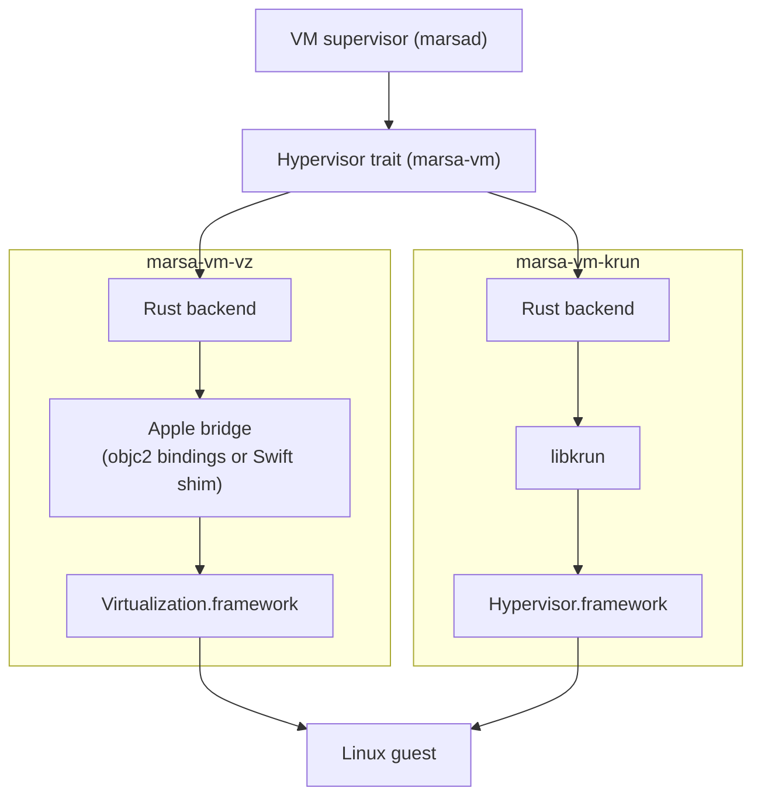
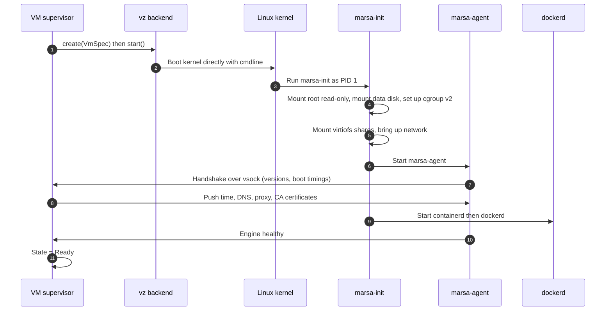

# 04 Virtualization on macOS

Marsa runs one shared Linux VM on Apple silicon. Two backends implement the same [`Hypervisor` trait](03-host-daemon.md#the-hypervisor-trait).

| Backend | Built on | Role | Status |
|---|---|---|---|
| `vz` | Apple Virtualization.framework | Default backend for version 1 | Decided |
| `krun` | libkrun on Apple Hypervisor.framework | Second backend, benchmarked against `vz`; becomes default only if it wins | Decided |

## Why two backends

- **Virtualization.framework** is the official, supported, lowest-risk path. It gives near-native CPU, virtiofs file sharing, vsock and NAT networking with little code.
- Its known weak point, found during planning research, is returning freed guest memory to macOS. The fastest products on the Mac (OrbStack, Docker's own VMM) moved to custom virtual machine monitors on Hypervisor.framework to control memory and file sharing.
- **libkrun** is an open-source Rust VMM (Apache-2.0) that runs on Hypervisor.framework and links directly into a Rust process. It is the base for that faster design, but research also found a report of stock libkrun being slower than Virtualization.framework on a database workload. So it must earn its place by measurement.
- Rosetta was the main reason to be tied to Virtualization.framework. With x86 images out of scope, both backends are on equal footing.

## Architecture

## The `vz` backend

### Virtual hardware

| Device | Framework class | Purpose |
|---|---|---|
| Boot loader | `VZLinuxBootLoader` | Boots the kernel directly with a command line; no firmware, no bootloader stage |
| CPU and memory | `VZVirtualMachineConfiguration` | CPU count and memory size from settings |
| Root disk | `VZVirtioBlockDeviceConfiguration` (read-only attachment) | The versioned guest root filesystem |
| Data disk | `VZVirtioBlockDeviceConfiguration` | Images, containers, volumes |
| Shared folders | `VZVirtioFileSystemDeviceConfiguration` | virtiofs shares for bind mounts |
| Control and Docker API | `VZVirtioSocketDeviceConfiguration` | vsock between `marsad` and the guest |
| Network | `VZVirtioNetworkDeviceConfiguration` with a NAT or file-handle attachment | See [06 Networking](06-networking.md) |
| Memory balloon | `VZVirtioTraditionalMemoryBalloonDeviceConfiguration` | Lowering the guest's memory target |
| Entropy | `VZVirtioEntropyDeviceConfiguration` | Randomness for the guest |
| Console | `VZVirtioConsoleDeviceSerialPortConfiguration` | Kernel and init log to `console.log` |

**Verify** each class and its availability on the minimum macOS version before implementing; the names above are from the framework as known at planning time.

### Entitlement and signing

- The process that creates the VM needs the `com.apple.security.virtualization` entitlement. `marsad` carries it.
- An unsigned or ad hoc signed development build must still include the entitlement, or VM creation fails.
- See [12 Build, release and update](12-build-release-update.md).

### Threading

Virtualization.framework objects must be used on the dispatch queue they were created with. The backend owns one serial queue for the VM and exposes async Rust methods that hop onto it. No framework object crosses to another thread.

### Calling the framework from Rust

**Open, resolved by task M1-02.** Two options:

| Option | For | Against |
|---|---|---|
| Rust bindings (`objc2` family) | One language, no second build system, no FFI layer to maintain | Bindings must cover every class Marsa needs; verify completeness |
| Small Swift shim with a C ABI | Uses the framework in its native language; delegate callbacks are simple | Adds Swift to the build and a hand-written FFI boundary |

Decision rule for the spike: choose Rust bindings if they can configure and boot the full device list above and deliver state-change callbacks reliably. Otherwise choose the Swift shim. Record the outcome in the decision records.

### Boot sequence

Boot-time budget (**Proposed**, measured by the agent handshake timings): kernel under 300 ms, init to agent handshake under 300 ms, dockerd healthy under 1.5 s.

## The `krun` backend

- Links libkrun into `marsad` (or a small helper process if isolation of the VMM proves necessary).
- Uses the same guest kernel configuration where possible. **Verify** whether libkrun requires its own bundled kernel (libkrunfw) or can boot Marsa's kernel; this affects the guest image build.
- Maps the same `VmSpec`: virtio block for disks, virtiofs for shares, vsock for control, virtio-net for networking.
- Needs the `com.apple.security.hypervisor` entitlement.
- **Verify** the current libkrun release, its macOS requirements and its C API before starting; planning research found version 1.19.x with macOS 14 or newer on arm64.

## Choosing the default: the benchmark gate

`vz` stays the default unless `krun` passes this gate (task group M11).

| Measure | `krun` must be |
|---|---|
| Bind-mount read and write throughput | At least equal to `vz` |
| Cold-cache directory walk of a large shared tree | Faster than `vz` |
| Database import on the data disk | Within 5% of `vz` |
| Idle memory after a 2 GiB workload ends | Lower than `vz` |
| Cold start to first container | Within 10% of `vz` |
| Stability | 72-hour soak test with sleep and wake cycles, no failures |

## Memory management

**Proposed**, with every mechanism to be measured:

1. **Right-size at start.** Default memory is a fraction of host RAM, capped, and changeable in settings.
2. **Balloon on idle.** When containers stop, lower the guest memory target through the balloon device. **Verify** how much memory Virtualization.framework actually returns to macOS; planning research found this is its weak point.
3. **Stop when idle.** With no running containers for `idle_timeout`, stop the VM. This always returns all memory and is the dependable mechanism.
4. **Fast restart.** Because boot is fast, stopping when idle is nearly invisible to the user.

## Failure handling

| Failure | Detection | Response |
|---|---|---|
| VM exits unexpectedly | Backend state event | Move to `Failed`, capture console tail, retry with backoff |
| Agent handshake timeout | Supervisor timer | Stop the VM, report `Failed` with the boot stage reached |
| dockerd never healthy | Agent health report | Report the engine log tail; keep the VM up for diagnosis if the user asks |
| Entitlement missing | VM creation error | Fail fast with a clear message; this is a packaging bug |

## Not used

| Technology | Why not |
|---|---|
| Apple's Containerization framework and `container` tool | One VM per container and not the Docker API; version 0.1.0 at planning time |
| Lima | A separate Go tool driven by SSH; useful as a bootstrap for early GUI work only, never shipped |
| QEMU | Emulation and a heavy stack; against the native-only principle |
| Rosetta | x86 images are out of scope |
