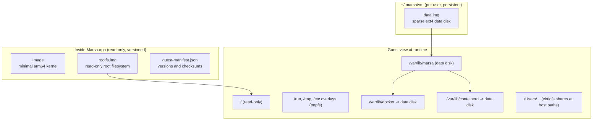
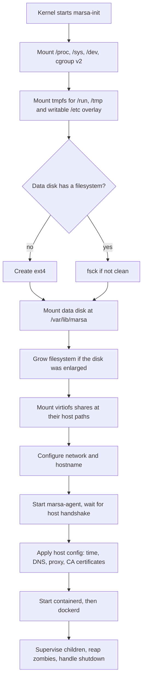
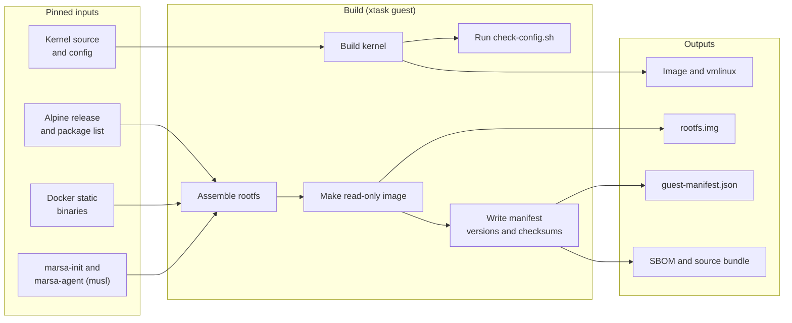

# 05 Guest image

The guest is the Linux system that runs inside the VM. It exists only to run the Docker engine, so it contains nothing else.

## Decisions

| Item | Decision | Status |
|---|---|---|
| Base | Alpine Linux, used as a minimal base | Decided |
| Architecture | arm64 for version 1; the recipe must also build x86_64 for later Windows use | Decided |
| Root filesystem | Read-only, versioned with the app, replaced whole on update | Decided |
| Data | Separate read-write data disk that survives updates | Decided |
| Init | `marsa-init`, a small Rust PID 1; no systemd, no OpenRC | Decided |
| Kernel | Marsa's own minimal build on macOS | Decided |
| Engine | Upstream Docker static binaries, unmodified | Decided |

## Layout

## Root filesystem contents

| Component | Source | Notes |
|---|---|---|
| Base | Pinned Alpine minirootfs | No OpenRC or package manager use at runtime |
| `marsa-init` | This repo, static musl build | PID 1 |
| `marsa-agent` | This repo, static musl build | Control channel endpoint |
| `dockerd`, `containerd`, `containerd-shim-runc-v2`, `runc`, `docker-proxy`, `docker-init` | Upstream Docker static release for linux/arm64 | Version pinned in the manifest |
| BuildKit | Bundled with the engine | Used through `docker buildx` |
| Networking tools | Alpine `iptables` and `iproute2-minimal` | Docker 29.10.0 uses `iptables` and `ip6tables` for bridge rules. The `ip` command is available for guest interface setup. |
| Filesystem tools | `e2fsprogs` and `e2fsprogs-extra` (mkfs, fsck, resize), `blkid` and `fstrim` from util-linux | For the data disk |
| CA certificates | `ca-certificates` | Extended at boot with host CAs |

Docker Engine 29.10.0 build `06db173` looks up `iptables` and `ip6tables` when configured with the iptables firewall backend. Alpine's `iptables` package supplies those commands through `xtables-nft-multi`. The native `nft` command is optional with the iptables backend. Docker tries to use it to clear old rules from its separate nftables backend. The engine uses netlink for bridge interface management. [Pinned Docker iptables implementation](https://github.com/moby/moby/blob/06db1734267bf7770914b417bff6556d835bf8cc/daemon/libnetwork/iptables/iptables.go#L64-L79), [Alpine 3.24 packaging](https://github.com/alpinelinux/aports/blob/3.24-stable/main/iptables/APKBUILD#L78-L85).

In the Virtualization.framework test guest running Linux 7.3.5, the pinned engine started with the staged configuration, created and removed a bridge network, and installed IPv4 masquerade rules. Both IPv4 and IPv6 NAT tables were accessible through Alpine's packaged commands.

[Marsa's daemon configuration](../guest/rootfs/daemon.json) binds the engine API to the guest's Unix socket, connects to containerd through `/run/containerd/containerd.sock`, and uses Docker's built-in seccomp profile. Experimental features, live restore and user namespace remapping are off. [Guest hardening](11-security.md#guest-hardening).

Rules:

- Nothing in the root filesystem is writable. Runtime state lives on tmpfs or the data disk.
- The root filesystem is an LZ4-compressed EROFS image presented as a read-only virtio block device. See [D-026](15-decisions.md#d-026-use-erofs-for-the-guest-root-filesystem).
- The image is built reproducibly from pinned inputs and its checksum is recorded in the manifest.

## Kernel

Build a minimal arm64 kernel from the pinned upstream stable release with a Marsa config. See [D-025](15-decisions.md#d-025-pin-the-current-stable-linux-kernel).

Must include:

| Area | Options |
|---|---|
| Virtio | block, net, console, vsock, balloon, rng, virtiofs (FUSE) |
| Containers | namespaces, cgroup v2 (all controllers), seccomp, overlayfs, veth, bridge, netfilter and NAT |
| Filesystems | ext4, EROFS, tmpfs, FUSE, overlayfs |
| Security | seccomp, AppArmor off or on by decision at implementation, user namespaces |
| Memory | free page reporting and balloon support |
| Misc | binfmt_misc (for optional later use), eBPF basics needed by the engine |

Must exclude: physical hardware drivers, sound, graphics, wireless, loadable modules where a built-in suffices.

Tier 1 verifies the resolved config with the upstream Moby 29.10.0 `check-config.sh`. The Linux 7.3.5 kernel booted on macOS 27.2.1 through the signed Rust VZ fixture, reached PID 1 and the shell, and detected both disks, virtiofs, vsock and the cgroup v2 CPU, cpuset, I/O, memory and PID controllers. The guest shut down cleanly.

## `marsa-init`

PID 1 in the guest. It replaces a general init system with a fixed, fast sequence.

Requirements:

- Reaps orphaned processes and forwards signals, as any PID 1 must.
- On shutdown: stop containers through the engine with a timeout, stop dockerd and containerd, sync and unmount the data disk, then power off.
- Writes each boot stage and its duration to the console and reports timings to the agent.
- Has no configuration file. Everything variable arrives on the kernel command line or from the host over vsock. `marsa.hostname` and `marsa.interface` override the default hostname and DHCP interface. Repeated `marsa.share=<tag>:<path>` parameters describe distinct virtiofs mountpoints. Percent-encode spaces and other characters that cannot appear in a kernel argument.
- Loopback is required for local services. If the upstream interface or the bounded initial DHCP attempt fails, PID 1 reports the failure on the console and continues with the control agent and local engine. External connectivity is assessed separately from engine readiness.
- PID 1 writes completed boot timings as stage and milliseconds pairs to `/run/marsa/boot-timings`. The guest agent signals that the host handshake and initial configuration are complete by creating `/run/marsa/agent.ready`. PID 1 then starts containerd and Docker in order.
- The unpartitioned virtio data disk is `/dev/vdb`. The current schema marker, `/var/lib/marsa/schema-version`, contains `1` and a newline. PID 1 rejects unknown contents or an unsupported marker. Data stays unmounted while any filesystem repair or growth runs.

## `marsa-agent`

The guest end of the control channel. It listens on vsock port 5000 and accepts connections from the host CID. It speaks the [versioned, size-limited guest protocol](../crates/marsa-proto/PROTOCOL.md#guest-control-channel).

| Function | Direction | Detail |
|---|---|---|
| Handshake | Guest to host | Protocol version, guest image version, boot timings |
| Time sync | Host to guest | The first successful clock update releases PID 1 to start the engine. The host can update the clock after a wake. |
| Network config | Host to guest | DNS servers, search domains, proxy variables for dockerd |
| CA certificates | Host to guest | Host-trusted certificates added to the guest trust store |
| Port events | Guest to host | A container published or released a port |
| Engine health | Guest to host | dockerd ping status and restart events |
| Stats | Guest to host | One-second samples of CPU time, memory, disk usage and VM network-device counters |
| Disk maintenance | Host to guest | Run `fstrim`, report usage |
| Shares | Host to guest | Mount or unmount a preconfigured virtiofs tag at its boot-allowlisted path |
| Shutdown | Host to guest | Reply to the request, then signal PID 1 to stop the engine and power off |
| Docker API bridge | Both | Host-only vsock port 5001 streams bytes to and from dockerd's Unix socket, preserving half-closes and upgrades |

The agent subscribes to Docker container lifecycle events and inspects `NetworkSettings.Ports` for TCP and UDP bindings. It reports transitions by comparing the current bindings with the previous set. When the event stream reconnects, the agent inspects the running containers again.

## Build pipeline

- Run `cargo xtask guest all` from a Mac with a local Docker daemon or from the Linux CI runner. The digest-pinned Linux builder downloads and verifies the arm64 guest sources. Individual stages are `kernel`, `rootfs` and `image`.
- Verified archives and their checksum list are written to `target/guest/`. A checksum mismatch stops the build. Remove a mismatched cached archive before retrying.
- The kernel stage compiles the arm64 kernel and writes the uncompressed boot `Image`, the ELF `vmlinux`, the resolved kernel config and the Moby configuration report. Run it on an arm64 Linux Docker daemon.
- The `rootfs` stage produces `target/guest/rootfs.tar` and prints its byte size. Tier 1 uploads the size report as `guest-rootfs-size`. The unprivileged builder writes root UID and GID 0 into the staging archive. M2-04 builds the read-only image. M2-05 and M2-06 supply the guest init and agent binaries.
- The source releases are pinned in [`guest/versions.toml`](../guest/versions.toml). The [arm64 APK lockfile](../guest/rootfs/aarch64.sha256) pins supplemental packages and their dependencies by exact version and SHA-256. The build verifies each APK before an offline, signature-checked install with package scripts disabled. Packages already present in Alpine's minirootfs are covered by its archive checksum. GNU tar is pinned separately for the [arm64](../guest/rootfs/builder/aarch64.sha256) and [x86_64](../guest/rootfs/builder/x86_64.sha256) builders.
- The `image` stage cross-builds the static Linux musl `marsa-init` and `marsa-agent` programs and adds them under `/usr/bin`. It imports the resulting `image-rootfs.tar` into EROFS and verifies file data with `fsck.erofs`. Install Rust's `aarch64-unknown-linux-musl` target and the [pinned host protobuf compiler](../crates/marsa-proto/PROTOCOL.md#build-the-rust-bindings) before running `image` or `all`. Build the kernel and root filesystem with the same pins before running this stage. `all` runs those stages first.
- The formatter uses a fixed timestamp and UUID, one compression worker, and path ordering. It runs as the host user inside the build container. The format preserves the numeric ownership in the staging archive.
- The image stage writes `rootfs.img` and `guest-manifest.json` to `target/guest/`. The manifest records the workspace release, architecture, filesystem format, component releases, and SHA-256 of the raw boot `Image` and `rootfs.img`. The manifest records the full Git commit when the source checkout is clean. Guest release builds remap workspace and Cargo registry paths to stable virtual paths. The core reader uses a size limit and streams artifact verification. M2-09 adds the full package inventory and verifies whole-build reproducibility in CI.

## Versioning and upgrades

- The guest image version is tied to the app version. An app update replaces kernel and root filesystem together.
- The data disk carries a schema version file. Before repairing or mounting an existing disk writable, `marsa-init` probes the marker with ext4's read-only `noload` option. The daemon reports an incompatible schema at the `data_disk` boot stage and skips automatic retries. The probe reads the marker before journal replay. A migration that introduces a future version must persist and checkpoint the marker before enabling filesystem changes that require it. [ext4 mount options](https://docs.kernel.org/admin-guide/ext4.html#options)
- Engine upgrades that change on-disk formats are handled by the engine itself; Marsa takes a snapshot note in the event log before the first boot of a new engine version, and offers a factory reset if the engine fails to start.

Keep the previous release's signed guest resources and manifest to exercise
the same data image across both guests. The packaged test creates a disposable
image, container and named volume under the previous guest, then checks their
identities and the volume contents after booting the current guest. A separate
downgrade fixture boots against an offline ext4 image seeded with a future schema
and compares its sparse extents and data bytes after the explicit refusal.
Run the [signed disk compatibility check](../crates/marsad/tests/run-disk-compatibility.sh)
with the assembled current guest, archived previous guest and built networking
helper. The check uses a fixture ext4 image created by the pinned guest's
`mkfs.ext4` in an isolated Linux container.

## Licence obligations

Shipping a Linux kernel and Alpine packages brings GPL and other open-source duties.

- Publish the exact kernel source reference and config for every release.
- Ship licence texts and an SBOM for everything in the image.
- Automate both in the guest build so they are never forgotten.

`cargo xtask guest all` writes the CycloneDX 1.7 inventory, exact source references, licence archive and resolved kernel configuration next to the image. Each Alpine package is tied to the aports commit recorded in its installed package metadata. The inventory maps shipped executables and BusyBox applets to their owning releases and rejects executable files whose provenance is missing. The build copies upstream notice text without rewriting it.

Tier 1 builds the guest twice from separate output directories and compares the images, kernel, configuration, manifests, licence archive and build reports byte for byte. The guest provenance artifact includes the image hashes, inventory, source references, notices and exact kernel configuration. The release process must publish these with the corresponding guest payloads.

When changing Alpine pins, derive package versions, licences, origins and aports commits from the rebuilt archive's `lib/apk/db/installed`. For each origin, record the exact APKBUILD digest and verify its source files against the recipe's SHA-512 checksums. Refresh the matching source records and SHA-256 checksums in [the Alpine notice lock](../guest/provenance/alpine-lock.json). Copy upstream licence, copyright and notice text byte for byte, and label SPDX reference text separately. Remove notices for packages that are no longer shipped. `cargo xtask guest provenance` verifies the resulting coverage against the packed image.

## Windows note

On Windows with WSL2 the same root filesystem is packaged as a WSL distribution and Microsoft's WSL2 kernel is used in place of Marsa's. The recipe therefore keeps kernel-dependent assumptions out of the root filesystem. See [14 Future platforms](14-future-platforms.md).
