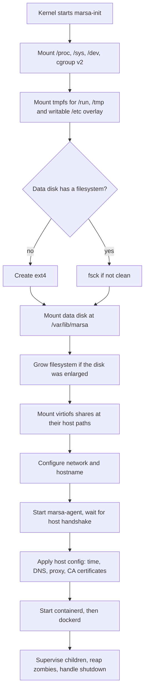
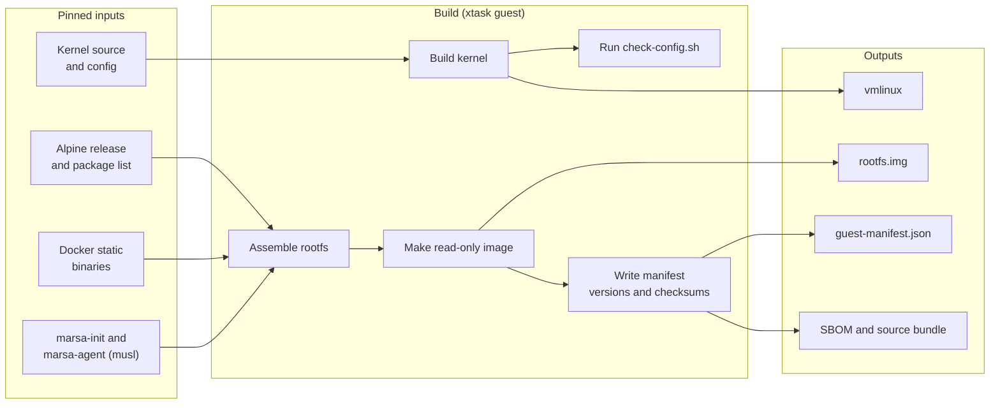

# 05 Guest image

The guest is the Linux system that runs inside the VM. It exists only to run the Docker engine, so it contains nothing else.

## Decisions

| Item | Decision | Status |
|---|---|---|
| Base | Alpine Linux, used as a minimal base | Decided |
| Architecture | arm64 for version 1; the recipe must also build x86_64 for later Windows use | Decided |
| Root filesystem | Read-only, versioned with the app, replaced whole on update | Decided |
| Data | Separate read-write data disk that survives updates | Decided |
| Init | `marsa-init`, a small Rust PID 1; no systemd, no OpenRC | Decided |
| Kernel | Marsa's own minimal build on macOS | Decided |
| Engine | Upstream Docker static binaries, unmodified | Decided |

## Layout

## Root filesystem contents

| Component | Source | Notes |
|---|---|---|
| Base | `alpine-base` packages only | No package manager use at runtime |
| `marsa-init` | This repo, static musl build | PID 1 |
| `marsa-agent` | This repo, static musl build | Control channel endpoint |
| `dockerd`, `containerd`, `containerd-shim-runc-v2`, `runc`, `docker-proxy`, `docker-init` | Upstream Docker static release for linux/arm64 | Version pinned in the manifest |
| BuildKit | Bundled with the engine | Used through `docker buildx` |
| Networking tools | `iptables` or `nftables`, `iproute2` | Whatever the pinned engine needs. **Verify** for the pinned engine version |
| Filesystem tools | `e2fsprogs` (mkfs, fsck, resize), `util-linux` (`fstrim`) | For the data disk |
| CA certificates | `ca-certificates` | Extended at boot with host CAs |

Rules:

- Nothing in the root filesystem is writable. Runtime state lives on tmpfs or the data disk.
- The root filesystem format is a compressed read-only filesystem (**Proposed:** EROFS, with SquashFS as the fallback) presented as a virtio block device.
- The image is built reproducibly from pinned inputs and its checksum is recorded in the manifest.

## Kernel

Build a minimal arm64 kernel from the pinned upstream stable release with a Marsa config. See [D-025](15-decisions.md#d-025-pin-the-current-stable-linux-kernel).

Must include:

| Area | Options |
|---|---|
| Virtio | block, net, console, vsock, balloon, rng, virtiofs (FUSE) |
| Containers | namespaces, cgroup v2 (all controllers), seccomp, overlayfs, veth, bridge, netfilter and NAT |
| Filesystems | ext4, EROFS or SquashFS, tmpfs, FUSE, overlayfs |
| Security | seccomp, AppArmor off or on by decision at implementation, user namespaces |
| Memory | free page reporting and balloon support |
| Misc | binfmt_misc (for optional later use), eBPF basics needed by the engine |

Must exclude: physical hardware drivers, sound, graphics, wireless, loadable modules where a built-in suffices.

Tier 1 verifies the resolved config with the upstream Moby 29.10.0 `check-config.sh`. The Linux 7.3.5 kernel booted on macOS 27.2.1 through the signed Rust VZ fixture, reached PID 1 and the shell, and detected both disks, virtiofs, vsock and the cgroup v2 CPU, cpuset, I/O, memory and PID controllers. The guest shut down cleanly.

## `marsa-init`

PID 1 in the guest. It replaces a general init system with a fixed, fast sequence.

Requirements:

- Reaps orphaned processes and forwards signals, as any PID 1 must.
- On shutdown: stop containers through the engine with a timeout, stop dockerd and containerd, sync and unmount the data disk, then power off.
- Writes each boot stage and its duration to the console and reports timings to the agent.
- Has no configuration file. Everything variable arrives on the kernel command line or from the host over vsock. `marsa.hostname` and `marsa.interface` override the default hostname and DHCP interface. Repeated `marsa.share=<tag>:<path>` parameters describe distinct virtiofs mountpoints. Percent-encode spaces and other characters that cannot appear in a kernel argument.
- PID 1 writes completed boot timings as stage and milliseconds pairs to `/run/marsa/boot-timings`. The guest agent signals that the host handshake and initial configuration are complete by creating `/run/marsa/agent.ready`. PID 1 then starts containerd and Docker in order.
- The unpartitioned virtio data disk is `/dev/vdb`. The current schema marker, `/var/lib/marsa/schema-version`, contains `1` and a newline. PID 1 rejects unknown contents or an unsupported marker. Data stays unmounted while any filesystem repair or growth runs.

## `marsa-agent`

The guest end of the control channel. It listens on vsock port 5000 and accepts connections from the host CID. It speaks the [versioned, size-limited guest protocol](../crates/marsa-proto/PROTOCOL.md#guest-control-channel).

| Function | Direction | Detail |
|---|---|---|
| Handshake | Guest to host | Protocol version, guest image version, boot timings |
| Time sync | Host to guest | The first successful clock update releases PID 1 to start the engine. The host can update the clock after a wake. |
| Network config | Host to guest | DNS servers, search domains, proxy variables for dockerd |
| CA certificates | Host to guest | Host-trusted certificates added to the guest trust store |
| Port events | Guest to host | A container published or released a port |
| Engine health | Guest to host | dockerd ping status and restart events |
| Stats | Guest to host | One-second samples of CPU time, memory, disk usage and VM network-device counters |
| Disk maintenance | Host to guest | Run `fstrim`, report usage |
| Shares | Host to guest | Mount or unmount a preconfigured virtiofs tag at its boot-allowlisted path |
| Shutdown | Host to guest | Reply to the request, then signal PID 1 to stop the engine and power off |
| Docker API bridge | Both | Host-only vsock port 5001 streams bytes to and from dockerd's Unix socket, preserving half-closes and upgrades |

The agent subscribes to Docker container lifecycle events and inspects `NetworkSettings.Ports` for TCP and UDP bindings. It reports transitions by comparing the current bindings with the previous set. When the event stream reconnects, the agent inspects the running containers again.

## Build pipeline

- Run `cargo xtask guest all` from a Mac with a local Docker daemon or from the Linux CI runner. The digest-pinned Linux builder downloads and verifies the arm64 guest sources. Individual stages are `kernel`, `rootfs` and `image`.
- Verified archives and their checksum list are written to `target/guest/`. A checksum mismatch stops the build. Remove a mismatched cached archive before retrying.
- The kernel stage compiles the arm64 kernel and writes the uncompressed boot `Image`, the ELF `vmlinux`, the resolved kernel config and the Moby configuration report. Run it on an arm64 Linux Docker daemon. M2-03 builds the root filesystem and M2-04 creates the bootable filesystem image.
- Every input is pinned by version and checksum in `guest/versions.toml`.
- The output is identical for identical inputs (reproducible build), verified in CI by building twice.

## Versioning and upgrades

- The guest image version is tied to the app version. An app update replaces kernel and root filesystem together.
- The data disk carries a schema version file. `marsa-init` refuses to start the engine on a data disk from a newer schema and reports it to the host.
- Engine upgrades that change on-disk formats are handled by the engine itself; Marsa takes a snapshot note in the event log before the first boot of a new engine version, and offers a factory reset if the engine fails to start.

## Licence obligations

Shipping a Linux kernel and Alpine packages brings GPL and other open-source duties.

- Publish the exact kernel source reference and config for every release.
- Ship licence texts and an SBOM for everything in the image.
- Automate both in the guest build so they are never forgotten.

This is not legal advice; have the release process reviewed.

## Windows note

On Windows with WSL2 the same root filesystem is packaged as a WSL distribution and Microsoft's WSL2 kernel is used in place of Marsa's. The recipe therefore keeps kernel-dependent assumptions out of the root filesystem. See [14 Future platforms](14-future-platforms.md).
