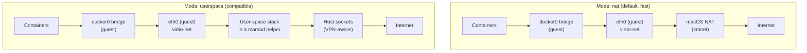
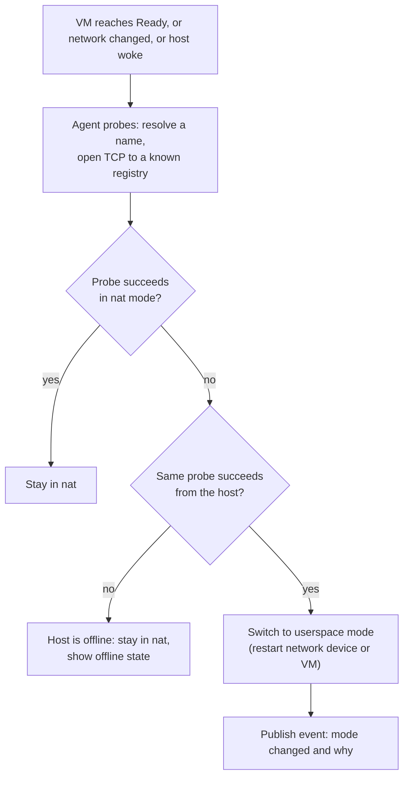
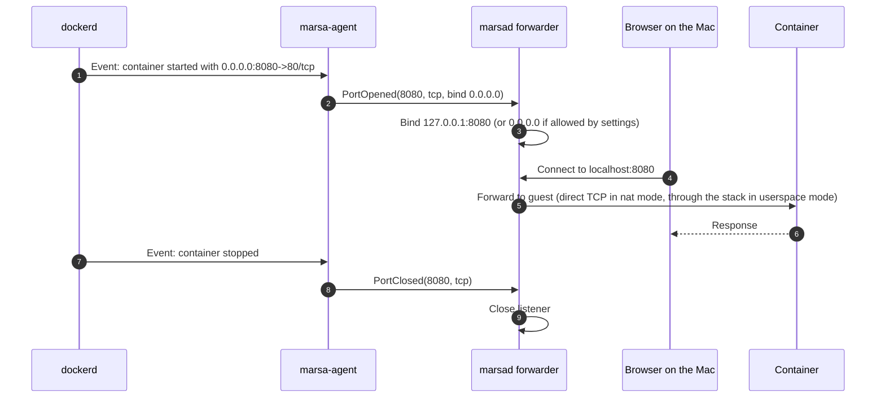
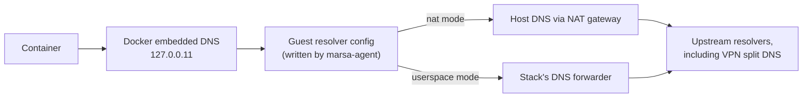

# 06 Networking

Networking has to do four things: give containers internet access, make published ports reachable on `localhost`, let containers reach the host, and keep working on VPNs and corporate networks.

## Decisions

| Item | Decision | Status |
|---|---|---|
| Default mode | Kernel-level NAT provided by macOS (fast path) | Decided |
| Fallback mode | User-space network stack, chosen automatically when NAT is blocked | Decided |
| Published ports | A Rust forwarder inside `marsad` | Decided |
| Mode selection | `auto` by default, with a manual override | Decided |

Planning research found the trade-off behind this: kernel NAT keeps packets in the OS network stack and is the fastest path, while a common open-source user-space stack (gvisor-tap-vsock) reports about 1.6 to 2.3 Gbit/s in its own test but keeps working in environments where the NAT path fails.

## Network modes

| | `nat` | `userspace` |
|---|---|---|
| How traffic leaves | Forwarded by macOS as NATed packets | Re-originated by a host process as ordinary sockets |
| Speed | Highest | Lower |
| VPNs and strict firewalls | Can fail when the VPN blocks forwarded traffic | Works, because traffic looks like it comes from a normal app |
| Guest IP reachable from host | Yes | No; ports are forwarded through the stack |
| Framework attachment | NAT attachment | File-handle (datagram socket) attachment |

**Verify:** the exact Virtualization.framework attachment classes and whether the NAT attachment needs any extra entitlement on the minimum macOS version.

### The user-space stack

**Proposed:** run gvisor-tap-vsock's `gvproxy` as a bundled helper process for version 1. It is proven, it is used by Podman and Lima, and it already provides DHCP, DNS and port forwarding. A pure-Rust stack is a possible later optimisation, not a version 1 goal.

## Automatic mode selection

Rules:

- The user can pin a mode in settings; `auto` never overrides a pinned mode.
- A mode switch is announced in the GUI and the event log, with the reason.
- Probe targets are configurable, and no probe sends identifying data.

## Published ports

When a container publishes a port, it must be reachable at `localhost:<port>` on the Mac.

Forwarder requirements:

- TCP and UDP.
- IPv4 and IPv6 loopback.
- **Bind address policy (Proposed):** ports published on `0.0.0.0` are bound to `127.0.0.1` on the Mac by default, so containers are not exposed to the local network unless the user enables "allow LAN access". This is safer than Docker Desktop's default and must be stated clearly in the UI.
- Privileged ports (below 1024): **Verify** current macOS behaviour for unprivileged binding; if binding fails, report it clearly.
- Port conflicts produce a clear error naming the process that holds the port when it can be determined.
- The forwarder is zero-copy where the platform allows and must not be the bottleneck in the network benchmark.

## Container to host

| Name | Resolves to | Purpose |
|---|---|---|
| `host.docker.internal` | The host as seen from the guest | Compatibility with existing Compose files |
| `gateway.docker.internal` | The guest's default gateway | Compatibility |
| `host.marsa.internal` | Same as `host.docker.internal` | Marsa's own name |

The agent configures these names in the engine's DNS or `/etc/hosts` injection (**Proposed:** through dockerd's `host-gateway` support and an extra hosts entry).

## DNS

- `marsad` reads the host's resolver configuration and pushes it to the agent at boot and on every network change.
- Split DNS from VPNs must keep working. In `userspace` mode the host resolver is used directly, which honours it.

## Proxies and certificates

Corporate networks were identified in planning as a top reason Docker alternatives fail.

| Need | Design |
|---|---|
| HTTP and HTTPS proxy | `marsad` reads system proxy settings (and manual overrides) and the agent configures dockerd and BuildKit with them |
| Custom CA certificates | `marsad` exports the certificates the user trusts in the macOS keychain and the agent installs them into the guest trust store before dockerd starts |
| Registry mirrors and insecure registries | Exposed in settings and written to the engine configuration |
| Proxy for containers | Optional injection of proxy variables into containers, off by default |

## IPv6

**Proposed:** IPv6 inside Docker networks follows the engine's configuration. IPv6 to the internet depends on the mode and on what macOS NAT provides. Treat full IPv6 egress as best effort in version 1 and document the behaviour that the tests observe.

## Sleep, wake and network change

- On wake and on network change, `marsad` re-pushes DNS and proxy settings, re-runs the mode probe and re-validates listeners.
- Long-lived connections that died during sleep are closed cleanly so clients reconnect.

## Test matrix

| Scenario | Must work |
|---|---|
| Plain home network | Pull, run, publish, `host.docker.internal` |
| Captive or offline network | Clear offline state, no hangs |
| Full-tunnel VPN | Pull and run after automatic switch to `userspace` |
| Split-tunnel VPN with split DNS | Internal names resolve from containers |
| Corporate proxy with TLS interception | Pull succeeds after CA import |
| Sleep for an hour, then wake | Ports and DNS work without restarting |
| Wi-Fi to Ethernet switch | Connectivity restored without restarting |
