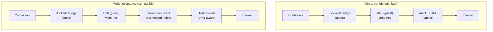
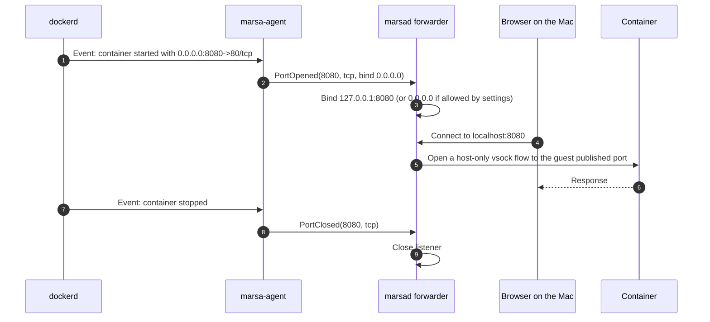
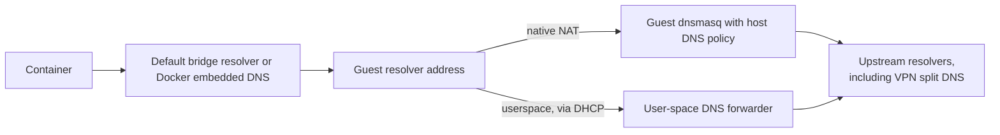

# 06 Networking

Networking has to do four things: give containers internet access, make published ports reachable on `localhost`, let containers reach the host, and keep working on VPNs and corporate networks.

## Decisions

| Item | Decision | Status |
|---|---|---|
| Default mode | Kernel-level NAT provided by macOS (fast path) | Decided |
| Fallback mode | User-space network stack, chosen automatically when NAT is blocked | Decided |
| Published ports | A Rust forwarder inside `marsad` | Decided |
| Mode selection | `auto` by default, with a manual override | Decided |

Planning research found the trade-off behind this: kernel NAT keeps packets in the OS network stack and is the fastest path, while a common open-source user-space stack (gvisor-tap-vsock) reports about 1.6 to 2.3 Gbit/s in its own test but keeps working in environments where the NAT path fails.

## Network modes

| | `nat` | `userspace` |
|---|---|---|
| How traffic leaves | Forwarded by macOS as NATed packets | Re-originated by a host process as ordinary sockets |
| Speed | Highest | Lower |
| VPNs and strict firewalls | Can fail when the VPN blocks forwarded traffic | Uses ordinary host sockets and is subject to VPN and process-filter policy |
| Guest IP reachable from host | Yes | No; ports are forwarded through the stack |
| Framework attachment | `VZNATNetworkDeviceAttachment` | `VZFileHandleNetworkDeviceAttachment` with a datagram socket |

Native NAT uses the standard virtualization entitlement on macOS 27. The
framework does not expose the assigned guest address. The backend reads the
guest's current upstream IPv4 address and default route over the host-only
network facts socket after the guest configures networking. These values are
guest-reported and do not authorize host connections.
[Apple’s NAT attachment](https://developer.apple.com/documentation/virtualization/vznatnetworkdeviceattachment),
[network facts wire format](../crates/marsa-proto/PROTOCOL.md#guest-network-facts).

### The user-space stack

The VZ backend supports an opt-in helper built from the signed and checksum-pinned
gvisor-tap-vsock v0.9.0 source. Marsa runs its own small entry point over an inherited
connected datagram socket. The helper provides IPv4 DHCP and ordinary host-socket
egress. Conventional guest DNS uses the macOS scoped resolver. Each activation
has its own process, bounded readiness, guest frame validation, and egress limits.
The helper has no listening host port. The default alias to host loopback is absent.
The helper rejects host interface addresses, loopback and metadata destinations.
A helper exit publishes a network event and leaves guest control alive.
[Build and verification](../network-helper/README.md).

## Automatic mode selection

The local engine and vsock control remain available when the guest has no
upstream link or DHCP lease. Track egress separately from Docker readiness.
Probe at first boot, after a host network change, and after waking. Use
bounded, configurable probes that send no identifying data. Compare host
and guest results for the same destination, address family, and proxy
policy. A registry authentication challenge can establish HTTPS reachability
after certificate validation succeeds.

The boot selector currently compares IPv4 to the Docker Hub registry. It
negotiates deferred Docker startup, checks the same resolved public address
with normal TLS verification, and requires a repeated native failure and
unchanged host route and proxy policy before trying the alternate attachment.
Unknown proxy policy, a DNS policy reply and certificate rejection preserve
the native attachment and keep local Docker available. A failed alternate
attempt must stop before the supervisor restores native networking on the
same data disk. Explicitly selected modes skip automatic switching.

The authenticated `Network.SetMode` call saves `auto`, `nat`, or `userspace`
as the configured mode. The current attachment stays in use until a cold
activation, such as an ordinary restart. A configured pin is authoritative
for that activation. When integrating approved daemon proxy policy, enforce
its user-space attachment requirement. An incompatible setting must be
refused or reported as pending until approval clears that constraint.

| Observation | Behavior in `auto` mode |
|---|---|
| Native path succeeds | Keep native NAT. |
| Host reaches the destination and native DHCP, DNS or TCP fails | Try the user-space path and confirm connectivity before reporting recovery. Publish the chosen mode and the failed stage. |
| Host and guest both fail DNS or transport | Keep the local engine usable. Report the failing stage and retry on an applicable network change. |
| Host DNS returns a policy answer, or TLS rejects a certificate | Preserve the resolver result and certificate validation. Surface the DNS, proxy or certificate error and use the configured trust path. |
| A process firewall blocks the signed helper | Report the affected helper and policy failure or timeout. Require the user's normal firewall decision. |
| User explicitly pins a mode | Keep that mode and report its connectivity status. |

Use the macOS scoped resolver for private VPN domains and split DNS. Route
helper sockets through the ordinary host network policy, with no firewall
or VPN changes. Keep the helper transport private, apply explicit host
service exposure rules, and preserve loopback-only published ports by
default. Confirm repeated failures before changing modes. Schedule a
restart-required change around active workloads and avoid repeated switching
on transient Wi-Fi, captive portals, or VPN handoffs.

### Apple silicon qualification

On macOS 27.2.1, both Marsa and a stock Ubuntu VM experienced native NAT
failures. With NordVPN disconnected and LuLu and the macOS firewall active,
a paired test booted the same Marsa image on native NAT and on a private
`VZFileHandleNetworkDeviceAttachment` backed by `gvproxy` v0.9.0. Both
received DHCP and resolved the same HTTPS destination. Native NAT timed out
while IPv4 forwarding reported off. The user-space path returned HTTP 200
with the server certificate verified. The probe used a disposable helper
with no TCP listening socket. It established the transport only. The pinned
helper's defaults map a guest address to host loopback and read
`/etc/resolv.conf` for some record types. Qualify an explicit helper
configuration with that loopback mapping controlled and all DNS requests
subject to scoped resolver policy. Validate policy outcomes with filters
enabled, including LuLu's documented limits on hostname-based filtering.
[Apple's file-handle attachment](https://developer.apple.com/documentation/virtualization/vzfilehandlenetworkdeviceattachment)
· [gvproxy v0.9.0 configuration](https://github.com/containers/gvisor-tap-vsock/blob/v0.9.0/cmd/gvproxy/config.go)
· [gvproxy v0.9.0 DNS](https://github.com/containers/gvisor-tap-vsock/blob/v0.9.0/pkg/services/dns/dns.go)
· [LuLu documentation](https://objective-see.org/products/lulu.html)

[M3-14](plan/M3-vm-and-daemon.md#m3-14-qualify-the-unprivileged-user-space-transport)
owns the transport and helper qualification.
[M3-15](plan/M3-vm-and-daemon.md#m3-15-select-the-network-mode-before-docker-starts)
owns automatic selection during boot.
[M4-10](plan/M4-docker-integration.md#m4-10-user-space-network-mode-and-automatic-selection)
owns transitions after boot and the port-forwarding policy.

The production helper in an entitled VM test reached the upstream Docker registry with NordVPN, LuLu and
the macOS firewall active. A local-only DNS-SD record resolved through the guest
and matched the macOS resolver. This Mac's independently configured lab resolver
timed out from the host during the VPN test. Positive qualification against that
resolver needs a reachable endpoint. The previous native test separately reached
HTTPS over IPv6 after router advertisement and timed out over IPv4.

For either VZ attachment, the backend reports the guest's current IPv4 address
and default gateway from its configured upstream interface over a host-only
vsock. The strict native qualification test compares those facts with the
guest kernel and runs the IPv4-only registry HTTPS probe through native NAT.
It runs independently of the device tests and the user-space registry pull.
The strict test passed on two consecutive cold boots of the packaged guest
on macOS 27.2.1 on 2026-11-25.
[M3-04 qualification results](plan/M3-vm-and-daemon.md#m3-04-qualify-strict-native-ipv4-nat)
· [Entitled test commands](../crates/marsa-vm-vz/README.md).

Apple's published XNU source initializes host-wide IPv4 forwarding to zero.
A live zero is consistent with the default and does not identify the process or
configuration that last set it. Apple documents its native NAT attachment as the
routing and translation mechanism. Marsa uses the forwarding value only as
diagnostic context and offers user-space networking as the alternative.
[Apple XNU default](https://github.com/apple-oss-distributions/xnu/blob/xnu-12377.121.6/bsd/netinet/ip_input.c#L192-L195)
· [Apple native NAT](https://developer.apple.com/documentation/virtualization/vznatnetworkdeviceattachment).

## Published ports

When a container publishes a port, it must be reachable at `localhost:<port>` on the Mac.

Forwarder requirements:

- TCP and UDP.
- IPv4 and IPv6 loopback.
- **Bind address policy (Decided).** By default, Marsa exposes published ports on the Mac through IPv4 and IPv6 loopback. The user must explicitly enable LAN access. [D-038](15-decisions.md#d-038-bind-published-ports-to-loopback-by-default)
- When macOS denies a host bind, report its address and port. For a privileged host port, suggest a host port of 1024 or higher. For example, `-p 8080:80` keeps the container service on port 80.
- Port conflicts produce a clear error naming the process that holds the port when it can be determined.
- The forwarder is zero-copy where the platform allows and must not be the bottleneck in the network benchmark.

The host opens each flow through the active VM’s vsock transport for either
attachment. A guest address announcement cannot direct host connections to a
third machine. The guest sends each flow to its own Docker-published port.
This also works when guest NAT egress is unavailable. LAN opt-in applies to
wildcard publications. Explicit localhost publications stay on localhost.
An unsupported specific binding or an occupied port appears in
`Network.ListForwardedPorts` with the affected address and port. Changing
`network.allow_lan` reconciles existing publications and closes connections
on a retired listener. [Relay protocol](../crates/marsa-proto/PROTOCOL.md#published-port-relay)

### macOS loopback port privilege

On macOS 27.2.1 on Apple silicon, a standard-user process called `bind()` on
`127.0.0.1` and `::1` using one socket at a time. The IPv6 socket used
`IPV6_V6ONLY`; the TCP socket called `listen()` after a successful bind. Each
socket closed before the next attempt. No LAN address or system setting was used.

| Loopback address | Transport | Ports 80, 443 and 1023 | Port 1024 |
|---|---|---|---|
| `127.0.0.1` | TCP | `EACCES` | Bound and listened |
| `127.0.0.1` | UDP | `EACCES` | Bound |
| `::1` | TCP | `EACCES` | Bound and listened |
| `::1` | UDP | `EACCES` | Bound |

The forwarder handles the actual OS bind result for each address and transport.

## Container to host

| Name | Resolves to | Purpose |
|---|---|---|
| `host.docker.internal` | The host as seen from the guest | Compatibility with existing Compose files |
| `gateway.docker.internal` | The guest's default gateway | Compatibility |
| `host.marsa.internal` | Same as `host.docker.internal` | Marsa's own name |

On native NAT the guest agent reads the upstream default gateway, updates the guest hosts file and configures Docker’s host gateway. The guest DNS service answers all three aliases for containers on the default bridge and user-defined bridge networks. The service on the Mac must listen on an address reachable through the native attachment.

## DNS

- In `userspace` mode, DHCP gives the guest a stable DNS gateway at `192.168.127.1`. The helper asks the macOS system resolver for each forwarded query. Changes to a scoped answer take effect without replacing the guest's DNS server address. Docker's default bridge uses the guest resolver address and custom networks forward external DNS through Docker's embedded resolver. [Apple DNS guidance](https://developer.apple.com/documentation/technotes/tn3151-choosing-the-right-networking-api#DNS) · [Docker DNS behavior](https://docs.docker.com/engine/network/#dns-services)
- On native NAT, PID 1 supervises the guest dnsmasq process. Docker keeps the same guest DNS address across host network changes. The daemon sends updated resolver and suffix settings through guest control. Guest firewall rules block DNS requests arriving on the upstream interface. [Native NAT qualification](plan/M4-docker-integration.md#m4-08-nat-networking-dns-and-host-names)

## Proxies and certificates

Corporate networks were identified in planning as a top reason Docker alternatives fail.

| Need | Design |
|---|---|
| HTTP and HTTPS proxy | The guest agent can configure dockerd before startup. M4-20 provisions the last approved credential-free manual proxy on the user-space attachment. M4-21 owns approval, restart and rollback for this policy. M4-15 extends the transaction to the full network policy. |
| Custom CA certificates | `marsad` exports the certificates the user trusts in the macOS keychain and the agent installs them into the guest trust store before dockerd starts |
| Registry mirrors and insecure registries | Exposed in settings and written to the engine configuration |
| Proxy for containers | Optional injection of proxy variables into containers, off by default |

Saving a manual proxy setting records a draft. Ordinary VM boots use the last approved
proxy. While that proxy is active, a draft change to the attachment also remains pending.

On the user-space attachment, the authenticated Network API previews the
impact before activation. A running VM is recycled after explicit approval.
Running containers, builds, attached Docker clients and one-session folder
grants may be interrupted. The daemon pauses new Docker admissions during
the transaction. It keeps the original data disk and records the candidate as
approved only after the guest and Docker are ready. A failed candidate keeps
the draft pending and restores the previous policy. If restoration cannot
start a previously running engine, the result tells the client that recovery
is required. Reopening the daemon still uses the last approved policy.

When a manual daemon proxy is approved, disable it with explicit activation before changing the network mode. A confirmed factory reset clears the approved policy with the other private state.

## IPv6

**Proposed:** IPv6 inside Docker networks follows the engine's configuration. IPv6 to the internet depends on the mode and on what macOS NAT provides. Treat full IPv6 egress as best effort in version 1 and document the behaviour that the tests observe.

## Sleep, wake and network change

- On wake and on network change, `marsad` refreshes DNS, re-runs the mode probe and re-validates listeners. The current daemon proxy remains in effect until an approved activation.
- Long-lived connections that died during sleep are closed cleanly so clients reconnect.

## Test matrix

| Scenario | Must work |
|---|---|
| Plain home network | Pull, run, publish, `host.docker.internal` |
| Captive or offline network | Clear offline state, no hangs |
| Full-tunnel VPN | Pull and run after automatic switch to `userspace` |
| Split-tunnel VPN with split DNS | Internal names resolve from containers |
| Corporate proxy with TLS interception | Pull succeeds after CA import |
| Sleep for an hour, then wake | Ports and DNS work without restarting |
| Wi-Fi to Ethernet switch | Connectivity restored without restarting |
