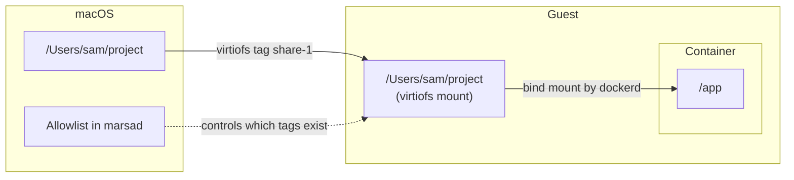
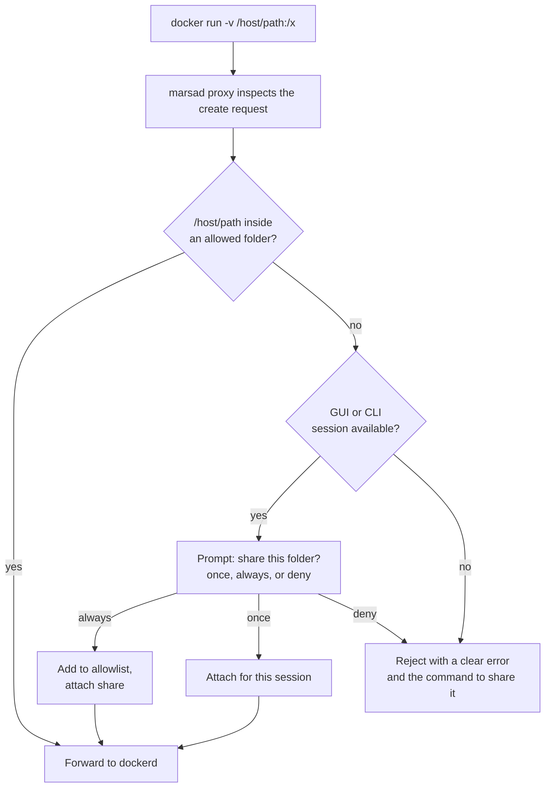
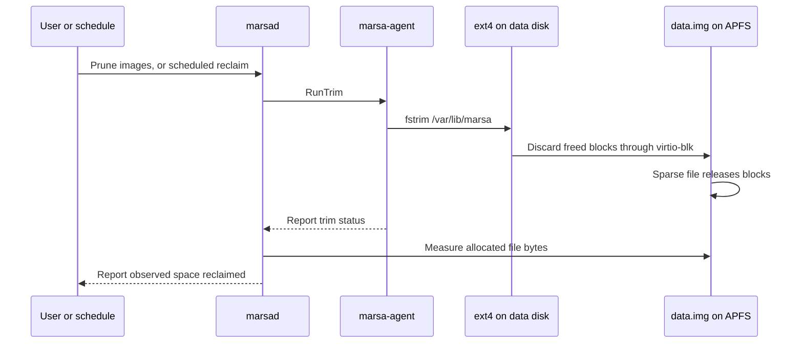

# 07 File sharing and storage

Two separate things live here: **shared folders** (host directories visible to containers through bind mounts) and the **data disk** (where the engine keeps images, containers and volumes).

## Decisions

| Item | Decision | Status |
|---|---|---|
| Sharing mechanism | virtiofs | Decided |
| What is shared | An explicit allowlist chosen by the user; never the whole home folder by default | Decided |
| Engine data | A separate sparse data disk, kept across updates | Decided |
| Disk space | Space freed in the guest is returned to macOS | Decided as a requirement; mechanism to verify |

## Shared folders

### Path model

A host folder is mounted in the guest **at the same absolute path**, so a standard bind mount works unchanged:

```text
docker run -v /Users/sam/project:/app ...
            └─ host path, also valid inside the VM
```



### The allowlist

Planning identified this as a top security gap in comparable tools: sharing the whole home folder lets any container read SSH keys and cloud credentials.



Rules:

- **First run** offers to share the folders the user picks; a typical choice is a projects directory. Nothing is shared silently.
- **Protected paths** include `~/.ssh`, `~/.aws`, `~/.gnupg`, `~/.kube`, `~/.docker`, `~/.marsa`, keychains and similar credential stores. The policy covers the configured home, the effective account home, and the daemon's active state directory. The list is defined and tested in `marsa-share`. A share cannot be a protected path, one of its ancestors, or one of its descendants, even if a credential directory has yet to be created.
- **Path checks** resolve symlinks and check filesystem identities, including macOS case variants and APFS Data volume aliases. Bind-source checks accept existing files and directories inside a canonical allowlist entry. They return the canonical path for the caller to use. Revalidate configured directories before attaching them to a VM.
- **Adding a share** uses a dynamic attach if the backend supports it; otherwise `marsad` explains that a VM restart is needed and performs it when no containers are running, or asks.
- **Named volumes** are unaffected: they live on the data disk and need no sharing.

### Correctness requirements

These were listed in planning as the quiet source of most bug reports.

| Requirement | Design | Status |
|---|---|---|
| File-change events reach containers (hot reload) | A host-side watcher forwards change events to the agent | The VZ spike saw file contents change with no inotify event. M4-06 verifies the relay with a dev server. |
| Files created in a container are owned by the user on the host | Map ownership so container users can write appropriately and new files belong to the Mac user | The VZ spike mapped guest root to the Mac user. A tested non-root identity could not create a file. M4-06 verifies container-user handling. |
| Case sensitivity | Document host case behavior and detect collisions in diagnostics | The default APFS share resolved a case-variant lookup in both macOS and Linux. |
| Symlinks, hard links, extended attributes | Cover them in the compatibility suite | Relative and dangling symlinks, hard links, and one user extended attribute worked in both directions in the VZ spike. |
| Performance | Benchmark small-file reads, large-file throughput, and directory walks | The VZ spike measured bulk reads at 5.86× native elapsed time in its cached workload. |

See the [virtiofs spike](spikes/M1-04-virtiofs.md) for the test scope,
measurements, and limitations.

### Performance guidance shown to users

- Keep dependency directories (for example `node_modules`) in a named volume when speed matters most.
- The GUI shows a hint when a container does very heavy I/O on a shared folder.

## Data disk

### Layout

| Item | Value | Status |
|---|---|---|
| File | `~/.marsa/vm/data.img` | Proposed |
| Type | Sparse raw image on APFS | Proposed |
| Filesystem | ext4 with explicit discard via `fstrim` | Proposed |
| Default maximum size | A setting; the file only uses what is written | Proposed |
| Contents | `/var/lib/docker`, `/var/lib/containerd`, Marsa guest state | Decided |

### Inspecting usage

Run `marsa disk usage` to see the bytes allocated to the sparse image on
macOS and the image's logical capacity. These values are available with
the VM stopped. If the VM has reported a current filesystem sample, the
CLI also shows guest used bytes and capacity. JSON output preserves this
distinction through the [CLI response schema](reference/cli-response.schema.json).

### Returning space to macOS



On the VZ backend, `fstrim` on the mounted ext4 data filesystem returned approximately 4 GiB of physical allocation to APFS after deleting 4 GiB of files from a sparse RAW image. Use automatic caching with full synchronization and request explicit trim after cleanup and when idle. Calculate the recovered bytes using the change in the image file's allocated size on the host. The guest's trim result counts bytes submitted for potential discard. [Measured results](spikes/M1-03-disk-reclaim.md)

M9-03 tests the same path after deleting Docker images. A backend that cannot pass discard through will require offline compaction while the VM is stopped.

### Disk cleanup with a preview

A version 1 feature. The GUI and CLI show what would be removed and how much space returns before anything is deleted.

| Category | Source |
|---|---|
| Stopped containers | Engine API |
| Unused images, dangling images | Engine API |
| Unused volumes | Engine API; listed individually and never selected by default |
| Build cache | BuildKit prune API |
| Reclaimable disk space | Trim estimate from the agent |

### Resizing

- Growing: enlarge the sparse file while the VM is stopped; `marsa-init` grows the filesystem at next boot.
- Shrinking: not supported in place. Offered through export, recreate and import, later.

### Integrity

- `marsa-init` runs a filesystem check when the disk was not cleanly unmounted.
- A clean shutdown path exists for app quit, logout, update and host shutdown.
- **Factory reset** deletes and recreates the data disk after an explicit, typed confirmation. It is the last-resort recovery and must always work.

### Backup and Time Machine

The packaged daemon excludes `data.img` from Time Machine by default. Set
`disk.exclude_from_backup = false` to clear that file's exclusion on the
next VM activation. This setting applies to the raw image in the private VM
directory. Volume backup and export is a later feature.
[Apple backup resource key](https://developer.apple.com/documentation/foundation/urlresourcekey/isexcludedfrombackupkey).

`Disk.Usage` reports the actual host allocation and logical image capacity.
Guest usage and capacity describe the mounted filesystem and are available
after the ready VM publishes its statistics. The service distinguishes
unavailable guest usage from an empty filesystem.

## Registry credentials

Not stored on either disk. See [11 Security](11-security.md#registry-credentials).
