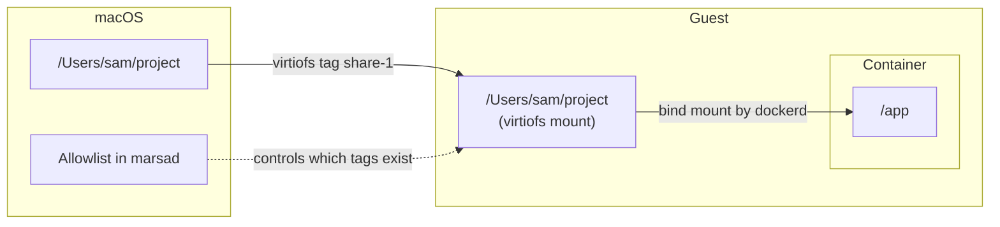
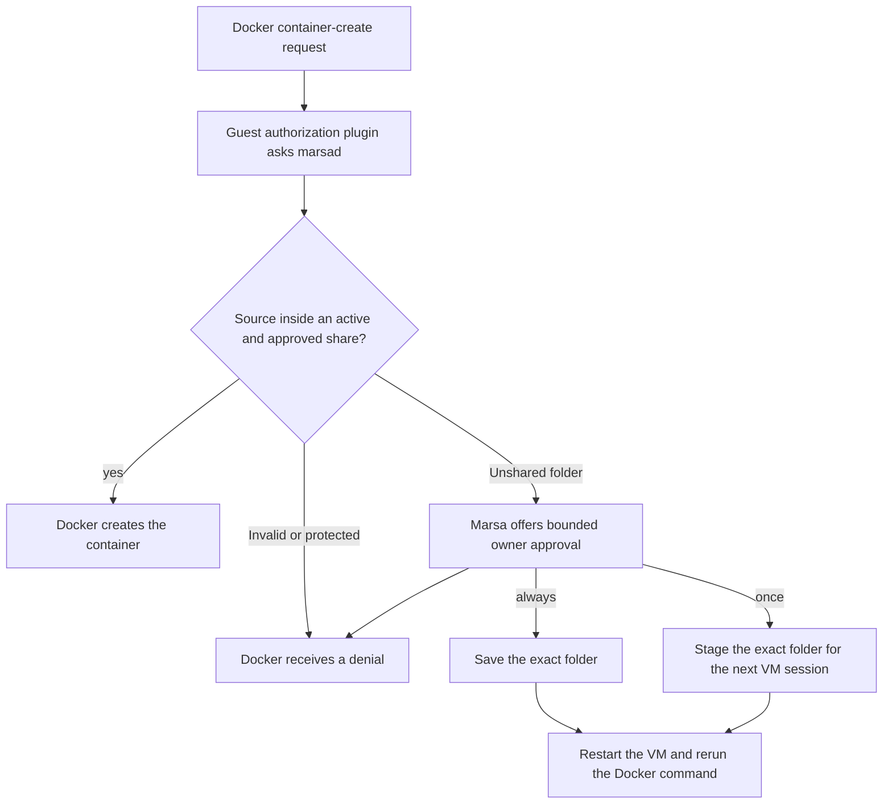
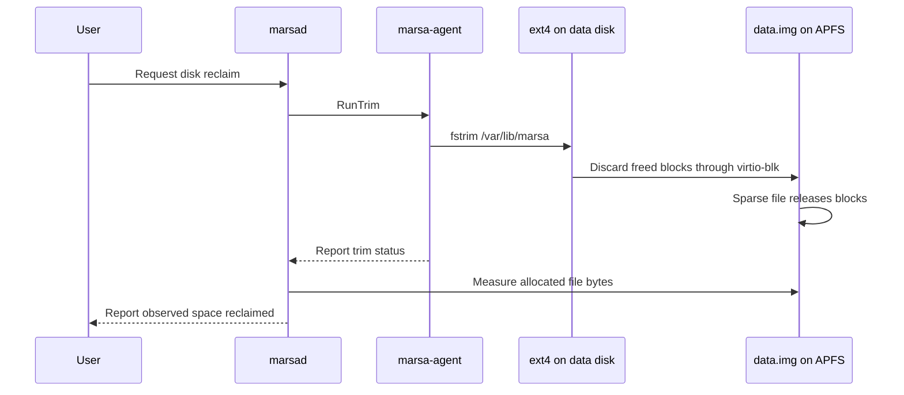

# 07 File sharing and storage

Two separate things live here: **shared folders** (host directories visible to containers through bind mounts) and the **data disk** (where the engine keeps images, containers and volumes).

## Decisions

| Item | Decision | Status |
|---|---|---|
| Sharing mechanism | virtiofs | Decided |
| What is shared | An explicit allowlist chosen by the user; never the whole home folder by default | Decided |
| Engine data | A separate sparse data disk, kept across updates | Decided |
| Disk space | Space freed in the guest is returned to macOS | Decided as a requirement; mechanism to verify |

## Shared folders

### Path model

A host folder is mounted in the guest **at the same absolute path**, so a standard bind mount works unchanged:

```text
docker run -v /Users/sam/project:/app ...
            └─ host path, also valid inside the VM
```



### The allowlist

Planning identified this as a top security gap in comparable tools: sharing the whole home folder lets any container read SSH keys and cloud credentials.



Rules:

- **First run** offers to share the folders the user picks; a typical choice is a projects directory. Nothing is shared silently.
- **Protected paths** include `~/.ssh`, `~/.aws`, `~/.gnupg`, `~/.kube`, `~/.docker`, `~/.marsa`, keychains and similar credential stores. The policy covers the configured home, the effective account home, and the daemon's active state directory. The list is defined and tested in `marsa-share`. A share cannot be a protected path, one of its ancestors, or one of its descendants, even if a credential directory has yet to be created.
- **Path checks** resolve filesystem identities and require canonical host paths for Docker binds. Approval records the exact directory identity. Marsa verifies configured roots before attachment and checks the mounted root identities for each bind.
- **Applying a share** on Virtualization.framework requires an explicit restart. A one-session approval applies to the next successful VM session and expires when it stops. Removing a grant revokes new authorized binds immediately. Restart to remove the VM mount and access from existing containers.
- **Named volumes** are unaffected: they live on the data disk and need no sharing.
- **Docker transport** retains the original byte stream for attach and BuildKit upgrades. Docker Engine calls its guest authorization plugin for container-create requests. The plugin submits explicit bind sources over a bounded host-initiated vsock session. The mounted roots define the host exposure boundary for guest root. A trusted Docker client can still use the exact guest Docker socket path. [Docker Engine authorization plugin interface](https://docs.docker.com/engine/extend/plugins_authorization/)

### Correctness requirements

These were listed in planning as the quiet source of most bug reports.

| Requirement | Design | Status |
|---|---|---|
| File-change events reach containers (hot reload) | Configure scoped Compose Watch sync into the container's filesystem | Linux 7.3.5 on Apple virtiofs observed updated bytes without host-origin inotify. Signed Compose 5.8.0 copied the initial file and delivered native Linux inotify create, modify and close-write events after a Mac atomic save. In M4-19 Hugo 0.170.1 rebuilt and sent browser LiveReload notifications after both regular writes and atomic replacement. |
| Files created in a container are owned by the user on the host | Use the Apple virtiofs ownership mapping provided by the pinned guest | With Linux 7.3.5 on macOS 27.2.1, Docker UID/GID 12345 wrote to a Mac-owned folder, and the file belonged to the Mac user. Apple virtiofs rejected an ID-mapped mount with EINVAL. Guest ext4 accepted the same operation in the control test. |
| Case sensitivity | Document host case behavior and detect collisions in diagnostics | The default APFS share resolved a case-variant lookup in both macOS and Linux. |
| Symlinks, hard links, extended attributes | Cover them in the compatibility suite | Relative and dangling symlinks, hard links, and one user extended attribute worked in both directions in the VZ spike. |
| Performance | Benchmark small-file reads, large-file throughput, and directory walks | The VZ spike measured bulk reads at 5.86× native elapsed time in its cached workload. |

See the [virtiofs spike](spikes/M1-04-virtiofs.md) for the test scope,
measurements, and limitations.

### Hot reload with Compose Watch

Configure `develop.watch` for the source directories your development service needs. Set `action: sync` and a writable container path. `initial_sync: true` copies the selected files when watching starts. Omit a bind mount on the watched path so the server reads from its own filesystem. Run `docker compose up --watch` from the project directory. The image needs `stat`, `mkdir`, and `rmdir`, and its configured user needs write access to the target. [Docker Compose Watch](https://docs.docker.com/compose/how-tos/file-watch/)

```yaml
services:
  app:
    build: .
    develop:
      watch:
        - action: sync
          path: ./src
          target: /app/src
          initial_sync: true
          ignore:
            - node_modules/
```

Compose Watch copies files from the Mac into the selected container. This workflow needs no Marsa folder grant. Edits inside the container do not sync back to the Mac. Direct virtiofs bind mounts expose changes in file contents, but the pinned Apple virtualization stack did not deliver host-origin inotify events. Development servers that watch a direct bind therefore need a documented polling mode or Compose Watch into writable container storage.

### Performance guidance shown to users

- Keep dependency directories (for example `node_modules`) in a named volume when speed matters most.
- The GUI shows a hint when a container does very heavy I/O on a shared folder.

## Data disk

### Layout

| Item | Value | Status |
|---|---|---|
| File | `~/.marsa/vm/data.img` | Proposed |
| Type | Sparse raw image on APFS | Proposed |
| Filesystem | ext4 with explicit discard via `fstrim` | Proposed |
| Default maximum size | A setting; the file only uses what is written | Proposed |
| Contents | `/var/lib/docker`, `/var/lib/containerd`, Marsa guest state | Decided |

### Inspecting usage

Run `marsa disk usage` to see the bytes allocated to the sparse image on
macOS and the image's logical capacity. These values are available with
the VM stopped. If the VM has reported a current filesystem sample, the
CLI also shows guest used bytes and capacity. JSON output preserves this
distinction through the [CLI response schema](reference/cli-response.schema.json).

### Returning space to macOS



On the VZ backend, `fstrim` on the mounted ext4 data filesystem returned
approximately 4 GiB of physical allocation to APFS after deleting 4 GiB
of files from a sparse RAW image. The backend uses automatic caching with
full synchronization. [Measured results](spikes/M1-03-disk-reclaim.md)

Run `marsa disk reclaim` with the VM running to discard unused ext4 blocks.
The guest synchronizes the data filesystem first so ext4 can make newly
freed blocks available to discard after its journal commits.
[Linux 7.3.5 ext4 allocator](https://github.com/gregkh/linux/blob/v7.3.5/fs/ext4/mballoc.c#L3782-L3796)

The command measures the decrease in physical allocation of the same sparse
image. The guest separately reports bytes submitted for potential discard.
The command affects free filesystem blocks and leaves Docker resources in
place. Reclaim holds lifecycle admission for the bounded request, so it
cannot overlap a factory reset or private proxy activation. Existing
container workloads keep running. New Docker connections can return busy
until reclaim completes.

M9-03 verifies this byte delta after removing disposable data from a signed
test VM. M9-14 owns automatic reclaim after confirmed cleanup, idle
scheduling and the remaining image-based test. An offline compaction fallback
is required only for backends that cannot pass discard through.

### Disk cleanup with a preview

A version 1 feature. The GUI and CLI show what would be removed and how much space returns before anything is deleted.

| Category | Source |
|---|---|
| Stopped containers | Engine API |
| Unused images, dangling images | Engine API |
| Unused volumes | Engine API; listed individually and never selected by default |
| Build cache | BuildKit prune API |
| Reclaimable disk space | Trim estimate from the agent |

### Resizing

- Growing: enlarge the sparse file while the VM is stopped; `marsa-init` grows the filesystem at next boot.
- Shrinking: not supported in place. Offered through export, recreate and import, later.

### Integrity

- `marsa-init` runs a filesystem check when the disk was not cleanly unmounted.
- A clean shutdown path exists for app quit, logout, update and host shutdown.
- **Factory reset** deletes and recreates the data disk after an explicit, typed confirmation. It is the last-resort recovery and must always work.

### Backup and Time Machine

The packaged daemon excludes `data.img` from Time Machine by default. Set
`disk.exclude_from_backup = false` to clear that file's exclusion on the
next VM activation. This setting applies to the raw image in the private VM
directory. Volume backup and export is a later feature.
[Apple backup resource key](https://developer.apple.com/documentation/foundation/urlresourcekey/isexcludedfrombackupkey).

`Disk.Usage` reports the actual host allocation and logical image capacity.
Guest usage and capacity describe the mounted filesystem and are available
after the ready VM publishes its statistics. The service distinguishes
unavailable guest usage from an empty filesystem.

## Registry credentials

Not stored on either disk. See [11 Security](11-security.md#registry-credentials).
