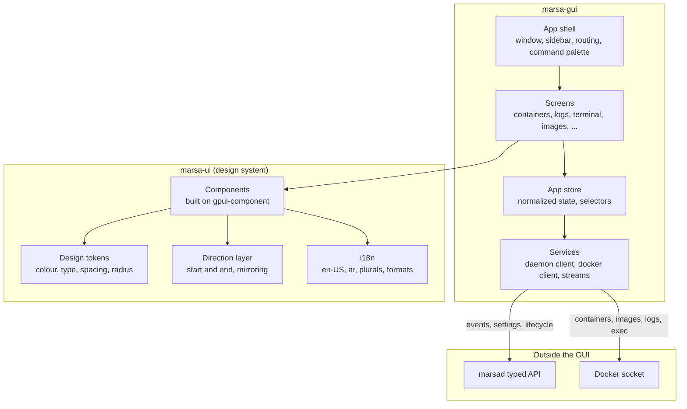
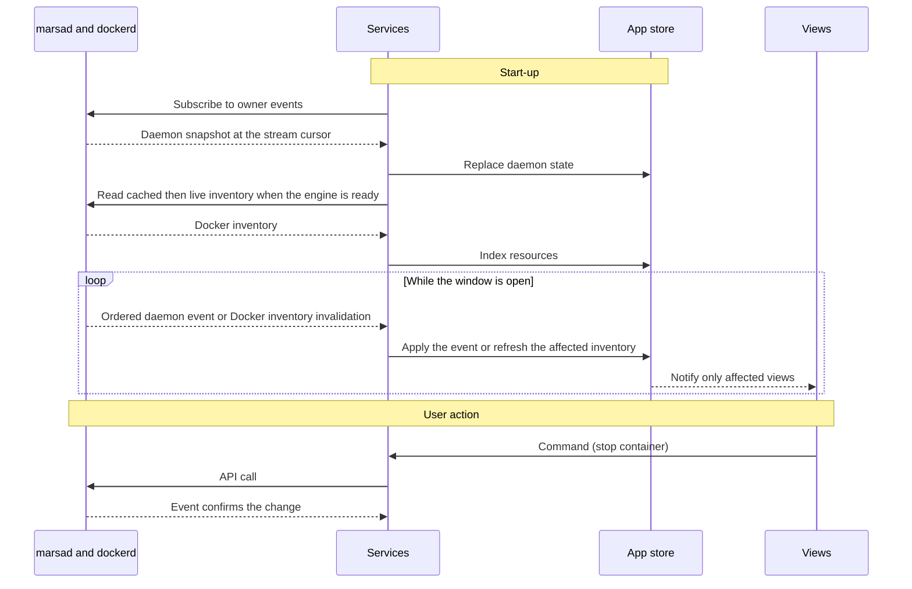
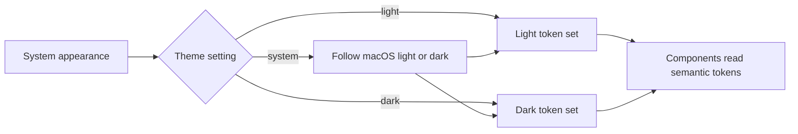
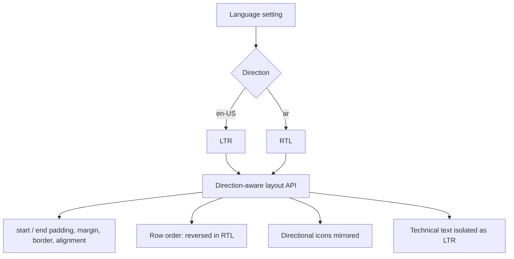

# 08 GUI

The Marsa GUI is a native window rendered on the GPU. It is a client of `marsad` and holds no logic the CLI could not also reach.

## Decisions

| Item | Decision | Status |
|---|---|---|
| Framework | GPUI with gpui-component, all Rust | Decided |
| Framework gate | The owner selected GPUI after the RTL and desktop qualification spikes | Closed in [D-023](15-decisions.md#d-023-choose-gpui-for-the-desktop) |
| Languages | English (US) and Arabic (Modern Standard) | Decided |
| Directions | Full left-to-right and right-to-left, mirrored layouts | Decided |
| Themes | Light and dark, following the system by default | Decided |
| Optional | The window can be closed with nothing left running but the daemon | Decided |

## Why GPUI

The planning comparison, on the criteria that mattered (performance and long-running stability):

| Criterion | Electron | Tauri 2 | GPUI | Three native UIs |
|---|---|---|---|---|
| Rendering | Bundled Chromium | System webview | Own GPU renderer | Each OS toolkit |
| Idle memory | Highest | Lower; near Electron on Windows under load | Lowest: no browser, no JS heap | Low on macOS and Linux; heavier on Windows |
| Days of uptime with log streams | Stable but heavy | Reports of memory growth on high-rate events | Best: Rust end to end, no garbage collector | Stable; large lists need lower-level controls |
| Same look on every OS | Yes | No, three engines | Yes | No, three apps |
| Accessibility | Mature | Mature | New (AccessKit merged upstream in 2026) | Best |
| Right-to-left | Mature | Mature | **Weakest area; see below** | Mature |
| Codebases | One | One | One | Three |
| Verdict | Rejected | Rejected | **Chosen** | Rejected for version 1 |

## The right-to-left risk

The macOS spike found that GPUI Kit 0.10.0 supports global interface direction and logical layout helpers above GPUI. CoreText rendered joined Arabic and isolated technical values in the correct order. GPUI's single-line input still mapped Arabic graphemes to incorrect caret and pointer positions. The upstream text-bidi work remains tracked in Zed. [M1-01 evidence](spikes/M1-01-gpui-rtl.md) · [GPUI Kit direction change](https://github.com/longbridge/gpui-kit/pull/3886) · [Zed RTL tracking issue](https://github.com/zed-industries/zed/issues/31102).

The owner selected GPUI in [D-023](15-decisions.md#d-023-choose-gpui-for-the-desktop) after the desktop qualification verified a Rust-backed AppKit editor inside a GPUI window. The probe passed Arabic typing, native caret events, mouse selection and live IME conversion. The alternate AppKit placement exposed both native and GPUI controls in the macOS accessibility tree. [Desktop qualification](spikes/M1-06-gpui-qualification.md).

### Spike pass criteria (task M1-01)

On macOS, with Arabic selected:

1. A sidebar and a container list render fully mirrored.
2. A text field accepts typed Arabic with correct caret movement, selection and deletion.
3. A row mixing Arabic labels with English container names, image tags and paths renders in the correct visual order.
4. Arabic text is shaped correctly (letters join) at every font size and weight used by the design system.
5. Switching language at runtime re-lays out the window without a restart.

These criteria continue to apply to the production GUI. M6-08 verifies the native editor’s physical keyboard behavior, IME candidate panel and spoken VoiceOver behavior.

## Architecture

### Data flow

The managed Overview reads resource counts from the same normalized store as
the other screens. Its utilization timer measures the retained running
containers without fetching inventory again. Cache-first engine identity,
disk measurements, and image update checks have independent work. Managed
image checks compare installed tags whenever containers or images change.
External engines retain their direct observations.

Rules:

- **One-way flow.** Views send commands; state changes arrive only through events. No view mutates shared state directly.
- **No polling for inventory.** The managed Docker resource store reads the owner API on readiness, reconnect, and coalesced Docker inventory invalidations. The daemon follows the running engine's [Docker Engine 1.57 event stream](https://docs.docker.com/reference/api/engine/version/v1.57/operations/SystemEvents/) without acquiring an activity lease. The pinned [Docker 29.10.0 handler](https://github.com/moby/moby/blob/docker-v29.10.0/daemon/server/router/system/system_routes.go#L274-L386) sends newline-delimited JSON and can replay recent events before following live changes. The daemon may refresh its inventory cache in the background ([D-034](15-decisions.md#d-034-cache-docker-inventory-in-the-daemon)).
- **Batches, not single events.** Logs and stats arrive in batches at a capped rate, so the UI never processes one event per log line.
- **Window close cancels window streams.** The window releases its owner, Docker, log, stats and other stream workers even if a task retains a service handle. The app-owned notification observer remains available until Quit so notifications can reopen the authenticated review window. The tray item belongs to `marsad`.

## Design system (`marsa-ui`)

Everything visual goes through `marsa-ui`. Screens never use raw colours, raw pixel values or left and right.

### Design tokens

| Token group | Examples | Notes |
|---|---|---|
| Colour (semantic) | `bg.surface`, `bg.elevated`, `text.primary`, `text.muted`, `border.subtle`, `accent`, `status.running`, `status.stopped`, `status.error` | Each has a light and a dark value |
| Typography | `font.ui.latin`, `font.ui.arabic`, `font.mono`, size and weight scales | One Latin UI face, one Arabic UI face, one monospace face, all bundled |
| Spacing | 4-point scale | Used for padding, gaps, row heights |
| Radius, elevation, motion | Small fixed scales | Motion respects the system "reduce motion" setting |

The Figma Foundations use IBM Plex Sans and IBM Plex Mono. Use the script-specific IBM Plex Sans Arabic face for Arabic text and mixed-script fallback. The [pinned font assets](../assets/fonts/README.md) include regular, medium and semibold Sans and Sans Arabic and regular Mono. The native files ship with their shared SIL Open Font License 1.1 notice. See [D-032](15-decisions.md#d-032-use-ibm-plex-for-desktop-typography).

### Themes

- The theme switches live, without a restart, and follows the system when set to `system`.
- Contrast for text and status colours meets WCAG AA in both themes; this is tested, not assumed.
- The workspace observes native window appearance updates and refreshes the active semantic palette and component theme in System mode. The token tests check text and status pairs at 4.5:1 across both appearances and all accent settings, and the disk chart categories at 3:1 against the card surface. [WCAG text contrast](https://www.w3.org/WAI/WCAG22/Understanding/contrast-minimum.html) · [WCAG non-text contrast](https://www.w3.org/WAI/WCAG22/Understanding/non-text-contrast.html).

### Direction layer

Rules, enforced by lint and review:

- **Use `start` and `end`, never `left` and `right`,** for padding, margins, borders, alignment and positioning. `marsa-ui` wraps the framework's styling so this is the only available API in screens.
- **Row direction follows the language.** Horizontal stacks reverse in right-to-left automatically.
- **Mirror only directional icons** (back, forward, chevrons, disclosure arrows). Never mirror logos, play and stop, checkmarks or charts' time axes.
- **Technical text is always left-to-right:** container names and IDs, image references, paths, commands, environment variables, logs and the terminal. These are wrapped in an isolated left-to-right run inside the mirrored layout.
- **Western digits (0 to 9) everywhere,** so ports, sizes and IDs match the CLI output.
- **Keyboard shortcuts do not change with language,** but arrow-key navigation follows the visual direction.

Screen code uses `marsa_ui::direction` for asymmetric inline edges,
row alignment and popover anchors. The `marsa-gui` build checks Rust
tokens under `src` for physical layout calls on macOS and headless
targets. The check recognizes direct Rust calls and geometry names. Review
checks aliases and layout semantics. Marsa supplies component popover
anchors and directional icons in their English orientation. The framework
resolves them for the active direction. A chart's samples and hover
targets use the same fixed-direction technical row so every point matches
its time interval in both languages. Sparkline bars share the available
width as the sample count grows.

### Internationalisation

| Topic | Design | Status |
|---|---|---|
| Locales | `en-US` (source), `ar` (Modern Standard Arabic) | Decided |
| Translation format | Fluent (`.ftl`) files in [`locales/`](../locales/README.md) | Implemented in M6-12 |
| Plurals | Full CLDR rules; Arabic has six plural forms | Decided as a requirement |
| Library | Fluent for Marsa strings. GPUI Component uses its pinned rust-i18n catalog, extended with Arabic by Marsa. | Implemented in M6-04 |
| Dates, times, sizes | Locale-aware human-readable formatting with Western digits | Implemented in M6-04 |
| Runtime switching | Language changes apply live | Decided |
| Missing strings | Build fails on missing or unexpected keys or mismatched placeholders | Implemented in M6-04 |
| Review | Arabic strings are reviewed by a fluent speaker for terminology consistency; a glossary of technical terms lives in `locales/GLOSSARY.md` | Proposed |

`marsa-l10n` validates the application catalogs and provides typed message
keys and locale-specific Fluent bundles through `marsa-client`. The GUI supports
English and Arabic. The CLI reads generated messages in English as specified in
[D-033](15-decisions.md#d-033-keep-the-command-line-interface-in-english).
The desktop updates its Fluent locale, component catalog, native menu and window labels, and layout direction together. GPUI Component's rust-i18n catalog handles
component wording and named interpolation. Fluent handles application plurals.
The application build checks the Arabic component extension against the pinned
English keys and placeholders.

Desktop dates follow Gregorian field order in the selected language. Human
times honor the selected 12- or 24-hour clock, including localized day-period
labels. Byte sizes use localized SI units and standard IEC symbols. Technical
timestamps and identifiers retain their interoperable representation.
[Gregorian data for English](https://github.com/unicode-org/cldr-json/blob/49.0.0/cldr-json/cldr-dates-full/main/en/ca-gregorian.json)
· [Gregorian data for Arabic](https://github.com/unicode-org/cldr-json/blob/49.0.0/cldr-json/cldr-dates-full/main/ar/ca-gregorian.json)
· [Arabic Western-digit symbols](https://github.com/unicode-org/cldr-json/blob/49.0.0/cldr-json/cldr-numbers-full/main/ar/numbers.json).

Technical terms policy (**Proposed**): keep established English terms that developers actually use (Docker, container image names, Compose, volume names as typed) in Latin script where an Arabic term would confuse, and translate interface language (actions, labels, messages) fully.

### Four variants, always

Every screen and component is built, reviewed and snapshot-tested in all four variants: English light, English dark, Arabic light, Arabic dark. A feature is not done until all four are correct.

## Screens

Global elements: command palette, engine status indicator, global search, toast and error surface, onboarding (first run: language, theme, shared folders).

Containers, Images, Volumes, Networks, and Stacks keep their page headings,
filters, and table columns above the scrollable rows. Resource details scroll
below their back control. The shared vertical scrollbar sits at the inline
end, including on the left in Arabic. Select the current sidebar route to
return to its list.

In both Images views, Tab reaches the Image details button in each row. Press
Return or Space to open the focused image. Closing the dialog returns focus to
that button.

Settings → General shares the System, Light, and Dark theme cards with
first-run setup and offers the interface language in a dropdown. It groups
the interface and terminal font menus with six
base text sizes. IBM Plex supplies the defaults and Arabic glyph fallback.
The menus include native macOS system faces and the
[optional bundled families](../assets/fonts/README.md#optional-typefaces).
SF Mono and Consolas appear when the Mac supplies them. If an installed font
is subsequently unavailable, the terminal uses IBM Plex Mono. The 12-hour
and 24-hour choices apply to the displayed times in activity, approvals, and
logs. Log timestamps use the time zone configured under Logs & files. Copied
and downloaded logs retain their RFC 3339 timestamps.

Settings → Environments lists the built-in Marsa engine, saved connections,
and discovered Docker engines in one table. Test a row or use Test all to
check the listed connections and see the result beside each engine. Add and
Edit open the same environment editor. Name and icon choices are stored
independently of the discovered Docker context. Resource and Network controls
are scoped to the environment in that editor. Its built-in connection also
offers Docker CLI context registration and endpoint copy. Keychain
configuration for Docker CLI credentials is in Settings → Registries. Saved connections can carry up to
ten labels and an optional IPv4 or IPv6 address for the Containers published
TCP port menu. Opening a link leaves Docker's port bindings as configured.

Add or edit a connection to choose Unix socket, direct SSH or mutual TLS,
Hawser Standard, or Hawser Edge. **Test connection** verifies the selected
engine before saving. Standard goes to the agent over verified HTTPS. Edge
opens a TLS listener in the desktop session and waits for a configured agent
to connect. [Hawser connection requirements](11-security.md#the-docker-socket).

On macOS, a matching owner-managed Lima Docker VM exposes CPU, memory, and
primary disk capacity in Resources, and supported host loopback access in
Network. Machine uses the same identity, Resources, and Boot & diagnostics
layout for the built-in, local Lima, and connection-only environments. A
verified Lima VM shows its backend, guest architecture, CPU count, guest
memory, primary disk capacity, and supported loopback setting even while
Docker is stopped. Start, stop, or restart Lima from Machine. Stop and restart
confirm the exact VM name and use graceful shutdown. The Environments list and
editor also offer start and stop. Connection-only environments show the
available Docker endpoint and connection details.
After stopping, the resource form reloads the allocation so you can apply
changes and start the VM again. Lima takes the saved allocation on
the next start and only grows the primary disk. Deleting a saved connection
removes that record and keeps its VM and Docker resources.

These controls use separately installed Lima 2.3 or later in the 2.x series.
On macOS the lifecycle process prevents elevation and launchd delegation.
This covers the ordinary user-mode VM while letting a VM that requires a
privileged network, an elevated block device helper, or launchd autostart
remain controlled by Lima. See the pinned [start command], [graceful stop],
and [privileged network reconciliation] source.

[start command]: https://github.com/lima-vm/lima/blob/v2.3.0/cmd/limactl/start.go
[graceful stop]: https://github.com/lima-vm/lima/blob/v2.3.0/pkg/instance/stop.go
[privileged network reconciliation]: https://github.com/lima-vm/lima/blob/v2.3.0/pkg/networks/reconcile/reconcile.go
[Primary disk resize](https://github.com/lima-vm/lima/blob/v2.3.0/website/content/en/docs/config/disk.md#resizing-the-vms-primary-disk)
[User-mode network](https://github.com/lima-vm/lima/blob/v2.3.0/website/content/en/docs/config/network/user.md)

Activity shows recent Docker events from the selected environment, newest first.
For Marsa the events use the passive owner API and appear alongside lifecycle
history and approvals. Docker Engine keeps up to 256 events in memory. In
Settings → Environments, select the engine before editing its Observation and
maintenance settings. The activity switch controls event reads and health
alerts. Activity reads the engine's retained events from the last 1, 6 or
24 hours and displays the resource, action and time. Marsa keeps no separate
persistent event history. An opt-in local alert reports new transitions to
unhealthy while a Marsa window monitors the selected engine. [Docker Engine event history](https://github.com/moby/moby/blob/docker-v29.10.0/daemon/events/events.go#L12-L32),
[Docker Engine date filtering](https://github.com/moby/moby/blob/docker-v29.10.0/daemon/server/router/system/system_routes.go#L274-L305).

Overview opens with four equal cards: the selected environment (icon, name,
status, runtime, OS/arch, plus container status counts and a health banner),
CPU and memory history with percent and absolute consumption against the host
budget, Docker disk usage as a donut with a category legend, and a resources
card for Images, Volumes, Stacks, and Networks. The top running containers list
stays below.
Select a status count to open the matching Containers filter.
Live usage and top-consumer sparklines keep the last 24 samples for the
selected engine while Overview is visible. A missing category or sample stays
unavailable. Disk bars use the sum of reported category sizes as the shared
scale; shared underlying storage can still appear in more than one category.
The built-in environment uses the owner API to query an already running guest
without starting it. When the desktop opens on the built-in environment after
setup, it requests a start once if the daemon reports a stopped engine. The
Overview card shows an icon-only Start or Stop button for the selected
built-in engine or verified local Lima VM. The button uses the same stop
confirmation as Machine.
[Moby 29.10.0 Engine API](https://github.com/moby/moby/blob/docker-v29.10.0/api/swagger.yaml),
[Moby disk accounting compatibility](https://github.com/moby/moby/blob/docker-v29.10.0/daemon/server/router/system/system_routes.go#L207-L248).

Disk & cleanup shows Docker's reported accounting and exact candidates for
the selected environment. The Images cleanup action opens this review. Each engine's
settings control whether unused volumes appear in the candidate list. The
Overview image update setting controls registry digest comparisons for that
engine. Verified Marsa release updates use the app-wide updater described in
[D-029](15-decisions.md#d-029-verify-updates-with-tuf). Cleanup remains a preview until the engine can guarantee deletion of
the reviewed identity. Host allocation and reclaim apply to the built-in
Marsa VM only. See [Disk cleanup with a preview](07-file-sharing-and-storage.md#disk-cleanup-with-a-preview).

The Reports page follows the active environment. Reports for an external engine
refresh its container inventory
and show container names, image references and lifecycle states, plus the
latest available resource counts. Review the report in Marsa and copy it to
the clipboard.

Settings → Logs & files configures retention and timestamp display for container
and stack logs. Its download format applies to the Files tab of a container.
Enter an absolute path inside that container and choose a new destination on
your Mac. Directories use TAR. In single-file mode, the app writes only the
selected file's bytes.

The Compose workspace can deploy an existing YAML file or start a new stack from
the template saved in Settings. Review the initial YAML before choosing the
project directory. Marsa creates `compose.yaml` there and deploys it to the
Docker environment shown in the dialog. If deployment fails, the file remains
in the project directory for editing and retry.

Settings → About shows the installed Marsa version, localized release notes,
and the versions of bundled Docker tools without opening a daemon connection.
The connected local daemon reports its own version and the guest components.
Available inventories and third-party notices open in Finder.

Settings → Git Repositories saves named HTTPS repository branches. The branch
test checks access and the checkout action creates a local copy in a selected
folder. To deploy the checkout, review it and explicitly select its Compose
file from the Compose page.

### Deploy secrets

Under Settings → Compose Template, save or remove a Keychain secret for a
selected local Compose file, project name, and secret name. Declare that
secret with `environment: MARSA_KEYCHAIN` in the top-level `secrets` map and
grant it to each intended service. In Compose → Deploy Stack, select the
target engine and enable **Use saved Keychain secrets**. The required images
must already be on that engine. Services receiving Keychain secrets cannot
declare mounts or use images that declare volumes. The project cannot inherit
container volumes.

## Feature priorities

From the planning whiteboard.

### Must have: version 1

| Feature | Notes |
|---|---|
| English (US) and Arabic (MSA), full LTR and RTL | All screens |
| Light and dark themes | Follow the system by default |
| Containers | List, start, stop, restart, remove; grouped by Compose project |
| Live logs | Follow, search, filter, several containers at once |
| Terminal into any container | One click |
| Inspect | Environment, ports, mounts, networks |
| Live stats | CPU, memory, network, disk |
| Images | List, pull, remove, sizes |
| Volumes and networks | List, remove |
| Compose projects | Up, down, restart |
| Engine control and resource limits | Start, stop, restart; CPU, memory, disk |
| Disk cleanup with a preview | See [07](07-file-sharing-and-storage.md#disk-cleanup-with-a-preview) |
| MCP server and agent approvals | See [10](10-mcp-server.md) |
| Tray icon | Status and quick actions; owned by `marsad` |
| Command palette and full keyboard use | Every action reachable without a mouse |
| Auto-update and settings | See [12](12-build-release-update.md) |

#Container creation opens on the selected engine. A named config set copies
network, restart, environment, label, port and mount options into that draft.
Edits to the draft apply to the new container. Review host mount paths and
access modes before submitting to an external engine. Marsa's existing
allowlist authorizes local host mounts.

## Should have: soon after

File browser for containers and volumes; build view (BuildKit progress and cache); registry sign-in and credentials; image layer inspector; crash and restart-loop notifications; clickable published ports.

### Later

In-app AI assistant; vulnerability scanning; volume backup, restore and export; local domain names and HTTPS; optional Kubernetes; dev containers; extensions.

## Performance rules

| Screen | Rule |
|---|---|
| Lists (containers, images) | Virtualised; only visible rows are built |
| Logs | Bounded log buffers, virtualised container rendering, background search, and UTC or system-local timestamps from Docker. General settings select capacity independently of the fixed byte and source limits. |
| Stats | Sampled at a fixed interval; charts keep a bounded history |
| Terminal | A real terminal emulator component with a bounded scrollback |
| Start-up | First frame before any network call completes; data fills in from the snapshot |

Targets are in [01](01-vision-and-scope.md#success-measures) and measured in [13](13-testing-and-benchmarks.md).

## Accessibility

- Full keyboard operation, visible focus, logical focus order in both directions.
- Screen-reader support through the framework's accessibility tree. **Verify** the state of GPUI's AccessKit integration on macOS at implementation time; planning research found it only merged upstream in 2026.
- Respect system settings: reduce motion, increase contrast, text size where the framework allows.

## Framework version policy

- gpui-component tracks GPUI from Zed's repository. Pin both to matching revisions in the workspace and upgrade them together in a dedicated task.
- Keep any GPUI patches in a clearly named fork branch with each patch upstreamed or documented.
