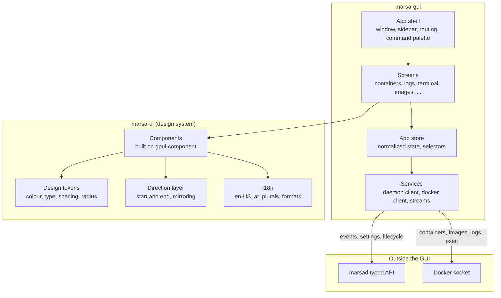
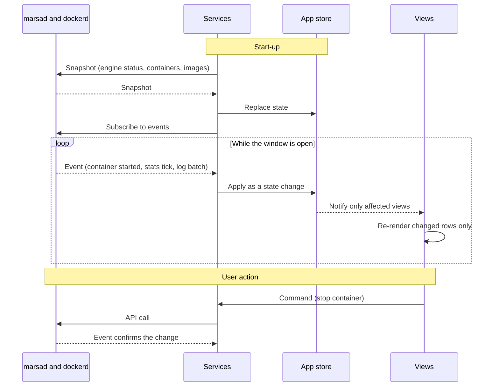
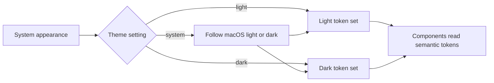
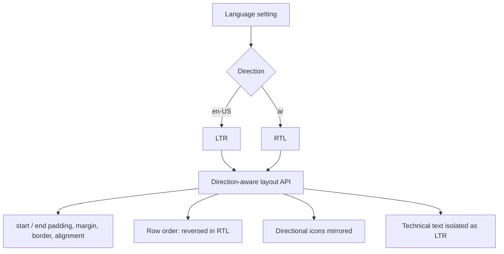
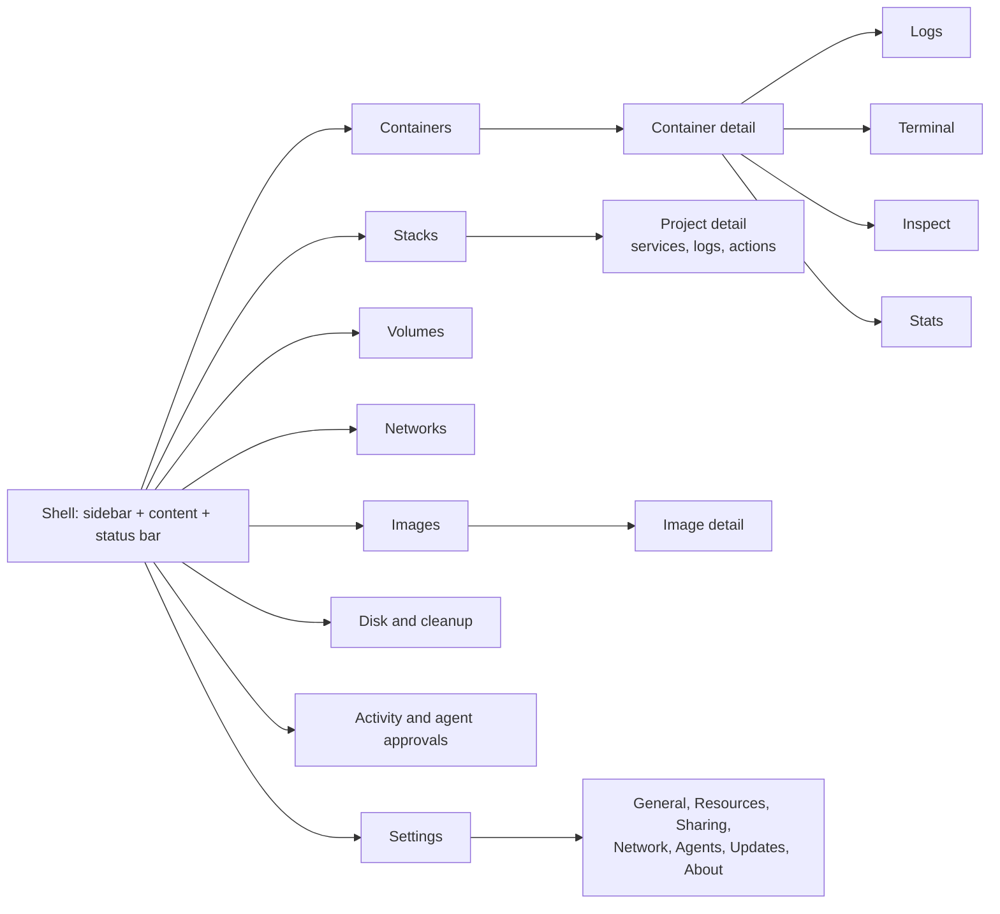

# 08 GUI

The Marsa GUI is a native window rendered on the GPU. It is a client of `marsad` and holds no logic the CLI could not also reach.

## Decisions

| Item | Decision | Status |
|---|---|---|
| Framework | GPUI with gpui-component, all Rust | Decided |
| Framework gate | The owner selected GPUI after the RTL and desktop qualification spikes | Closed in [D-023](15-decisions.md#d-023-choose-gpui-for-the-desktop) |
| Languages | English (US) and Arabic (Modern Standard) | Decided |
| Directions | Full left-to-right and right-to-left, mirrored layouts | Decided |
| Themes | Light and dark, following the system by default | Decided |
| Optional | The window can be closed with nothing left running but the daemon | Decided |

## Why GPUI

The planning comparison, on the criteria that mattered (performance and long-running stability):

| Criterion | Electron | Tauri 2 | GPUI | Three native UIs |
|---|---|---|---|---|
| Rendering | Bundled Chromium | System webview | Own GPU renderer | Each OS toolkit |
| Idle memory | Highest | Lower; near Electron on Windows under load | Lowest: no browser, no JS heap | Low on macOS and Linux; heavier on Windows |
| Days of uptime with log streams | Stable but heavy | Reports of memory growth on high-rate events | Best: Rust end to end, no garbage collector | Stable; large lists need lower-level controls |
| Same look on every OS | Yes | No, three engines | Yes | No, three apps |
| Accessibility | Mature | Mature | New (AccessKit merged upstream in 2026) | Best |
| Right-to-left | Mature | Mature | **Weakest area; see below** | Mature |
| Codebases | One | One | One | Three |
| Verdict | Rejected | Rejected | **Chosen** | Rejected for version 1 |

## The right-to-left risk

The macOS spike found that GPUI Kit 0.10.0 supports global interface direction and logical layout helpers above GPUI. CoreText rendered joined Arabic and isolated technical values in the correct order. GPUI's single-line input still mapped Arabic graphemes to incorrect caret and pointer positions. The upstream text-bidi work remains tracked in Zed. [M1-01 evidence](spikes/M1-01-gpui-rtl.md) · [GPUI Kit direction change](https://github.com/longbridge/gpui-kit/pull/3886) · [Zed RTL tracking issue](https://github.com/zed-industries/zed/issues/31102).

The owner selected GPUI in [D-023](15-decisions.md#d-023-choose-gpui-for-the-desktop) after the desktop qualification verified a Rust-backed AppKit editor inside a GPUI window. The probe passed Arabic typing, native caret events, mouse selection and live IME conversion. The alternate AppKit placement exposed both native and GPUI controls in the macOS accessibility tree. [Desktop qualification](spikes/M1-06-gpui-qualification.md).

### Spike pass criteria (task M1-01)

On macOS, with Arabic selected:

1. A sidebar and a container list render fully mirrored.
2. A text field accepts typed Arabic with correct caret movement, selection and deletion.
3. A row mixing Arabic labels with English container names, image tags and paths renders in the correct visual order.
4. Arabic text is shaped correctly (letters join) at every font size and weight used by the design system.
5. Switching language at runtime re-lays out the window without a restart.

These criteria continue to apply to the production GUI. M6-08 verifies the native editor’s physical keyboard behavior, IME candidate panel and spoken VoiceOver behavior.

## Architecture

### Data flow

Rules:

- **One-way flow.** Views send commands; state changes arrive only through events. No view mutates shared state directly.
- **No polling.** Everything is event-driven from the daemon and the engine's event stream.
- **Batches, not single events.** Logs and stats arrive in batches at a capped rate, so the UI never processes one event per log line.
- **Window close frees everything.** Streams are cancelled and the process exits; the tray item belongs to `marsad`.

## Design system (`marsa-ui`)

Everything visual goes through `marsa-ui`. Screens never use raw colours, raw pixel values or left and right.

### Design tokens

| Token group | Examples | Notes |
|---|---|---|
| Colour (semantic) | `bg.surface`, `bg.elevated`, `text.primary`, `text.muted`, `border.subtle`, `accent`, `status.running`, `status.stopped`, `status.error` | Each has a light and a dark value |
| Typography | `font.ui.latin`, `font.ui.arabic`, `font.mono`, size and weight scales | One Latin UI face, one Arabic UI face, one monospace face, all bundled |
| Spacing | 4-point scale | Used for padding, gaps, row heights |
| Radius, elevation, motion | Small fixed scales | Motion respects the system "reduce motion" setting |

The Figma Foundations use IBM Plex Sans and IBM Plex Mono. Use the script-specific IBM Plex Sans Arabic face for Arabic text and mixed-script fallback. The [pinned font assets](../assets/fonts/README.md) include regular, medium and semibold Sans and Sans Arabic and regular Mono. The native files ship with their shared SIL Open Font License 1.1 notice. See [D-032](15-decisions.md#d-032-use-ibm-plex-for-desktop-typography).

### Themes

- The theme switches live, without a restart, and follows the system when set to `system`.
- Contrast for text and status colours meets WCAG AA in both themes; this is tested, not assumed.

### Direction layer

Rules, enforced by lint and review:

- **Use `start` and `end`, never `left` and `right`,** for padding, margins, borders, alignment and positioning. `marsa-ui` wraps the framework's styling so this is the only available API in screens.
- **Row direction follows the language.** Horizontal stacks reverse in right-to-left automatically.
- **Mirror only directional icons** (back, forward, chevrons, disclosure arrows). Never mirror logos, play and stop, checkmarks or charts' time axes.
- **Technical text is always left-to-right:** container names and IDs, image references, paths, commands, environment variables, logs and the terminal. These are wrapped in an isolated left-to-right run inside the mirrored layout.
- **Western digits (0 to 9) everywhere,** so ports, sizes and IDs match the CLI output.
- **Keyboard shortcuts do not change with language,** but arrow-key navigation follows the visual direction.

### Internationalisation

| Topic | Design | Status |
|---|---|---|
| Locales | `en-US` (source), `ar` (Modern Standard Arabic) | Decided |
| Translation format | Fluent (`.ftl`) files in [`locales/`](../locales/README.md) | Implemented in M6-12 |
| Plurals | Full CLDR rules; Arabic has six plural forms | Decided as a requirement |
| Library | **Verify:** gpui-component is built on rust-i18n, which may not provide plural rules. Use Fluent for Marsa strings and bridge gpui-component's own strings | Verify |
| Dates, times, sizes | Locale-aware formatting with Western digits | Proposed |
| Runtime switching | Language changes apply live | Decided |
| Missing strings | Build fails if any key exists in one locale and not the other | Proposed |
| Review | Arabic strings are reviewed by a fluent speaker for terminology consistency; a glossary of technical terms lives in `locales/GLOSSARY.md` | Proposed |

`marsa-l10n` validates the application catalogs and provides typed message
keys and locale-specific Fluent bundles through `marsa-client`. The GUI supports
English and Arabic. The CLI reads generated messages in English as specified in
[D-033](15-decisions.md#d-033-keep-the-command-line-interface-in-english). GUI
integration and locale formatting remain part of M6-04.

Technical terms policy (**Proposed**): keep established English terms that developers actually use (Docker, container image names, Compose, volume names as typed) in Latin script where an Arabic term would confuse, and translate interface language (actions, labels, messages) fully.

### Four variants, always

Every screen and component is built, reviewed and snapshot-tested in all four variants: English light, English dark, Arabic light, Arabic dark. A feature is not done until all four are correct.

## Screens

Global elements: command palette, engine status indicator, global search, toast and error surface, onboarding (first run: language, theme, shared folders).

Settings → Environments opens the same editor for adding a connection or
editing a saved or discovered environment. Saved connections can carry up to
ten labels and an optional IPv4 or IPv6 address for the Containers published
TCP port menu. Opening a link leaves Docker's port bindings as configured.

On macOS, a matching owner-managed Lima Docker VM exposes CPU, memory, and
primary disk capacity in Resources, and supported host loopback access in
Network. Stop the instance in Lima and refresh the dialog before applying
a change. Lima takes the saved allocation on the next start and only grows
the primary disk. Marsa also shows verified stopped Lima instances. These
controls use separately installed Lima 2.3 or later in the 2.x series.
[Primary disk resize](https://github.com/lima-vm/lima/blob/v2.3.0/website/content/en/docs/config/disk.md#resizing-the-vms-primary-disk)
[User-mode network](https://github.com/lima-vm/lima/blob/v2.3.0/website/content/en/docs/config/network/user.md)

For a selected external Docker environment, Activity shows the engine's recent
events, newest first. Docker Engine keeps up to 256 events in memory. Marsa
requests the events retained from the previous 24 hours and displays the resource,
action and time. [Docker Engine event history](https://github.com/moby/moby/blob/docker-v29.10.0/daemon/events/events.go#L12-L32),
[Docker Engine date filtering](https://github.com/moby/moby/blob/docker-v29.10.0/daemon/server/router/system/system_routes.go#L274-L305).

External environment reports refresh the selected engine's container inventory
and show container names, image references and lifecycle states, plus the
latest available resource counts. Review the report in Marsa and copy it to
the clipboard.

Settings → Logs & files configures retention and timestamp display for container
and stack logs. Its download format applies to the Files tab of a container.
Enter an absolute path inside that container and choose a new destination on
your Mac. Directories use TAR. In single-file mode, the app writes only the
selected file's bytes.

The Compose workspace can deploy an existing YAML file or start a new stack from
the template saved in Settings. Review the initial YAML before choosing the
project directory. Marsa creates `compose.yaml` there and deploys it to the
Docker environment shown in the dialog. If deployment fails, the file remains
in the project directory for editing and retry.

Settings → About shows the installed Marsa version, localized release notes,
and the versions of bundled Docker tools without opening a daemon connection.
The connected local daemon reports its own version and the guest components.
Available inventories and third-party notices open in Finder.

Settings → Git Repositories saves named HTTPS repository branches. The branch
test checks access and the checkout action creates a local copy in a selected
folder. To deploy the checkout, review it and explicitly select its Compose
file from the Compose page.

## Feature priorities

From the planning whiteboard.

### Must have: version 1

| Feature | Notes |
|---|---|
| English (US) and Arabic (MSA), full LTR and RTL | All screens |
| Light and dark themes | Follow the system by default |
| Containers | List, start, stop, restart, remove; grouped by Compose project |
| Live logs | Follow, search, filter, several containers at once |
| Terminal into any container | One click |
| Inspect | Environment, ports, mounts, networks |
| Live stats | CPU, memory, network, disk |
| Images | List, pull, remove, sizes |
| Volumes and networks | List, remove |
| Compose projects | Up, down, restart |
| Engine control and resource limits | Start, stop, restart; CPU, memory, disk |
| Disk cleanup with a preview | See [07](07-file-sharing-and-storage.md#disk-cleanup-with-a-preview) |
| MCP server and agent approvals | See [10](10-mcp-server.md) |
| Tray icon | Status and quick actions; owned by `marsad` |
| Command palette and full keyboard use | Every action reachable without a mouse |
| Auto-update and settings | See [12](12-build-release-update.md) |

#Container creation opens on the selected engine. A named config set copies
network, restart, environment, label, port and mount options into that draft.
Edits to the draft apply to the new container. Review host mount paths and
access modes before submitting to an external engine. Marsa's existing
allowlist authorizes local host mounts.

## Should have: soon after

File browser for containers and volumes; build view (BuildKit progress and cache); registry sign-in and credentials; image layer inspector; crash and restart-loop notifications; clickable published ports.

### Later

In-app AI assistant; vulnerability scanning; volume backup, restore and export; local domain names and HTTPS; optional Kubernetes; dev containers; extensions.

## Performance rules

| Screen | Rule |
|---|---|
| Lists (containers, images) | Virtualised; only visible rows are built |
| Logs | Bounded log buffers, virtualised container rendering, background search, and UTC or system-local timestamps from Docker. General settings select capacity independently of the fixed byte and source limits. |
| Stats | Sampled at a fixed interval; charts keep a bounded history |
| Terminal | A real terminal emulator component with a bounded scrollback |
| Start-up | First frame before any network call completes; data fills in from the snapshot |

Targets are in [01](01-vision-and-scope.md#success-measures) and measured in [13](13-testing-and-benchmarks.md).

## Accessibility

- Full keyboard operation, visible focus, logical focus order in both directions.
- Screen-reader support through the framework's accessibility tree. **Verify** the state of GPUI's AccessKit integration on macOS at implementation time; planning research found it only merged upstream in 2026.
- Respect system settings: reduce motion, increase contrast, text size where the framework allows.

## Framework version policy

- gpui-component tracks GPUI from Zed's repository. Pin both to matching revisions in the workspace and upgrade them together in a dedicated task.
- Keep any GPUI patches in a clearly named fork branch with each patch upstreamed or documented.
