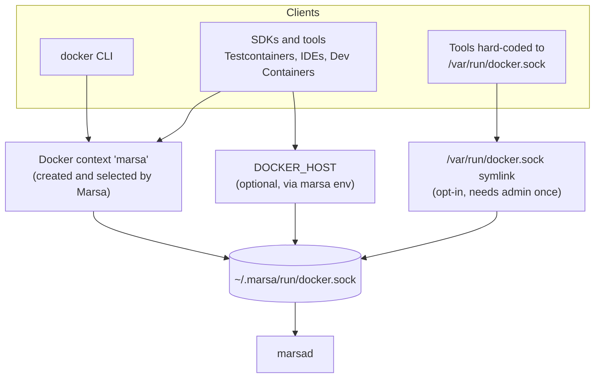

# 09 CLI and Docker compatibility

Two command-line surfaces exist. The upstream `docker` CLI does all container work, unchanged. The `marsa` CLI manages Marsa itself.

## Compatibility goal

Anything that works against Docker Desktop's engine works against Marsa without changes, as long as it uses linux/arm64 images. Planning named this as a make-or-break item: if IDEs, Testcontainers and Dev Containers do not work on day one, people uninstall.

## How clients find the engine



| Mechanism | Default | Notes |
|---|---|---|
| Docker context `marsa` | Created at first run and made current, after asking if another context is active | The clean, standard way; no privileges needed |
| `DOCKER_HOST` | Not set automatically | `marsa env` prints the export line for shells and CI |
| `/var/run/docker.sock` | Off | An opt-in setting creates the symlink with a one-time administrator prompt. Needed only for tools that ignore contexts. This is the only action in Marsa that asks for administrator rights |

**Verify:** which popular tools still ignore Docker contexts (historically some SDK-based tools did) and document the recommended setting for each.

## Bundled upstream binaries

| Binary | Source | Location |
|---|---|---|
| `docker` | Docker CLI, darwin/arm64 | `Marsa.app/Contents/Resources/bin` |
| `docker-compose` | Compose CLI plugin | `Marsa.app/Contents/Resources/bin/cli-plugins` |
| `docker-buildx` | Buildx plugin | Same `cli-plugins` directory |
| `docker-credential-osxkeychain` | docker-credential-helpers | Same `bin` directory |

M4-03 verified the stable macOS ARM64 assets current on 2026-11-22. The Docker CLI
archive contains `bin/docker`. Compose, Buildx and the Keychain helper are
standalone Mach-O executables. The [version pins](../packaging/upstream-versions.toml)
record the SHA-256 published for each download.

| Binary | Verified release | Published checksum |
|---|---|---|
| Docker CLI | 29.10.0 | [Docker static download](https://download.docker.com/mac/static/stable/aarch64/docker-cli_29.10.0.tgz.sha256) |
| Compose | 5.8.0 | [Compose release checksum](https://github.com/docker/compose/releases/download/v5.8.0/docker-compose-darwin-aarch64.sha256) |
| Buildx | 0.39.1 | [Buildx macOS checksum list](https://github.com/docker/buildx/releases/download/v0.39.1/checksums-signed.txt) |
| Keychain helper | 0.9.13 | [Keychain helper checksum list](https://github.com/docker/docker-credential-helpers/releases/download/v0.9.13/checksums.txt) |

From the repository root, run `cargo xtask fetch-upstream` with `curl` and
`tar` available. Use the printed staging directory under `target/upstream/`.
Copy its `bin/` tree to the app’s `Contents/Resources/bin/`. Use
`upstream-sbom-input.json` as input for the release SBOM. The component hashes
describe the staged binaries before app signing. The distribution hashes
describe the original upstream downloads, including the Docker CLI archive.
The build publishes the staging directory only after all downloads match
their pins. A different pin file produces a different staging path.

For native version checks on an Apple silicon Mac, set `staged` to the printed
directory and point the Docker CLI at the staged plugins for the test:

```sh
config="$(mktemp -d)"
printf '{"cliPluginsExtraDirs":["%s/bin/cli-plugins"]}\n' "$staged" > "$config/config.json"
"$staged/bin/docker" --version
"$staged/bin/docker" --config "$config" compose version
"$staged/bin/docker" --config "$config" buildx version
"$staged/bin/docker-credential-osxkeychain" version
rm "$config/config.json"
rmdir "$config"
```

The staged executables retain their upstream bytes until app signing.
Docker CLI 29.10.0 discovers plugins through its Docker config directory or
`cliPluginsExtraDirs`, as shown in its [plugin manager source](https://github.com/docker/cli/blob/v29.10.0/cli-plugins/manager/manager.go#L35-L56).

- Marsa offers to link them into a directory on `PATH` (**Proposed:** `~/.marsa/bin`, added to the shell profile on request, or `/usr/local/bin` with an administrator prompt).
- If the user already has a `docker` CLI, Marsa does not replace it; it only adds the context.

## Coexistence with Docker Desktop and others

- Marsa never edits another tool's files or socket.
- The `marsa` context sits alongside `desktop-linux`, `orbstack`, `colima` and others; the user switches with `docker context use`.
- **Import (should-have):** copy images and volumes from another running engine through the Docker API (`save` and `load`, volume copy through a helper container).

## Compatibility checklist

Each line is an automated test in the conformance suite ([13](13-testing-and-benchmarks.md)).

| Area | Must work |
|---|---|
| Core | `run`, `exec`, `attach`, `logs -f`, `cp`, `stats`, `events`, `inspect` |
| Build | `docker build`, `docker buildx build`, cache mounts, secrets, SSH forwarding |
| Compose | `up`, `down`, `logs`, `watch`, profiles, healthchecks, depends_on |
| Networking | Published TCP and UDP ports on `localhost`, `host.docker.internal`, user-defined networks |
| Storage | Bind mounts of shared folders, named volumes, tmpfs |
| Tools | Testcontainers (Java, Node, Go, Python), VS Code Dev Containers, JetBrains Docker integration |
| Auth | `docker login` with credentials stored in the macOS keychain |
| Streams | Interactive TTY, terminal resize, signals |

### Known and intended differences

| Difference | Reason |
|---|---|
| `--platform linux/amd64` fails with a clear message | x86 images are out of scope |
| Bind mounts outside the shared-folder allowlist are refused with instructions | Security decision |
| Ports published on `0.0.0.0` bind to loopback unless LAN access is enabled | Security decision (proposed default) |
| Multi-arch builds produce arm64 only unless a remote builder is used | No emulation |

Each difference is documented for users and returned as an explicit error, never a silent failure.

## SSH agent forwarding

For Docker builds, pass `docker build --ssh default` with `SSH_AUTH_SOCK` pointing to the intended host agent. A Dockerfile step requests access using `RUN --mount=type=ssh,required=true`. Buildx forwards agent requests through that build's session and BuildKit supplies the step's socket. The private key stays with the host agent. [Build secrets documentation](https://docs.docker.com/build/building/secrets/#ssh-mounts) · [Pinned BuildKit provider](https://github.com/moby/buildkit/blob/v0.35.0/session/sshforward/sshprovider/agentprovider.go).

M4-17 tracks opt-in forwarding for bind-mounted agent sockets in regular containers. It requires a separate authorization and transport design. See [SSH agent access](11-security.md#ssh-agent-access).

Qualify build SSH forwarding on Apple silicon with the [signed VM test fixture](03-host-daemon.md#docker-socket-proxy). The test downloads checksum-pinned Alpine packages on the Mac, installs them without guest egress, and serves a disposable Git repository on the VM's loopback. Only the test public key is sent to that server. A separate macOS agent holds the fixture private key.

```sh
MACOSX_DEPLOYMENT_TARGET=27.0 cargo test --locked -p marsad \
  --test packaged_runtime packaged_buildkit_ssh_session -- --ignored --nocapture
```

## The `marsa` CLI

A thin client of the typed API. It never talks to the VM directly.

```text
marsa status                    Engine and VM state, versions, resource use
marsa start | stop | restart    Control the engine VM
marsa env                       Print DOCKER_HOST export for the current shell
marsa config get|set|list       Read and change settings
marsa share list|add|remove     Manage the shared-folder allowlist
marsa disk usage                Show data-disk usage
marsa disk cleanup [--dry-run]  Preview and run cleanup, then reclaim space
marsa disk reclaim              Return freed space to macOS
marsa network status|mode       Show or pin the network mode
marsa logs [--follow]           Daemon and guest logs
marsa diagnose                  Collect a diagnostics bundle
marsa update check|apply        Updates
marsa mcp                       Run the MCP server on stdio
marsa agents list|approve|deny|revoke   Agent permissions
marsa reset [--factory]         Reset settings or wipe the data disk (typed confirmation)
marsa version                   Versions of every component
marsa completion <shell>        Shell completions
```

CLI rules:

- Every command supports `--json` for scripts and agents, with a stable schema.
- Exit codes are documented and stable.
- Human output is localised (English and Arabic); `--json` output is not.
- Destructive commands require an explicit flag or a typed confirmation, and never run destructively when stdin is not a terminal unless `--yes` is given.
- `marsa` starts `marsad` if it is not running.
