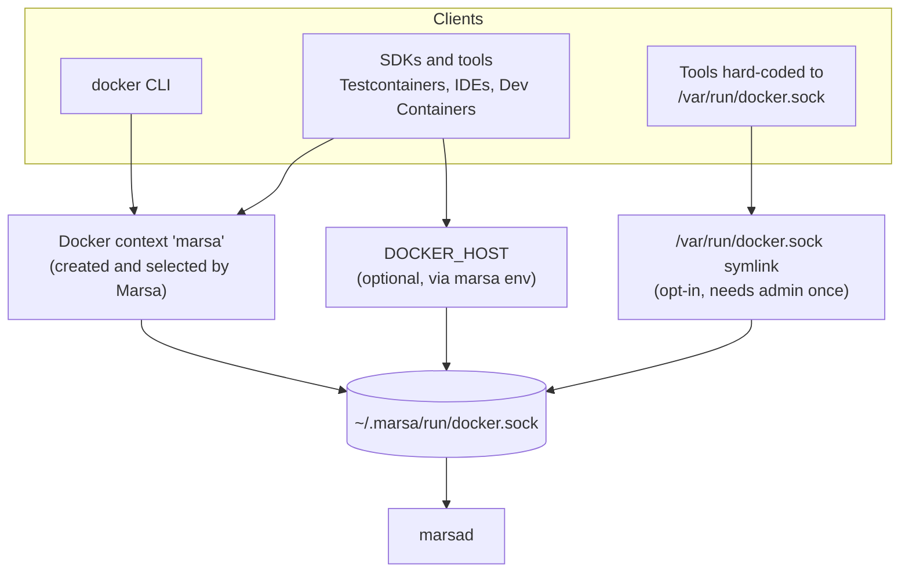

# 09 CLI and Docker compatibility

Two command-line surfaces exist. The upstream `docker` CLI does all container work, unchanged. The `marsa` CLI manages Marsa itself.

## Compatibility goal

Anything that works against Docker Desktop's engine works against Marsa without changes, as long as it uses linux/arm64 images. Planning named this as a make-or-break item: if IDEs, Testcontainers and Dev Containers do not work on day one, people uninstall.

## How clients find the engine



| Mechanism | Default | Notes |
|---|---|---|
| Docker context `marsa` | Created at first run and made current, after asking if another context is active | The clean, standard way; no privileges needed |
| `DOCKER_HOST` | Not set automatically | `marsa env` prints the export line for shells and CI |
| `/var/run/docker.sock` | Off | An opt-in setting creates the symlink with a one-time administrator prompt. Needed only for tools that ignore contexts. This is the only action in Marsa that asks for administrator rights |

**Verify:** which popular tools still ignore Docker contexts (historically some SDK-based tools did) and document the recommended setting for each.

## Bundled upstream binaries

| Binary | Source | Location |
|---|---|---|
| `docker` | Docker CLI, darwin/arm64 | `Marsa.app/Contents/Resources/bin` |
| `docker-compose` | Compose v2 plugin | CLI plugins directory |
| `docker-buildx` | Buildx plugin | CLI plugins directory |
| `docker-credential-osxkeychain` | docker-credential-helpers | Same `bin` directory |

- All are unmodified upstream releases, pinned by version and checksum, and listed in the SBOM.
- Marsa offers to link them into a directory on `PATH` (**Proposed:** `~/.marsa/bin`, added to the shell profile on request, or `/usr/local/bin` with an administrator prompt).
- If the user already has a `docker` CLI, Marsa does not replace it; it only adds the context.

## Coexistence with Docker Desktop and others

- Marsa never edits another tool's files or socket.
- The `marsa` context sits alongside `desktop-linux`, `orbstack`, `colima` and others; the user switches with `docker context use`.
- **Import (should-have):** copy images and volumes from another running engine through the Docker API (`save` and `load`, volume copy through a helper container).

## Compatibility checklist

Each line is an automated test in the conformance suite ([13](13-testing-and-benchmarks.md)).

| Area | Must work |
|---|---|
| Core | `run`, `exec`, `attach`, `logs -f`, `cp`, `stats`, `events`, `inspect` |
| Build | `docker build`, `docker buildx build`, cache mounts, secrets, SSH forwarding |
| Compose | `up`, `down`, `logs`, `watch`, profiles, healthchecks, depends_on |
| Networking | Published TCP and UDP ports on `localhost`, `host.docker.internal`, user-defined networks |
| Storage | Bind mounts of shared folders, named volumes, tmpfs |
| Tools | Testcontainers (Java, Node, Go, Python), VS Code Dev Containers, JetBrains Docker integration |
| Auth | `docker login` with credentials stored in the macOS keychain |
| Streams | Interactive TTY, terminal resize, signals |

### Known and intended differences

| Difference | Reason |
|---|---|
| `--platform linux/amd64` fails with a clear message | x86 images are out of scope |
| Bind mounts outside the shared-folder allowlist are refused with instructions | Security decision |
| Ports published on `0.0.0.0` bind to loopback unless LAN access is enabled | Security decision (proposed default) |
| Multi-arch builds produce arm64 only unless a remote builder is used | No emulation |

Each difference is documented for users and returned as an explicit error, never a silent failure.

## SSH agent forwarding

**Proposed:** expose the host SSH agent socket to the guest over vsock so `docker build --ssh default` and containers mounting the agent socket work, as Docker Desktop does. The socket path inside the guest is fixed and documented.

## The `marsa` CLI

A thin client of the typed API. It never talks to the VM directly.

```text
marsa status                    Engine and VM state, versions, resource use
marsa start | stop | restart    Control the engine VM
marsa env                       Print DOCKER_HOST export for the current shell
marsa config get|set|list       Read and change settings
marsa share list|add|remove     Manage the shared-folder allowlist
marsa disk usage                Show data-disk usage
marsa disk cleanup [--dry-run]  Preview and run cleanup, then reclaim space
marsa disk reclaim              Return freed space to macOS
marsa network status|mode       Show or pin the network mode
marsa logs [--follow]           Daemon and guest logs
marsa diagnose                  Collect a diagnostics bundle
marsa update check|apply        Updates
marsa mcp                       Run the MCP server on stdio
marsa agents list|approve|deny|revoke   Agent permissions
marsa reset [--factory]         Reset settings or wipe the data disk (typed confirmation)
marsa version                   Versions of every component
marsa completion <shell>        Shell completions
```

CLI rules:

- Every command supports `--json` for scripts and agents, with a stable schema.
- Exit codes are documented and stable.
- Human output is localised (English and Arabic); `--json` output is not.
- Destructive commands require an explicit flag or a typed confirmation, and never run destructively when stdin is not a terminal unless `--yes` is given.
- `marsa` starts `marsad` if it is not running.
