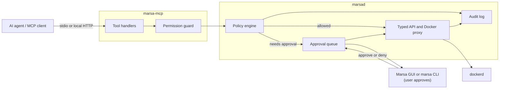
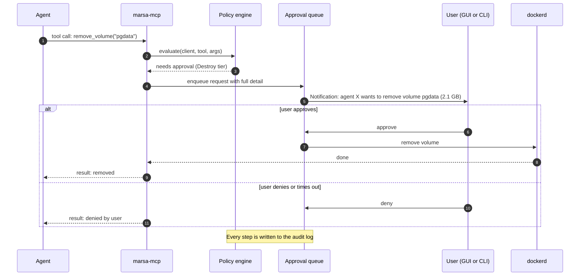

# 10 MCP server

Marsa ships a Model Context Protocol server so AI coding agents can inspect and operate containers. **Decided:** it is in version 1.

Because the Docker socket is equivalent to root over the VM and every shared folder, the MCP server is designed around permissions first and tools second.

## Design goals

1. An agent can do the everyday read-only work (list, logs, inspect, stats) without interrupting the user.
2. Anything that changes or destroys state needs the user's approval, given in the GUI or CLI.
3. An agent can never do something the GUI could not show and the user could not review.
4. Everything an agent does is recorded.

## Architecture

- `marsa mcp` runs the server on stdio, which is how most MCP clients launch local servers.
- **Proposed:** an optional local HTTP transport bound to loopback with a per-client token, for clients that need it. Off by default.
- The MCP server holds no privileges of its own. Every call goes through `marsad`'s policy engine.

## Permission tiers

| Tier | Examples | Default |
|---|---|---|
| **Read** | List containers, images, volumes, networks; inspect; read logs; read stats; engine status; disk usage | Allowed without asking |
| **Operate** | Start, stop, restart a container; run a new container from a local image; `exec` a command; Compose up and down; pull an image | Ask the first time per client and per project; the user may grant "always for this project" |
| **Destroy** | Remove containers, images, volumes, networks; prune; factory reset | Always ask, every time, showing exactly what will be removed. Never grantable as "always" |
| **Host-affecting** | Add a shared folder; bind-mount a new host path; publish a port to the LAN; change settings | Always ask, every time |

Rules:

- **Volumes are precious.** Removing a volume always shows its name, size and which containers used it.
- **`exec` is powerful.** It runs arbitrary commands inside a container and is in the Operate tier with its command shown in the approval.
- **Bind mounts are checked twice:** by the agent policy and by the shared-folder allowlist.
- **No privilege flags by default.** `--privileged`, host network, host PID and mounting the Docker socket into a container are refused for agents unless the user enables an explicit "advanced agent access" setting, and even then each use asks.

## Approval flow

- Requests time out (default a few minutes) and return a clear "not approved" result so the agent can continue or ask the user in its own interface.
- If no GUI is open, the notification appears through the tray item and `marsa agents approve` works from a terminal.

## Tools

**Proposed** first set. Names are stable; arguments use JSON Schema.

| Tool | Tier | Purpose |
|---|---|---|
| `engine_status` | Read | State, versions, resources |
| `list_containers`, `inspect_container` | Read | Containers and their details |
| `container_logs` | Read | Tail or range, with a size cap |
| `container_stats` | Read | One sample or a short window |
| `list_images`, `inspect_image` | Read | Images |
| `list_volumes`, `list_networks` | Read | Volumes and networks |
| `compose_list`, `compose_ps`, `compose_logs` | Read | Compose projects |
| `disk_usage`, `cleanup_preview` | Read | What could be reclaimed |
| `start_container`, `stop_container`, `restart_container` | Operate | Lifecycle |
| `run_container` | Operate | Create and start from a spec |
| `exec_in_container` | Operate | Run a command, return output with a size cap |
| `pull_image` | Operate | Pull by reference |
| `compose_up`, `compose_down`, `compose_restart` | Operate | Compose lifecycle (`down` without volumes) |
| `remove_container`, `remove_image`, `remove_network` | Destroy | Removal |
| `remove_volume`, `compose_down_volumes`, `prune` | Destroy | Data-destroying removal |
| `add_share` | Host-affecting | Request a new shared folder |

Tool rules:

- Outputs are bounded (logs and exec output are truncated with a clear marker and a way to page).
- Errors are structured: a code, a message, and when relevant the reason for denial.
- Tool descriptions state the tier, so a well-behaved agent can predict approvals.

## Treating container output as untrusted

Logs, exec output, image labels and container names are data from the workload. They can contain text crafted to look like instructions. The server:

- Returns them as plain data in clearly delimited fields, never merged into tool descriptions or system text.
- Notes in each tool description that returned content is untrusted workload output.
- Never lets returned content influence the permission decision.

## Client identity and grants

- Each MCP client is identified at first connection (name reported by the client, plus the launching process where it can be determined) and shown to the user.
- Grants are stored per client and per project directory in `~/.marsa/state/grants.json`, visible and revocable in Settings and with `marsa agents`.
- Grants expire (**Proposed:** 30 days of disuse) and are cleared by factory reset.

## Audit log

Every MCP call is recorded: time, client, tool, arguments (with secrets redacted), decision, approver, result. It is shown in the GUI's Activity screen and exported in diagnostics bundles only with the user's consent.

## One API for everything

The MCP server, the GUI and the CLI all call the same `marsad` API through `marsa-client`. There is no agent-only code path into the engine, so the policy engine and audit log cannot be bypassed from the MCP side.
