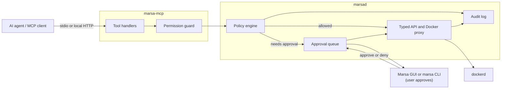
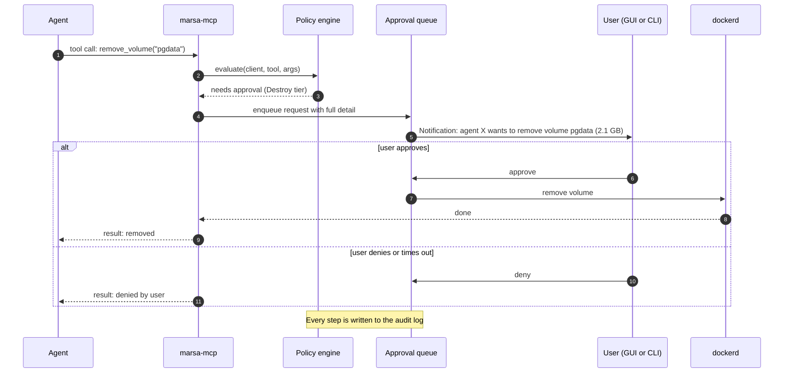

# 10 MCP server

Marsa ships a Model Context Protocol server so AI coding agents can inspect and operate containers. **Decided:** it is in version 1.

Because the Docker socket is equivalent to root over the VM and every shared folder, the MCP server is designed around permissions first and tools second.

## Design goals

1. An agent can do the everyday read-only work (list, logs, inspect, stats) without interrupting the user.
2. Anything that changes or destroys state needs the user's approval, given in the GUI or CLI.
3. An agent can never do something the GUI could not show and the user could not review.
4. Everything an agent does is recorded.

## Protocol version

MCP published the stable `2026-07-28` specification. The official Rust SDK's current stable release is `rmcp` 3.11.0 as of 2026-11-22 and supports both that revision and `2025-11-25`. M8-04 validates and pins the SDK when the stdio transport is implemented. The daemon's policy evaluates typed operations independently of the transport. [MCP specification release](https://blog.modelcontextprotocol.io/posts/2026-07-28/), [Rust SDK release](https://github.com/modelcontextprotocol/rust-sdk/releases/tag/rmcp-v3.11.0)

## Architecture

- `marsa mcp` runs the server on stdio, which is how most MCP clients launch local servers.
- **Proposed:** an optional local HTTP transport bound to loopback with a per-client token, for clients that need it. Off by default.
- The MCP server holds no privileges of its own. Every call goes through `marsad`'s policy engine.

## Permission tiers

| Tier | Examples | Default |
|---|---|---|
| **Read** | List containers, images, volumes, networks; inspect; read logs; read stats; engine status; disk usage | Allowed without asking |
| **Operate** | Start, stop, restart a container; run a new container from a local image; `exec` a command; Compose up and down; pull an image | Ask the first time per client and per project; the user may grant "always for this project" |
| **Destroy** | Remove containers, images, volumes, networks; prune; factory reset | Always ask, every time, showing exactly what will be removed. Never grantable as "always" |
| **Host-affecting** | Add a shared folder; bind-mount a new host path; publish a port to the LAN; change settings | Always ask, every time |

Rules:

- **Volumes are precious.** Removing a volume always shows its name, size and which containers used it.
- **`exec` is powerful.** It runs arbitrary commands inside a container and is in the Operate tier with its command shown in the approval.
- **Bind mounts are checked twice:** by the agent policy and by the shared-folder allowlist.
- **No privilege flags by default.** `--privileged`, host network, host PID and mounting the Docker socket into a container are refused for agents unless the user enables an explicit "advanced agent access" setting, and even then each use asks.

## Approval flow

- Requests time out (default a few minutes) and return a clear "not approved" result so the agent can continue or ask the user in its own interface.
- If no GUI is open, the tray and CLI are planned owner clients for the same approval API.
- The owner-only daemon socket serves `Agents.OpenSession` and approval decisions. A trusted local owner client registers the agent and project, then delegates a 12-hour capability to the restricted `agent.sock` endpoint. The agent capability authenticates `AgentOps` and has no owner permissions. Do not give an agent the owner connection or raw Docker socket.
- This protects against an agent using only its delegated operations. Local processes running with the unrestricted owner's Unix access are inside the trusted host boundary. The daemon does not attest physical user presence. The owner GUI or CLI is responsible for collecting the user's decision.
- M8-02 supports engine status and a reviewed stop for a full container ID. A stop requires approval each time because the handler cannot prove project ownership of a Docker container. The daemon verifies the target ID before issuing the stop.
- M8-10 enables requests that create bind mounts after the agent and active host share checks are integrated. Until then, the daemon refuses container creation through `AgentOps`.

## Tools

**Proposed** first set. Names are stable; arguments use JSON Schema.

| Tool | Tier | Purpose |
|---|---|---|
| `engine_status` | Read | State, versions, resources |
| `list_containers`, `inspect_container` | Read | Containers and their details |
| `container_logs` | Read | Tail or range, with a size cap |
| `container_stats` | Read | One sample or a short window |
| `list_images`, `inspect_image` | Read | Images |
| `list_volumes`, `list_networks` | Read | Volumes and networks |
| `compose_list`, `compose_ps`, `compose_logs` | Read | Compose projects |
| `disk_usage`, `cleanup_preview` | Read | What could be reclaimed |
| `start_container`, `stop_container`, `restart_container` | Operate | Lifecycle |
| `run_container` | Operate | Create and start from a spec |
| `exec_in_container` | Operate | Run a command, return output with a size cap |
| `pull_image` | Operate | Pull by reference |
| `compose_up`, `compose_down`, `compose_restart` | Operate | Compose lifecycle (`down` without volumes) |
| `remove_container`, `remove_image`, `remove_network` | Destroy | Removal |
| `remove_volume`, `compose_down_volumes`, `prune` | Destroy | Data-destroying removal |
| `add_share` | Host-affecting | Request a new shared folder |

Tool rules:

- Outputs are bounded (logs and exec output are truncated with a clear marker and a way to page).
- Errors are structured: a code, a message, and when relevant the reason for denial.
- Tool descriptions state the tier, so a well-behaved agent can predict approvals.

## Treating container output as untrusted

Logs, exec output, image labels and container names are data from the workload. They can contain text crafted to look like instructions. The server:

- Returns them as plain data in clearly delimited fields, never merged into tool descriptions or system text.
- Notes in each tool description that returned content is untrusted workload output.
- Never lets returned content influence the permission decision.

## Client identity and grants

- Each MCP client is identified at first connection (name reported by the client, plus the launching process where it can be determined) and shown to the user.
- Grants are stored per client and per project directory in `~/.marsa/state/grants.json`, visible and revocable in Settings and with `marsa agents`.
- An approval can grant one ordinary Operate action for the authenticated client and the project directory. The daemon binds it to the canonical path and filesystem identity. Reusing the path for a different directory requires a new grant.
- Grants expire after 30 days of disuse. An operation that actually uses a grant renews it. Factory reset clears the grants.
- The daemon stores the versioned grant document with owner-only permissions and replaces it atomically. If the file is malformed or unsafe, the daemon treats it as unavailable for authorizing an operation.

## Audit log

The daemon records one terminal entry per decoded `AgentOps.Execute` call. A retry gets its own entry even when the request ID replays a previous result. Each entry records receipt time, the registered client's fingerprint when authenticated, the typed operation and a redacted argument summary, the decision, the local owner role when someone decided, and the result. Argument values, tokens, client and container IDs, paths, and workload output are kept out of the audit log.

`Agents.ListAudit` is available on the owner connection. It pages newest completed entries first and filters by client fingerprint, operation, decision, and receipt time. Four owner-only JSON Lines files retain up to 2 MiB inside `~/.marsa/state`. If rotation removes a cursor, the owner client starts a new query. Reviewed execution checks that the audit storage is accessible first, and the daemon syncs its terminal entry before returning the result. A caller that disconnects during normal operation can still have a completed entry. An abrupt process or storage failure can interrupt an in-flight entry.

The GUI Activity screen and explicit diagnostic export are separate clients of the private audit data.

## One API for everything

The MCP server, the GUI and the CLI all call the same `marsad` API through `marsa-client`. There is no agent-only code path into the engine, so the policy engine and audit log cannot be bypassed from the MCP side.
