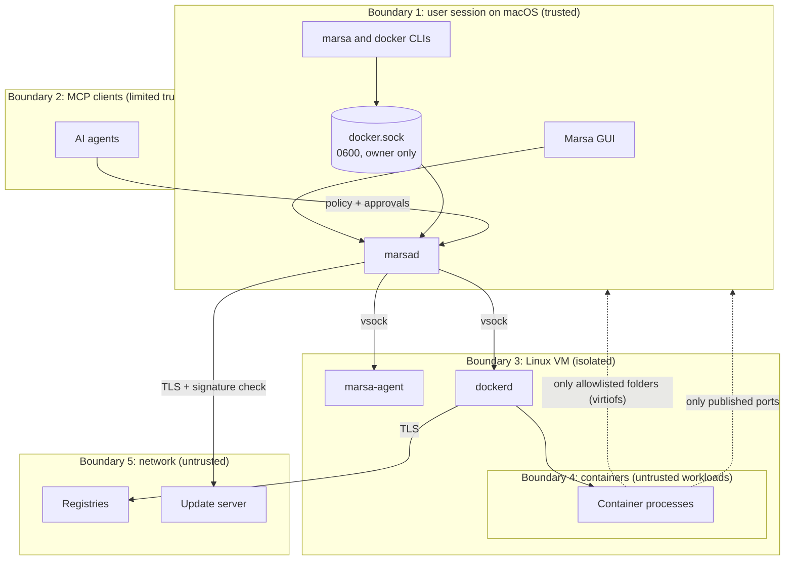
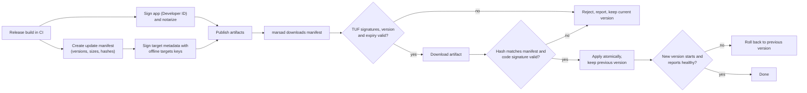

# 11 Security

Marsa ships a hypervisor client, a Linux kernel, a container engine and an agent interface. Each is a place where a mistake hands someone the user's machine. This doc sets the security model; every other doc must stay consistent with it.

## Security principles

1. **Least privilege.** Everything runs as the logged-in user. No root daemon, no privileged helper by default.
2. **Explicit sharing.** The VM sees only folders the user chose.
3. **The VM is a boundary, not a guarantee.** Containers are isolated from the Mac by the VM, but anything shared into the VM is exposed to every container.
4. **Signed everything.** App, updates and guest image are signed and verified.
5. **Patch fast.** Engine, runc and kernel vulnerabilities are fixed in days.
6. **Agents are least-trusted clients.** See [10 MCP server](10-mcp-server.md).

## Trust boundaries

## Threat model

| # | Threat | Mitigation |
|---|---|---|
| T1 | Another local user or a sandboxed app connects to the Docker socket | Socket and its directory are owner-only (0600 and 0700). No TCP listener. The optional `/var/run/docker.sock` symlink points to the same owner-only socket |
| T2 | A malicious or compromised container reads the user's secrets through a shared folder | Allowlist; protected paths can never be shared; no home-folder share by default |
| T3 | A container escapes to the guest kernel | The VM contains it. Guest kernel and runc are patched quickly. The guest holds no host credentials |
| T4 | A guest compromise attacks the host through virtual devices or the control channel | Minimal device set; the control protocol is a strict, versioned schema with bounded message sizes; `marsad` treats everything from the guest as untrusted input |
| T5 | An AI agent is tricked (for example by text in container logs) into destructive actions | Permission tiers; destructive actions always need human approval; workload output is marked untrusted; full audit log |
| T6 | A tampered update or guest image is installed | TUF verification against an embedded public root before installation; notarized app; rollback on failed start |
| T7 | Supply-chain compromise of a dependency | Pinned versions and checksums; `cargo-deny` and `cargo-audit` in CI; SBOM per release; reproducible guest build |
| T8 | Registry credentials leak | Stored only in the macOS keychain through the credential helper; never written to disk in plain text; never sent to the guest except per request by the engine |
| T9 | Published container ports exposed to the local network unintentionally | Loopback binding by default; LAN exposure is an explicit setting |
| T10 | Privileged container flags used to reach more than intended | The VM limits the blast radius to the guest and shared folders; agents are refused these flags by default |
| T11 | Diagnostics bundle leaks secrets | Redaction of environment variables, tokens and paths marked sensitive; the user reviews the bundle before sharing |
| T12 | Local privilege escalation through an installer or helper | No privileged helper by default. The single optional administrator action (the socket symlink) is a one-shot, auditable operation with no persistent root process |

## The Docker socket

- Anyone who can use the socket can run a container that mounts any shared folder and controls the VM. Treat socket access as full control of everything Marsa can reach.
- The socket lives in `~/.marsa/run/` with directory mode 0700.
- Marsa never exposes the engine over TCP. Remote access is a later feature and would use SSH.
- Mounting the socket into a container (`-v /var/run/docker.sock:...`) works for compatibility, with the guest's socket, and is shown with a warning badge in the GUI. Agents are refused this by default.

## Shared folders

See [07](07-file-sharing-and-storage.md#the-allowlist). Security-relevant points:

- The allowlist check runs in `marsad` on the host, not in the guest, so a compromised guest cannot widen it.
- Paths are canonicalised and symlinks resolved before checking.
- The protected-path list is code, has tests, and cannot be overridden from settings.

## Registry credentials

- `docker login` stores credentials through `docker-credential-osxkeychain` in the macOS Keychain when that helper is on the Docker CLI's `PATH`. The authenticated opt-in adds `credsStore = osxkeychain` to the configured Docker client file only after the caller obtains consent. Existing `credsStore` and `credHelpers` entries remain untouched. If Docker already holds credentials in the file, log out before enabling Keychain and log in again afterwards. [Docker login](https://docs.docker.com/reference/cli/docker/login/), [pinned helper source](https://github.com/docker/docker-credential-helpers/blob/v0.9.13/osxkeychain/osxkeychain.go).
- The engine in the guest receives credentials per pull or push from the CLI, as in standard Docker. Nothing is persisted in the guest.

## SSH agent access

For builds, the Docker client selects the host agent and offers it through its own Buildx session. BuildKit makes the socket available to Dockerfile steps that request an SSH mount within that session. A build with an SSH grant can request signatures from the chosen agent for the lifetime of its session. The upstream provider permits signing without exporting private keys. Adding, removing and locking keys through the forwarded socket is refused by the upstream provider. [Pinned provider source](https://github.com/moby/buildkit/blob/v0.35.0/session/sshforward/sshprovider/agentprovider.go).

The Docker byte proxy has no independent indication that a client granted access to an arbitrary guest workload. A predictable guest listener would remain reachable to other guest processes with permission to mount or open it. Container-mounted forwarding requires a host-enforced, revocable grant and is tracked in [M4-17](plan/M4-docker-integration.md#m4-17-explicit-ssh-agent-access-for-containers).

## Guest hardening

| Measure | Detail |
|---|---|
| Read-only root | The root filesystem cannot be modified at runtime |
| Minimal userland | No shell access path from the host by default; a debug shell exists only in development builds or behind an explicit diagnostics action |
| Engine defaults | Default seccomp profile, no experimental features, live-restore off, user namespaces remapping evaluated (**Proposed:** off for compatibility in version 1, documented) |
| No inbound services | The guest listens only on vsock and on published container ports |
| Kernel config | Only what containers need; verified by Docker's `check-config.sh` |

## Process hardening on the host

- Hardened runtime enabled on all binaries; only the entitlements each binary needs (virtualization or hypervisor for `marsad`).
- `marsad` parses all untrusted input (guest messages, Docker requests it inspects, update manifests) with bounded, well-tested parsers; fuzzing targets exist for each ([13](13-testing-and-benchmarks.md)).
- No shelling out with user-controlled strings.
- Secrets are never logged. Log redaction is tested.

## Updates and supply chain

- TUF root and targets keys are held separately from the Apple signing identity, offline or hardware-backed with threshold signatures. See the [key handling procedures](reference/update-manifest.md#keys-and-expiry).
- Downgrades are refused unless the user explicitly requests one.
- Details in [12](12-build-release-update.md).

### Rust dependency policy

`cargo xtask check` checks the locked dependency graph with all features enabled against [the dependency policy](../deny.toml). All packages, including development and build dependencies, must have an allowed licence. The policy rejects duplicate versions, the unmaintained `failure` crate, wildcard registry requirements, and unknown dependency sources. Approved Git dependencies must specify a commit revision.

The [daily dependency audit](../.github/workflows/dependency-audit.yml) checks `Cargo.lock` against the current RustSec advisory database. Vulnerabilities and audit warnings fail the job. The audit has read-only repository access.

To verify licence enforcement, a disposable copy of the workspace added a local, unpublished crate outside the workspace as a dependency of `marsa-core` and regenerated its lockfile. With `license = "GPL-3.0-only"`, `cargo xtask check` exited 1 with a licence rejection. Changing only the fixture licence to MIT made the check pass. The audit command also exited 1 on a disposable lockfile containing a package version flagged by RustSec.

## Vulnerability response

| Step | Target |
|---|---|
| Monitoring | Subscribe to security advisories for Moby, containerd, runc, the Linux kernel, Alpine, libkrun and Rust dependencies; automated daily dependency audit |
| Triage | Within one working day of a relevant advisory |
| Fix for container-escape or remote-execution issues | Signed update released within days, not weeks |
| Disclosure | A `SECURITY.md` with a private reporting channel and a published policy |
| Communication | Release notes state which CVEs an update fixes |

Because the guest image is replaced whole on update, a patched kernel and engine reach users in a single app update.

## Privacy

- **Decided:** no telemetry by default. Any future telemetry is opt-in, documented field by field, and never includes container names, image names, paths or environment values.
- Crash reports are opt-in and reviewed by the user before sending.
- The network-mode probe contacts only the configured probe targets and sends no identifiers.

## Security testing

Listed in [13](13-testing-and-benchmarks.md#security-tests): socket permission tests, allowlist and protected-path tests including symlink escapes, agent policy tests, update verification tests with tampered artifacts, fuzzing of parsers, and a pre-release external review before version 1.
