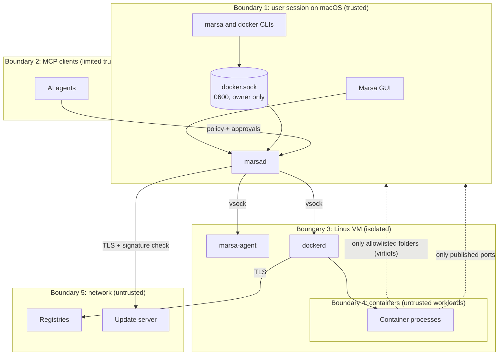
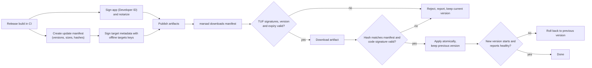

# 11 Security

Marsa ships a hypervisor client, a Linux kernel, a container engine and an agent interface. Each is a place where a mistake hands someone the user's machine. This doc sets the security model; every other doc must stay consistent with it.

## Security principles

1. **Least privilege.** Everything runs as the logged-in user. No root daemon, no privileged helper by default.
2. **Explicit sharing.** The VM sees only folders the user chose.
3. **The VM is a boundary, not a guarantee.** Containers are isolated from the Mac by the VM, but anything shared into the VM is exposed to every container.
4. **Signed everything.** App, updates and guest image are signed and verified.
5. **Patch fast.** Engine, runc and kernel vulnerabilities are fixed in days.
6. **Agents are least-trusted clients.** See [10 MCP server](10-mcp-server.md).

## Trust boundaries

## Threat model

| # | Threat | Mitigation |
|---|---|---|
| T1 | Another local user or a sandboxed app connects to the Docker socket | Socket and its directory are owner-only (0600 and 0700). No TCP listener. The optional `/var/run/docker.sock` symlink points to the same owner-only socket |
| T2 | A malicious or compromised container reads the user's secrets through a shared folder | Allowlist; protected paths can never be shared; no home-folder share by default |
| T3 | A container escapes to the guest kernel | The VM contains it. Guest kernel and runc are patched quickly. The guest holds no host credentials |
| T4 | A guest compromise attacks the host through virtual devices or the control channel | Minimal device set; the control protocol is a strict, versioned schema with bounded message sizes; `marsad` treats everything from the guest as untrusted input |
| T5 | An AI agent is tricked (for example by text in container logs) into destructive actions | Permission tiers; destructive actions always need human approval; workload output is marked untrusted; full audit log |
| T6 | A tampered update or guest image is installed | TUF verification against an embedded public root before installation; notarized app; rollback on failed start |
| T7 | Supply-chain compromise of a dependency | Pinned versions and checksums; `cargo-deny` and `cargo-audit` in CI; SBOM per release; reproducible guest build |
| T8 | Registry credentials leak | Stored only in the macOS keychain through the credential helper; never written to disk in plain text; never sent to the guest except per request by the engine |
| T9 | Published container ports exposed to the local network unintentionally | Loopback binding by default; LAN exposure is an explicit setting |
| T10 | Privileged container flags used to reach more than intended | The VM limits the blast radius to the guest and shared folders; agents are refused these flags by default |
| T11 | Diagnostics bundle leaks secrets | Redaction of environment variables, tokens and paths marked sensitive; the user reviews the bundle before sharing |
| T12 | Local privilege escalation through an installer or helper | No privileged helper by default. The single optional administrator action (the socket symlink) is a one-shot, auditable operation with no persistent root process |

## The Docker socket

- Anyone who can use the socket can run a container that mounts any shared folder and controls the VM. Treat socket access as full control of everything Marsa can reach.
- The socket lives in `~/.marsa/run/` with directory mode 0700.
- Marsa never exposes its own engine over TCP. The desktop can connect to configured external engines using OpenSSH with verified host keys or mutual TLS with a configured CA, client certificate, and client key. Plain TCP and contexts that skip TLS verification remain unavailable. SSH resolves and pins the context identity before operations.
- Hawser Standard requires HTTPS verified against the configured CA and the exact agent hostname or IP. Marsa sends the token on every request and verifies Hawser metadata before reading the Docker engine identity.
- Hawser Edge listens in the open desktop session on an explicitly configured unprivileged address and port. The operator supplies the server certificate and an owner-private key. Configure the agent to trust that certificate and use `DOCKHAND_SERVER_URL=wss://host:port/api/hawser/edge`, with the exact `AGENT_ID` and shared token. Authentication uses Hawser's version 1.0 hello over TLS and a constant-time token digest comparison. An existing request is scoped to its WebSocket session, so reconnecting cannot move that request to a replacement session.
- Hawser tokens use separate Keychain entries tied to the configured connection. The settings file holds only an opaque reference. Edge caps forwarded request bodies at 24 MiB and incoming WebSocket messages at 36 MiB. Larger archive operations may require a direct Docker connection.
- Every external action captures the selected endpoint. Deployment uses an owner-only temporary Unix socket backed by that authenticated connection. Compose uses a local YAML file the user chose, or one the user reviewed and created in a chosen project directory. Template creation preserves any existing `compose.yaml`. The Compose process may read includes and associated files. Engine-provided project labels cannot select a local file.
- Mounting the socket into a container (`-v /var/run/docker.sock:...`) works for compatibility, with the guest's socket, and is shown with a warning badge in the GUI. Agents are refused this by default.

Scheduled maintenance uses the built-in passive owner API or a registered
owner-authenticated Unix socket. The external review verifies the saved
registration and canonical path, then checks the Docker engine ID on the same
connection used to fetch disk usage. Reviews never start a VM, use a remote
transport, retrieve credentials, or authorize cleanup. The manual preview and
confirmation govern destructive operations.

## Shared folders

See [07](07-file-sharing-and-storage.md#the-allowlist). Security-relevant points:

- The allowlist check runs in `marsad` on the host, not in the guest, so a compromised guest cannot widen it.
- Paths are canonicalised and symlinks resolved before checking.
- The protected-path list is code, has tests, and cannot be overridden from settings.

## Compose deploy secrets

An explicit deploy option grants the selected Docker engine and the services
named in the Compose model access to the saved workload credentials. The
Keychain namespace scopes entries to the canonical Compose path, exact
project name, and secret name. Settings keeps no plaintext secret values.
Replacement writes a fresh Keychain revision before retiring its predecessor.

Marsa loads and normalizes the user-selected Compose model before retrieving
any Keychain values. It uses a private second invocation whose environment
contains fresh per-deployment keys, referenced only by the approved runtime
secret definitions. The child receives the validated model over stdin.
It bypasses further dotenv loading and uses no host provider, build,
credential helper, or image pull. The protected invocation discards raw
Compose and engine output. Only an opaque random revision is stored in
Docker labels, so a later deploy recreates containers whose saved secret
revision changed.

Compose 5.8.0 puts each runtime secret into the granted container's writable
filesystem. The engine administrator and the granted workload can read the
materialized file. A workload that prints the secret exposes it in its own
container logs. Keychain removal leaves existing container copies in place,
and exporting or committing a container can include those files.
Marsa limits the protected path to standard `/run/secrets/<name>` targets
and refuses Compose mounts on receiving services, inherited volumes in the
project, and other secret sources or conflicting configs on receiving services.
Moby follows symbolic links when extracting the secret archive, so an
apparently unrelated mount path could lead to shared storage. Marsa also
rejects images with declared volumes and pins receiving images to their local
content IDs. This prevents Compose from inheriting a previous container's
mount at an image-declared volume destination. Protected deployment disallows
host providers, jobs and model runners.
Compose writes secret files immediately before engine start. A failed copy
prevents that container from starting, and a deploy retry can populate an
existing stopped container.
[Pinned Compose runtime implementation](https://github.com/docker/compose/blob/v5.8.0/pkg/compose/secrets.go)
· [Pinned start executor](https://github.com/docker/compose/blob/v5.8.0/pkg/compose/executor_ops.go)
· [Pinned Compose volume inheritance](https://github.com/docker/compose/blob/v5.8.0/pkg/compose/create.go#L1202-L1246)
· [Pinned Moby archive extraction](https://github.com/moby/moby/blob/docker-v29.10.0/daemon/archive_unix.go#L121-L158).

## Desktop image scanning

Explicit image scans use the selected engine's immutable image ID. The
installed scanner receives a temporary private archive and runs with a clean
environment without the Docker socket or registry credentials. Opt-in report
retention stores only bounded normalized findings and the original image ID
in an owner-only file keyed by the engine. A confirmed cache cleanup operates
on the desktop's fixed scanner database directories, keeps the scan locks in
place, and never sends a cleanup request to Docker.

### Confined named-volume downloads

The owner-only download endpoint targets the running built-in VM on a
dedicated host-CID-only connection. The guest validates that the selected
volume is ordinary, local and option-free. It confirms the Docker creation
timestamp and fixed data path. The guest pins the volume before the owner
reviews the path and then pins the requested object's descriptor.
Linux `openat2` disallows symlinks and mount crossings below the managed data
mount. Regular files must have one link. Directory traversal is bounded by
entry count, depth, path size and total output. The guest rechecks the pinned
identities and Docker metadata before reporting success. The Mac stages the
bounded data stream inside the protected owner runtime, outside guest folder
grants. It holds the staging directory by descriptor and checks the
destination folder and staged inode and publishes without overwriting an
existing name only after success and stream termination.
[Docker local volume layout](https://github.com/moby/moby/blob/docker-v29.10.0/daemon/volume/local/local.go) · [Linux path resolution](https://man7.org/linux/man-pages/man2/openat2.2.html)

## Registry credentials

- `docker login` stores credentials through `docker-credential-osxkeychain` in the macOS Keychain when that helper is on the Docker CLI's `PATH`. The authenticated opt-in adds `credsStore = osxkeychain` to the configured Docker client file only after the caller obtains consent. Existing `credsStore` and `credHelpers` entries remain untouched. If Docker already holds credentials in the file, log out before enabling Keychain and log in again afterwards. [Docker login](https://docs.docker.com/reference/cli/docker/login/), [pinned helper source](https://github.com/docker/docker-credential-helpers/blob/v0.9.13/osxkeychain/osxkeychain.go).
- The engine in the guest receives credentials per pull or push from the CLI, as in standard Docker. Nothing is persisted in the guest.
- The desktop Registries settings use an isolated namespace in the same verified
  Keychain helper. A replacement is written at a fresh key before the old key is
  removed. Docker CLI configuration and its credential entries are independent.
- Desktop registry connection tests use HTTPS from macOS without redirects or
  a proxy, and never pass credentials in subprocess arguments. Private Basic
  authentication goes directly to the selected authority. A private Bearer
  challenge is accepted only if its token realm uses the same HTTPS authority.
  Docker Hub uses its official HTTPS token service. [Docker registry auth](https://docs.docker.com/reference/api/registry/auth/)
- Desktop image transfers have no independent address binding for a
  registry-controlled token realm or for a redirected request. Stock Docker's
  registry login passes credentials to a realm supplied by the registry. The
  pinned containerd bearer authorizer checks hostname without restricting
  scheme, and its resolver can reauthorize a redirect. Credentials saved in
  desktop Registries settings therefore serve the direct connection test. Keep
  private image pulls and Docker CLI credentialed pushes on the established
  container workflow until a transfer path can enforce the same boundary.
  [Pinned registry login](https://github.com/moby/moby/blob/docker-v29.10.0/daemon/pkg/registry/auth.go) ·
  [Pinned bearer handling](https://github.com/moby/moby/blob/docker-v29.10.0/daemon/containerd/resolver.go) ·
  [Pinned redirect handling](https://github.com/moby/moby/blob/docker-v29.10.0/vendor/github.com/containerd/containerd/v2/core/remotes/docker/resolver.go)

## Git sources

Settings saves the repository name, HTTPS or SSH URL and branch in an
owner-private file. The desktop runs the root-owned macOS `/usr/bin/git` in a fresh private
directory with the environment cleared and system and global Git configuration
disabled. A separate empty home keeps libcurl away from the login user's
`.netrc`. Git's temporary home and branch-test directory are under the
protected Marsa state root, which is excluded from guest shares. Git verifies HTTPS certificates and disables redirects, other
protocols, ambient HTTP authentication, hooks, templates and submodule checkout.
Tested with Apple
Git 2.54.0. [Git environment options](https://git-scm.com/docs/git/2.54.0) ·
[Git configuration](https://git-scm.com/docs/git-config/2.54.0).

The branch test reads advertised references. A checkout creates a fresh
child directory of the owner-selected folder. Review files in the checkout
before using the usual Compose picker to select its YAML and confirm the
target engine.

An optional HTTPS credential is saved through the signed macOS Keychain
helper. Its Keychain item is scoped to the saved repository ID and exact URL.
Settings contains only the current nonsecret association revision. To run
the test or checkout, the desktop verifies that the selected reference still
matches its saved record and starts a short-lived owner-private Unix socket.
The system Git helper obtains the credential over that socket only when its
requested protocol, authority and repository path match the approved URL.
The selected credential uses HTTPS Basic authentication. Git receives no
credential in its environment or command arguments. Changing
the URL or removing the repository or credential revokes the association.
The action checks the current Keychain revision against the reviewed revision.
A private cleanup journal records opaque item names before mutations and
retries pending erasures on subsequent repository or credential edits.
Compose receives only the file the owner selects after checkout.
[Git credential context](https://git-scm.com/docs/gitcredentials/2.54.0) ·
[Git helper request format](https://git-scm.com/docs/git-credential/2.54.0) ·
[Pinned HTTP authentication setup](https://github.com/git/git/blob/v2.54.0/http.c#L566-L623) ·
[Pinned libcurl home lookup](https://github.com/curl/curl/blob/curl-8_7_1/lib/netrc.c#L279-L316).

For SSH use `ssh://user@host[:port]/repository`. Obtain the OpenSSH public
host key through a trusted channel and compare its SHA-256 fingerprint in
Settings. Choose an owner-only private-key file. Settings records its local
path and public fingerprint. If its key changes, select the file again to
review the new public fingerprint. The supported public key types are
Ed25519, NIST ECDSA and RSA of at least 2048 bits using SHA-2 signatures.
BatchMode requires a private key usable without a passphrase prompt.

Marsa starts the system OpenSSH client with an isolated configuration that
pins the destination, user, port, host key and selected identity. OpenSSH
checks the host key before repository traffic. The client uses no ambient
SSH configuration, agent, macOS Keychain identities, certificates, proxy,
forwarding or alternate authentication. For each operation, the selected
owner-private key is opened without following the final symlink, staged in
an owner-only directory under the protected Marsa state root and checked
against its saved public fingerprint before connecting. The temporary
directory is removed when the operation ends. Only the public source URL is
recorded as the checkout's Git origin. Private key bytes are never put in
settings, Git arguments or Compose.
[Pinned OpenSSH client configuration](https://github.com/openssh/openssh-portable/blob/V_10_5_P1/ssh_config.5) ·
[Pinned Git SSH invocation](https://github.com/git/git/blob/v2.54.0/connect.c).

## SSH agent access

For builds, the Docker client selects the host agent and offers it through its own Buildx session. BuildKit makes the socket available to Dockerfile steps that request an SSH mount within that session. A build with an SSH grant can request signatures from the chosen agent for the lifetime of its session. The upstream provider permits signing without exporting private keys. Adding, removing and locking keys through the forwarded socket is refused by the upstream provider. [Pinned provider source](https://github.com/moby/buildkit/blob/v0.35.0/session/sshforward/sshprovider/agentprovider.go).

The Docker byte proxy has no independent indication that a client granted access to an arbitrary guest workload. A predictable guest listener would remain reachable to other guest processes with permission to mount or open it. Container-mounted forwarding requires a host-enforced, revocable grant and is tracked in [M4-17](plan/M4-docker-integration.md#m4-17-explicit-ssh-agent-access-for-containers).

[M4-24](plan/M4-docker-integration.md#m4-24-qualify-ssh-agent-transport-and-guest-peer-identity)
qualifies a host-opened vsock relay and Linux Unix-socket opener identity.
A socket bind can be inherited, so an approved path does not establish that
a new opener is the approved workload. The production grant must bind the
opener to an immutable Docker ID and fail closed when that identity cannot
be verified. An engine administrator can execute code in the approved
container, and the approved workload can relay signing access while its
grant is active. The transport fixture does not qualify those privileges,
Mac socket selection policy, or container lifecycle revocation. [Pinned Moby mount inheritance](https://github.com/moby/moby/blob/docker-v29.10.0/daemon/volumes.go)

### Container agent grant boundary

The container grant remains unavailable under the current trust model.
The M4-24 fixture verified that the guest kernel can distinguish ordinary
openers in separate cgroups and that closing the VZ stream disconnects the
guest client. It used synthetic cgroups and a disposable host agent.
[Entitled fixture](../crates/marsa-vm-vz/tests/real_vm/ssh_fixture/README.md)

- The stock engine reports a full container ID and a numeric init PID.
  The ID persists across restart. The API has no stable handle for one
  process lifetime. A Linux pidfd can pin it inside the guest and prevent
  numeric PID reuse from renewing a grant. Docker publishes its `die`
  event after exit processing. Event delivery, names and timestamps cannot
  establish a stable host-side lifetime. [Pinned inspect source](https://github.com/moby/moby/blob/docker-v29.10.0/daemon/inspect.go) · [Pinned start source](https://github.com/moby/moby/blob/docker-v29.10.0/daemon/start.go) · [Pinned exit processing](https://github.com/moby/moby/blob/docker-v29.10.0/daemon/monitor.go) · [Pinned Linux socket peer code](https://github.com/gregkh/linux/blob/v7.3.5/net/core/sock.c)
- `--volumes-from` can inherit a bind without listing its source in the new
  request. A guest opener check addresses that case for ordinary workloads.
  The supported guest Docker socket also grants engine administration.
  Its holder can ask Docker to run a process in the approved container.
  That process belongs to the approved task and can satisfy the opener
  identity check. [Pinned mount inheritance](https://github.com/moby/moby/blob/docker-v29.10.0/daemon/volumes.go) · [Pinned exec implementation](https://github.com/moby/moby/blob/docker-v29.10.0/daemon/exec.go) · [Pinned runc cgroup placement](https://github.com/opencontainers/runc/blob/v1.5.3/libcontainer/process_linux.go)
- A host-initiated VZ connection identifies the VM endpoint and provides
  port information and a byte stream. It carries no host-authenticated
  Docker ID, guest namespace or guest process lifetime. A compromised
  guest can still send requests on a host-opened stream while that stream
  exists. A bounded signing protocol limits operations, while the host
  still lacks independent authorization for the requesting workload.
  [Apple VZ connection contract](https://developer.apple.com/documentation/virtualization/vzvirtiosocketconnection)

Reopen M4-17 when the host can verify a workload and its lifetime independently,
or the owner approves a trust decision that explicitly scopes admin and
compromised-guest access while a grant is active. BuildKit keeps its separate
client-authorized session contract.

## Guest hardening

| Measure | Detail |
|---|---|
| Read-only root | The root filesystem cannot be modified at runtime |
| Minimal userland | No shell access path from the host by default; a debug shell exists only in development builds or behind an explicit diagnostics action |
| Engine defaults | Default seccomp profile, no experimental features, live-restore off, user namespaces remapping evaluated (**Proposed:** off for compatibility in version 1, documented) |
| No inbound services | The guest listens only on vsock and on published container ports |
| Kernel config | Only what containers need; verified by Docker's `check-config.sh` |

## Process hardening on the host

- Hardened runtime enabled on all binaries; only the entitlements each binary needs (virtualization or hypervisor for `marsad`).
- `marsad` parses all untrusted input (guest messages, Docker requests it inspects, update manifests) with bounded, well-tested parsers; fuzzing targets exist for each ([13](13-testing-and-benchmarks.md)).
- No shelling out with user-controlled strings.
- Secrets are never logged. Log redaction is tested.

## Updates and supply chain

- TUF root and targets keys are held separately from the Apple signing identity, offline or hardware-backed with threshold signatures. See the [key handling procedures](reference/update-manifest.md#keys-and-expiry).
- Downgrades are refused unless the user explicitly requests one.
- Details in [12](12-build-release-update.md).

### Rust dependency policy

`cargo xtask check` checks the locked dependency graph with all features enabled against [the dependency policy](../deny.toml). All packages, including development and build dependencies, must have an allowed licence. The policy rejects duplicate versions, the unmaintained `failure` crate, wildcard registry requirements, and unknown dependency sources. Approved Git dependencies must specify a commit revision.

The [daily dependency audit](../.github/workflows/dependency-audit.yml) checks `Cargo.lock` against the current RustSec advisory database. Vulnerabilities and audit warnings fail the job. The audit has read-only repository access.

To verify licence enforcement, a disposable copy of the workspace added a local, unpublished crate outside the workspace as a dependency of `marsa-core` and regenerated its lockfile. With `license = "GPL-3.0-only"`, `cargo xtask check` exited 1 with a licence rejection. Changing only the fixture licence to MIT made the check pass. The audit command also exited 1 on a disposable lockfile containing a package version flagged by RustSec.

## Vulnerability response

| Step | Target |
|---|---|
| Monitoring | Subscribe to security advisories for Moby, containerd, runc, the Linux kernel, Alpine, libkrun and Rust dependencies; automated daily dependency audit |
| Triage | Within one working day of a relevant advisory |
| Fix for container-escape or remote-execution issues | Signed update released within days, not weeks |
| Disclosure | A `SECURITY.md` with a private reporting channel and a published policy |
| Communication | Release notes state which CVEs an update fixes |

Because the guest image is replaced whole on update, a patched kernel and engine reach users in a single app update.

## Privacy

- **Decided:** no telemetry by default. Any future telemetry is opt-in, documented field by field, and never includes container names, image names, paths or environment values.
- The owner approved opt-in crash reporting in [D-037](15-decisions.md#d-037-offer-opt-in-crash-reporting). M9-12 owns implementation and verification.
- Crash reports are opt-in and reviewed by the user before sending.
- The network-mode probe contacts only the configured probe targets and sends no identifiers.

## Security testing

Listed in [13](13-testing-and-benchmarks.md#security-tests): socket permission tests, allowlist and protected-path tests including symlink escapes, agent policy tests, update verification tests with tampered artifacts, fuzzing of parsers, and a pre-release external review before version 1.
