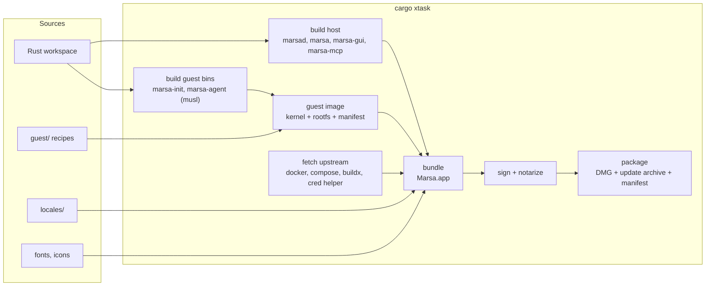
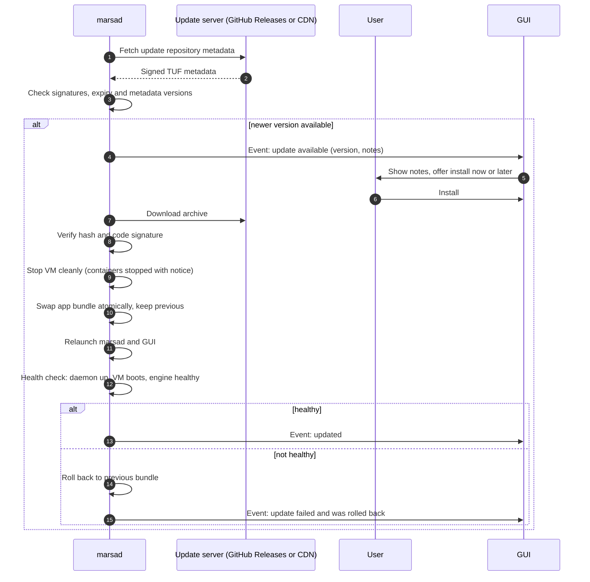
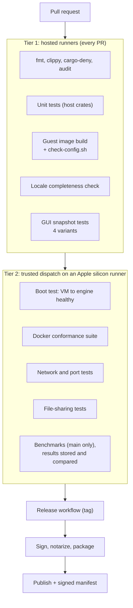

# 12 Build, release and update

How Marsa is built, packaged, signed, shipped and kept up to date on macOS.

## Toolchain

| Item | Choice | Status |
|---|---|---|
| Rust | Stable channel, version pinned in `rust-toolchain.toml` | Proposed |
| Host target | `aarch64-apple-darwin`, macOS 27 minimum | Decided |
| Guest target | `aarch64-unknown-linux-musl` (static) | Proposed |
| Task runner | `cargo xtask` (no Makefile, no shell-script sprawl) | Proposed |
| Protobuf | Cargo generates bindings with `prost` and `tonic` using [pinned protoc](../crates/marsa-proto/PROTOCOL.md#build-the-rust-bindings) | Decided in M0-05 |
| Guest build | Containerised image assembly with static Rust guest programs, driven by `cargo xtask guest` | Proposed |
| Lint and format | `rustfmt`, `clippy` with warnings denied in CI | Proposed |
| Dependency policy | `cargo-deny` (licences, bans, advisories), `cargo-audit` | Proposed |

The guest agent TLS provider builds its freestanding ARM64 code with Clang
and uses the pinned Rust toolchain's `llvm-tools` component for its ELF
archives. The static guest programs link to the pinned Rust musl target.

## Build graph



## App bundle layout

**Proposed.**

```text
Marsa.app/
└── Contents/
    ├── Info.plist
    ├── MacOS/
    │   ├── marsa-gui                  # main executable
    │   ├── marsad
    │   ├── marsa
    │   └── marsa-mcp                 # launched by marsa mcp
    ├── Helpers/
    │   └── marsa-net-helper           # signed native ARM64 helper
    ├── Resources/
    │   ├── bin/
    │   │   ├── docker
    │   │   ├── docker-credential-osxkeychain
    │   │   └── cli-plugins/           # docker-compose and docker-buildx
    │   ├── guest/
    │   │   ├── Image
    │   │   ├── rootfs.img
    │   │   └── guest-manifest.json
    │   ├── Marsa.icns
    │   ├── locales/
    │   ├── fonts/
    │   ├── release-notes.json          # notes for the installed version
    │   └── licenses/                  # third-party notices and SBOM
    └── Library/
        └── LaunchAgents/
            └── io.github.nasraldin.marsa.marsad.plist
```

Use `io.github.nasraldin.marsa` as the app's `CFBundleIdentifier` for the checked-in [LaunchAgent template](../packaging/macos/LaunchAgents/io.github.nasraldin.marsa.marsad.plist). If the bundle identifier changes, update the plist filename and its `Label` together.

Prepare the guest and Docker resources in a private release workspace before
assembling the app:

```sh
cargo xtask stage-release-resources \
  --guest-dir "$guest_handoff" \
  --guest-manifest-sha256 "$trusted_manifest_sha256" \
  --output "$release_workspace/staged"
```

The guest handoff contains exactly `Image`, `rootfs.img`, and
`guest-manifest.json`. Obtain the manifest SHA-256 from the trusted guest
build record through a separate trusted channel. Hashing the manifest after
receiving the handoff provides no independent validation. The stager checks
the manifest and guest bytes, then fetches and verifies the four
[pinned Docker artifacts](09-cli-and-docker-compat.md#bundled-upstream-binaries).

Use paths without symlink components and a new output directory inside a
workspace you own and control. On macOS, the immediate output parent must
have no access control entries because a new directory can inherit them
even with owner-only mode bits. The stage uses a private scratch directory
under the checked output parent and verifies the parent path again before
publishing atomically on macOS and GNU/Linux. Use the complete staged directory
as input to bundle assembly and to the combined SBOM and notices command.

Build the host executables and user-space network helper on Apple silicon:

```sh
MACOSX_DEPLOYMENT_TARGET=27.0 cargo build --release --locked \
  -p marsa-gui -p marsad -p marsa-cli -p marsa-mcp
bash network-helper/build.sh "$release_workspace/marsa-net-helper"
cargo xtask bundle \
  --host-dir target/release \
  --network-helper "$release_workspace/marsa-net-helper" \
  --resources-dir "$release_workspace/staged" \
  --guest-manifest-sha256 "$trusted_manifest_sha256" \
  --licenses-dir "$release_workspace/notices" \
  --output "$release_workspace/Marsa.app"
```

Maintain `packaging/release-notes/<version>.json` for the Cargo workspace
version. Specify the version in `version` and plain-text summaries in `en-US`
and `ar`. Bundle assembly includes that file in the signed app so that About
can display the installed release's notes offline.

For local qualification, `--licenses-dir` may be omitted. Public distribution
requires the complete notice set. Use new output paths under a private workspace.

Verify the checksums in the [font asset inventory](../assets/fonts/README.md) before copying the native fonts and their original notice into the bundle.

Copy the verified [Harbor icon](../assets/icons/README.md) into `Contents/Resources/Marsa.icns` and set `CFBundleIconFile` to `Marsa.icns`.

Verify the checksums in the [font asset inventory](../assets/fonts/README.md) before copying the native fonts and their original notice into the bundle.


Copy the verified `bin/` tree from the directory printed by
[`cargo xtask fetch-upstream`](09-cli-and-docker-compat.md#bundled-upstream-binaries)
into `Contents/Resources/bin/`. Feed the staging directory’s
`upstream-sbom-input.json` into the release SBOM.

## Release notices and source publication

Stage the verified [licence notices, combined SBOM and kernel source references](../packaging/release/README.md) before bundling a distribution build. Keep the exact kernel configuration and the guest notice archive with the published binaries. A local build used to qualify launch can be assembled before the supplier handoff is complete.

## Signing and notarization

| Requirement | Detail |
|---|---|
| Apple Developer Program membership | Needed for a Developer ID certificate |
| Developer ID Application certificate | Signs every Mach-O binary in the bundle, inside-out |
| Hardened runtime | Enabled on all binaries |
| Secure timestamp | Required on every Developer ID signature |
| Entitlements | `com.apple.security.virtualization` on the binary that creates the VM; `com.apple.security.hypervisor` if the `krun` backend is bundled |
| Bundled upstream binaries | Re-signed with Marsa's identity as part of the bundle |
| Notarization | Submit the DMG, wait, staple the ticket |
| Gatekeeper check | CI verifies the stapled, signed result on a clean machine |

M1-02 confirmed the `com.apple.security.virtualization` entitlement in ad hoc signed macOS builds. See the [boot and signing evidence](spikes/M1-02-vz-binding.md). **Verify** Developer ID signing and notarization for Virtualization.framework and Hypervisor.framework before M10.

Run the pre-notarization verifier after signing. Use a private staging
directory under the release job's exclusive control and exclude concurrent
writers from verification through submission. Supply the trusted Team ID from
release configuration.

```sh
cargo xtask verify-signature --team-id "$MARSA_TEAM_ID" target/release/Marsa.app
```

The verifier checks the app identifier and resource seal, then independently
checks the documented native roles and every additional Mach-O, including
code under `Contents/Resources`. It accepts thin arm64 code. It uses Apple's
`codesign` with a strict requirement for Apple-issued Developer ID
Application signatures from the supplied team. It checks the Hardened
Runtime flag and the certified signing timestamp on each file. It reads the
timestamp directly from Security.framework after strict signature validation.
It requires the virtualization entitlement on
`marsad` alone for the VZ release. All other code has an empty entitlement
dictionary. [Apple code requirements](https://developer.apple.com/documentation/technotes/tn3127-inside-code-signing-requirements/)
· [Apple's distribution signing guide](https://developer.apple.com/documentation/xcode/creating-distribution-signed-code-for-the-mac)
· [Apple's Hardened Runtime flag](https://github.com/apple-oss-distributions/xnu/blob/main/osfmk/kern/cs_blobs.h)
· [Apple's signing information keys](https://developer.apple.com/documentation/security/signing-information-dictionary-keys).

The required native roles include the MCP executable used by M8-07. A missing
MCP executable fails verification before notarization.

A hardened ad-hoc fixture passed strict structural verification and failed
both the Developer ID requirement and the standalone timestamp check on macOS
27.2.1. The standalone check accepted a separate strictly verified Developer ID
reference binary with a certified timestamp. M10-02 owns Developer ID signing,
notarization, stapling, Gatekeeper assessment, and clean-Mac installation and
VM boot.
[Apple's notarization requirements](https://developer.apple.com/documentation/security/notarizing-macos-software-before-distribution).

For notarization, M10-02 verifies the app inside the final pre-staple
submission artifact, for example by mounting a DMG read-only. Record the
SHA-256 of that verified artifact and check it immediately before submitting
the exact same file from private staging. Stop the release if the digest
changes. Assess the stapled artifact separately for distribution.

With the signing environment provisioned, prepare the notarized installer and
distribution directory:

```sh
cargo xtask sign --app "$release_workspace/Marsa.app" \
  --output "$release_workspace/signed"
cargo xtask package --signed-dir "$release_workspace/signed" \
  --output "$release_workspace/distribution"
```

`sign --local` uses the same Developer ID, Hardened Runtime and timestamp checks
and produces an app for local qualification. Distribution requires the notarized
app and installer, their stapled tickets and the notarization receipt.

The Mac App Store is not a distribution target: the sandbox it requires conflicts with running a VM daemon, a shared socket and bundled CLIs.

### Signing and clean-Mac handoff

- Confirm the project’s Apple Developer Program team and the 10-character Team
  ID. Name the owner responsible for certificate issuance and the custodian of
  the Developer ID Application identity.
- Make that identity and its matching private key available to the designated
  signing user or protected release job. Provision notarization there as an
  Apple `notarytool` Keychain profile, or use an App Store Connect team API key
  with its key ID and issuer ID. Share the approved Team ID and profile name
  through release configuration. Enter credentials directly into the protected
  signing environment.
- Designate separate custodians for the [TUF update keys](reference/update-manifest.md#keys-and-expiry).
  Keep root and targets signing offline or hardware-backed. Sign and test the
  G3 VM qualification artifact independently of establishing the update channel.
- Provide a second physical Apple silicon Mac running macOS 27 or later with no
  Xcode or command-line developer tools and no prior Marsa install or data. Use
  a standard macOS account, keep Gatekeeper enabled, and allow access to the
  distribution download. Tell the release operator
  which macOS build and Mac model are available and who will perform the test.
- For G3, download the notarized qualification build and record a successful
  Linux VM boot. For the app release, download the stapled DMG through a browser
  and preserve quarantine, drag Marsa to Applications, and open it in Finder.
  Record the first-launch result and VM readiness. Keep the artifact SHA-256
  and the OS build with the evidence. The release conformance tests cover
  public image pulls.

For a local qualification, an authorized Xcode account can submit a
Developer ID archive and export the stapled app through Xcode's distribution
workflow. The existing credentials were sufficient for the M3-10
qualification archive. The protected release workflow still needs its own
scoped signing and notarization configuration.
[Apple's Xcode notarization workflow](https://developer.apple.com/documentation/security/notarizing-macos-software-before-distribution).

[Apple Developer ID certificate setup](https://developer.apple.com/help/account/certificates/create-developer-id-certificates)
· [Apple notarization authentication](https://developer.apple.com/documentation/technotes/tn3147-migrating-to-the-latest-notarization-tool)
· [Apple distribution testing](https://developer.apple.com/documentation/xcode/packaging-mac-software-for-distribution).

### Automated Tart qualification

Prepare a disposable Tart guest from an Apple macOS 27 or newer restore image.
Keep Apple's default security settings and a fresh desktop account
automatically logged in. Install a verified Tart Guest Agent release as an
unprivileged launchd agent for that account with `--run-rpc`. Use the resulting
guest as the baseline for disposable clones. The upstream Golden Gate CI
template disables Gatekeeper, so use the Apple restore baseline for release
qualification.

Keep the host VPN and firewall in their target configuration. Attach the
trusted signed M3-10 qualification ZIP through a read-only guest volume.

From the host, with Tart and Python 3.11 or later:

```sh
python3 packaging/macos/check-tart-qualification.py \
  marsa-qualification /path/to/Marsa-VM-Qualification.zip
```

The default guest archive path is
`/Volumes/Marsa Qualification/Marsa-VM-Qualification.zip`. Use
`--guest-archive` for another read-only volume path. The runner uses `tart exec`
to check IPv4, the gateway and HTTPS, verify the guest ZIP against the host's
SHA-256, assess the app with a test quarantine marker, and wait for the daemon
socket after first launch. Use a fresh clone for the full run because launch
creates Marsa state in the guest account. Keep the graphical Tart window visible
so the agent can confirm the standard macOS first-open prompt for the verified
Marsa app. Use `--assessment-only` for a headless run that ends after assessment.

If native window automation times out while other Tart processes are running,
give the qualification window a dedicated app identity. Create the local
viewer from an installed, verified Tart app into a private directory:

```sh
viewer=$(bash packaging/macos/prepare-tart-window.sh \
  "/path/to/installed/Tart.app" "/path/to/private/Marsa Tart Qualification.app")
```

Use `"$viewer"` for the qualification VM's `run` command with the existing
`--net-fd` and read-only volume arguments. Address the resulting window by
bundle identifier `io.github.nasraldin.marsa.tart-qualification-viewer`.
The local viewer uses ad hoc signing with only Apple's virtualization
entitlement. The host runner still uses the installed Tart CLI for `exec`.

G3 additionally requires the second physical Mac boot, and app release
qualification includes downloading the DMG through a browser with quarantine
preserved. [Tart Guest Agent](https://github.com/openai/tart-guest-agent)
· [Golden Gate CI image template](https://github.com/cirruslabs/macos-image-templates/blob/main/templates/vanilla-golden-gate.pkr.hcl).

## Distribution channels

| Channel | Status |
|---|---|
| Signed, notarized DMG from GitHub Releases | Version 1 |
| Homebrew cask | Version 1 |
| Direct download from a project site | When a site exists |

## Auto-update



Rules:

- **Decided:** `marsad` coordinates updates through one service for desktop and headless clients. A maintained TUF verifier authenticates metadata and archives against the pinned public root. See [D-029](15-decisions.md#d-029-verify-updates-with-tuf) and the [manifest and key procedures](reference/update-manifest.md).
- Updates never restart running containers without telling the user first. The user can defer.
- Channels: `stable` and `beta`.
- The guest image updates with the app; the data disk is untouched.
- Security updates may be marked "recommended now" in the manifest and are highlighted, but still never forced silently.

## Versioning

- Semantic versioning for the app: `MAJOR.MINOR.PATCH`.
- `guest-manifest.json` records the kernel, Alpine, engine and guest-binary versions for each app version.
- The typed API is versioned separately (`marsa.v1`), as is the guest control protocol; the handshake rejects incompatible pairs with a clear message.

## Continuous integration

Planning flagged that VM code cannot be tested in ordinary cloud CI. The pipeline therefore has two tiers.



- Tier 1 checks documentation on every pull request and push to `main`. It skips Rust verification and the guest build when the diff contains only Markdown under `docs/` or the root README and governance documents. Mixed changes, an empty diff or an unavailable comparison run the build jobs. Those jobs use hosted Linux and Apple silicon macOS 27 runners. GitHub-hosted Apple silicon runners lack nested virtualization. [GitHub runner reference](https://docs.github.com/en/actions/reference/runners/github-hosted-runners#limitations-for-arm64-macos-runners).
- Apple signing and notarization credentials are scoped to the protected release workflow. TUF root and targets keys stay offline. CI publishes signed metadata and uses scoped signing services for the online TUF roles.

### Tier 2 runner setup

Run Tier 2 from a private validation repository containing reviewed Marsa commits. GitHub advises against connecting a persistent self-hosted runner to a public repository. [GitHub runner setup](https://docs.github.com/en/actions/how-tos/manage-runners/self-hosted-runners/add-runners).

1. Use a dedicated standard macOS account on the selected Apple silicon Mac with macOS 27 or later. Install Xcode command-line tools, Rustup, Python 3.11 or later, a Docker CLI connected to an arm64 Linux daemon, and `docker-buildx`. Put the tools on the runner account’s PATH. The workflow installs the pinned protobuf compiler and Linux musl Rust target.
2. In the private validation repository, restrict writes to trusted maintainers and protect the default branch. In **Settings → Actions → Runners**, select **New self-hosted runner**, macOS, and ARM64. Follow GitHub's registration instructions and add the `marsa-virtualization` label.
3. Mirror reviewed code to the private default branch. Set the private repository variable `MARSA_TIER2_ENABLED` to `true` and dispatch **Tier 2** on that branch. The job builds the guest from the checked-out revision, runs the [physical boot test](../spikes/vz-boot/README.md#verify-the-packaged-guest), and uploads the guest boot timings.

The public repository runs Tier 1. Release checks consume Tier 2 results from the same reviewed commit.

## Release checklist

1. All Tier 1 and Tier 2 checks green on the release commit.
2. Benchmarks within thresholds against the previous release.
3. Guest manifest, SBOM and third-party licence notices generated.
4. Kernel source reference and config published for GPL compliance.
5. Changelog written in English and Arabic.
6. Signed, notarized, stapled DMG verified on a clean machine.
7. Update from the previous release tested end to end, including rollback.
8. Signed manifest published to `beta`, then promoted to `stable` after a soak period.

## Uninstall

`marsa reset --factory` followed by removing the app must leave nothing behind. A documented uninstall removes: the app bundle, `~/.marsa`, the launch agent, the Docker context, the optional `/var/run/docker.sock` symlink and any PATH entries Marsa added. An automated test verifies this on a clean machine.
