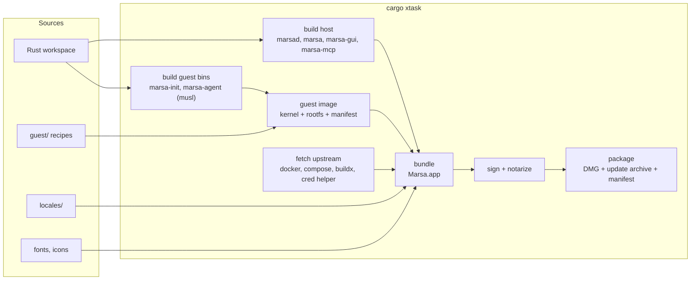
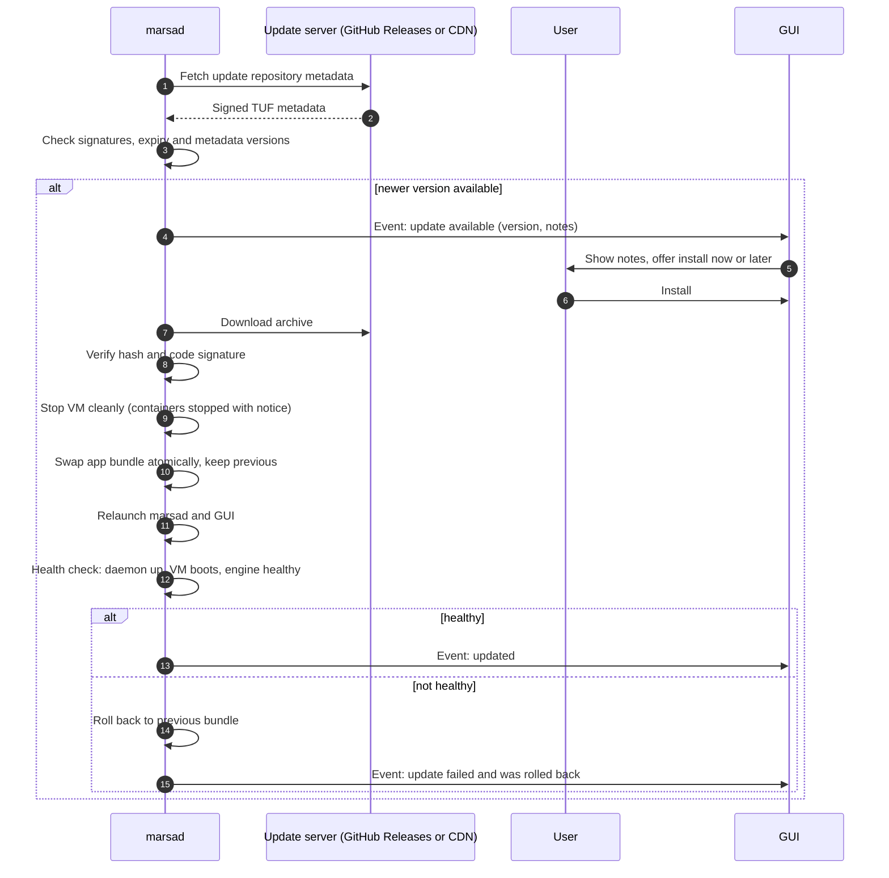
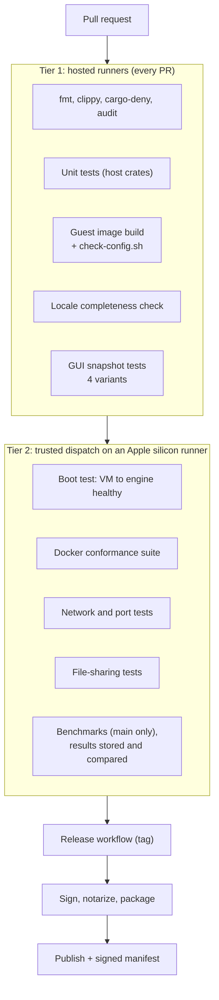

# 12 Build, release and update

How Marsa is built, packaged, signed, shipped and kept up to date on macOS.

## Toolchain

| Item | Choice | Status |
|---|---|---|
| Rust | Stable channel, version pinned in `rust-toolchain.toml` | Proposed |
| Host target | `aarch64-apple-darwin`, macOS 27 minimum | Decided |
| Guest target | `aarch64-unknown-linux-musl` (static) | Proposed |
| Task runner | `cargo xtask` (no Makefile, no shell-script sprawl) | Proposed |
| Protobuf | Cargo generates bindings with `prost` and `tonic` using [pinned protoc](../crates/marsa-proto/PROTOCOL.md#build-the-rust-bindings) | Decided in M0-05 |
| Guest build | Containerised image assembly with static Rust guest programs, driven by `cargo xtask guest` | Proposed |
| Lint and format | `rustfmt`, `clippy` with warnings denied in CI | Proposed |
| Dependency policy | `cargo-deny` (licences, bans, advisories), `cargo-audit` | Proposed |

The guest agent TLS provider builds its freestanding ARM64 code with Clang
and uses the pinned Rust toolchain's `llvm-tools` component for its ELF
archives. The static guest programs link to the pinned Rust musl target.

## Build graph



## App bundle layout

**Proposed.**

```text
Marsa.app/
└── Contents/
    ├── Info.plist
    ├── MacOS/
    │   ├── marsa-gui                  # main executable
    │   ├── marsad
    │   └── marsa
    ├── Helpers/
    │   └── marsa-net-helper           # signed native ARM64 helper
    ├── Resources/
    │   ├── bin/
    │   │   ├── docker
    │   │   ├── docker-credential-osxkeychain
    │   │   └── cli-plugins/           # docker-compose and docker-buildx
    │   ├── guest/
    │   │   ├── Image
    │   │   ├── rootfs.img
    │   │   └── guest-manifest.json
    │   ├── Marsa.icns
    │   ├── locales/
    │   ├── fonts/
    │   └── licenses/                  # third-party notices and SBOM
    └── Library/
        └── LaunchAgents/
            └── io.github.nasraldin.marsa.marsad.plist
```

Use `io.github.nasraldin.marsa` as the app's `CFBundleIdentifier` for the checked-in [LaunchAgent template](../packaging/macos/LaunchAgents/io.github.nasraldin.marsa.marsad.plist). If the bundle identifier changes, update the plist filename and its `Label` together.

Copy the verified [Harbor icon](../assets/icons/README.md) into `Contents/Resources/Marsa.icns` and set `CFBundleIconFile` to `Marsa.icns`.

Verify the checksums in the [font asset inventory](../assets/fonts/README.md) before copying the native fonts and their original notice into the bundle.


Copy the verified `bin/` tree from the directory printed by
[`cargo xtask fetch-upstream`](09-cli-and-docker-compat.md#bundled-upstream-binaries)
into `Contents/Resources/bin/`. Feed the staging directory’s
`upstream-sbom-input.json` into the release SBOM.

## Signing and notarization

| Requirement | Detail |
|---|---|
| Apple Developer Program membership | Needed for a Developer ID certificate |
| Developer ID Application certificate | Signs every Mach-O binary in the bundle, inside-out |
| Hardened runtime | Enabled on all binaries |
| Entitlements | `com.apple.security.virtualization` on the binary that creates the VM; `com.apple.security.hypervisor` if the `krun` backend is bundled |
| Bundled upstream binaries | Re-signed with Marsa's identity as part of the bundle |
| Notarization | Submit the DMG, wait, staple the ticket |
| Gatekeeper check | CI verifies the stapled, signed result on a clean machine |

M1-02 confirmed the `com.apple.security.virtualization` entitlement in ad hoc signed macOS builds. See the [boot and signing evidence](spikes/M1-02-vz-binding.md). **Verify** Developer ID signing and notarization for Virtualization.framework and Hypervisor.framework before M10.

The Mac App Store is not a distribution target: the sandbox it requires conflicts with running a VM daemon, a shared socket and bundled CLIs.

## Distribution channels

| Channel | Status |
|---|---|
| Signed, notarized DMG from GitHub Releases | Version 1 |
| Homebrew cask | Version 1 |
| Direct download from a project site | When a site exists |

## Auto-update



Rules:

- **Decided:** `marsad` coordinates updates through one service for desktop and headless clients. A maintained TUF verifier authenticates metadata and archives against the pinned public root. See [D-029](15-decisions.md#d-029-verify-updates-with-tuf) and the [manifest and key procedures](reference/update-manifest.md).
- Updates never restart running containers without telling the user first. The user can defer.
- Channels: `stable` and `beta`.
- The guest image updates with the app; the data disk is untouched.
- Security updates may be marked "recommended now" in the manifest and are highlighted, but still never forced silently.

## Versioning

- Semantic versioning for the app: `MAJOR.MINOR.PATCH`.
- `guest-manifest.json` records the kernel, Alpine, engine and guest-binary versions for each app version.
- The typed API is versioned separately (`marsa.v1`), as is the guest control protocol; the handshake rejects incompatible pairs with a clear message.

## Continuous integration

Planning flagged that VM code cannot be tested in ordinary cloud CI. The pipeline therefore has two tiers.



- Tier 1 runs for pushes and pull requests on hosted Linux and Apple silicon macOS 27 runners. GitHub-hosted Apple silicon runners lack nested virtualization. [GitHub runner reference](https://docs.github.com/en/actions/reference/runners/github-hosted-runners#limitations-for-arm64-macos-runners).
- Apple signing and notarization credentials are scoped to the protected release workflow. TUF root and targets keys stay offline. CI publishes signed metadata and uses scoped signing services for the online TUF roles.

### Tier 2 runner setup

Run Tier 2 from a private validation repository containing reviewed Marsa commits. GitHub advises against connecting a persistent self-hosted runner to a public repository. [GitHub runner setup](https://docs.github.com/en/actions/how-tos/manage-runners/self-hosted-runners/add-runners).

1. Use a dedicated standard macOS account on the selected Apple silicon Mac with macOS 27 or later. Install Xcode command-line tools, Rustup, Python 3.11 or later, a Docker CLI connected to an arm64 Linux daemon, and `docker-buildx`. Put the tools on the runner account’s PATH. The workflow installs the pinned protobuf compiler and Linux musl Rust target.
2. In the private validation repository, restrict writes to trusted maintainers and protect the default branch. In **Settings → Actions → Runners**, select **New self-hosted runner**, macOS, and ARM64. Follow GitHub's registration instructions and add the `marsa-virtualization` label.
3. Mirror reviewed code to the private default branch. Set the private repository variable `MARSA_TIER2_ENABLED` to `true` and dispatch **Tier 2** on that branch. The job builds the guest from the checked-out revision, runs the [physical boot test](../spikes/vz-boot/README.md#verify-the-packaged-guest), and uploads the guest boot timings.

The public repository runs Tier 1. Release checks consume Tier 2 results from the same reviewed commit.

## Release checklist

1. All Tier 1 and Tier 2 checks green on the release commit.
2. Benchmarks within thresholds against the previous release.
3. Guest manifest, SBOM and third-party licence notices generated.
4. Kernel source reference and config published for GPL compliance.
5. Changelog written in English and Arabic.
6. Signed, notarized, stapled DMG verified on a clean machine.
7. Update from the previous release tested end to end, including rollback.
8. Signed manifest published to `beta`, then promoted to `stable` after a soak period.

## Uninstall

`marsa reset --factory` followed by removing the app must leave nothing behind. A documented uninstall removes: the app bundle, `~/.marsa`, the launch agent, the Docker context, the optional `/var/run/docker.sock` symlink and any PATH entries Marsa added. An automated test verifies this on a clean machine.
