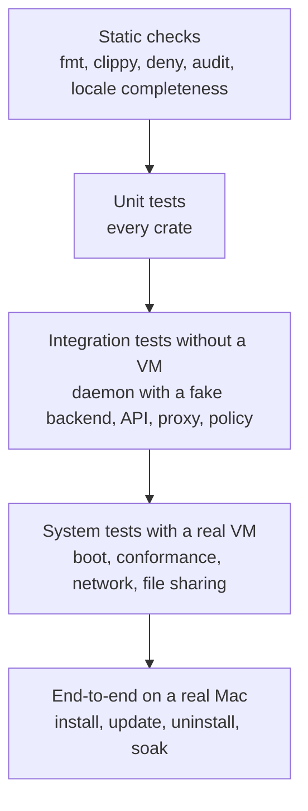

# 13 Testing and benchmarks

Marsa's promises are speed, compatibility and correctness in two languages. Each needs its own kind of test.

## Test pyramid

| Level | Runs where | Runs when |
|---|---|---|
| Static checks | Hosted runner | Every push |
| Unit | Hosted runner | Every push |
| Integration (fake backend) | Hosted runner | Every push |
| System (real VM) | Apple silicon runner with virtualization | Pull requests labelled for it, and every commit on `main` |
| End-to-end and soak | Dedicated Mac | Nightly and before releases |

## The fake backend

`marsa-vm` ships a `FakeHypervisor` that implements the trait in memory: it simulates state transitions, a scripted agent on a loopback channel and failure injection (boot timeout, sudden exit, slow handshake). It lets the daemon's supervisor, API, proxy and policy engine be tested on any machine without virtualization. This is what makes most of the codebase testable in ordinary CI.

## Unit and integration tests

| Area | Must cover |
|---|---|
| Supervisor state machine | Every transition in [03](03-host-daemon.md#vm-lifecycle), including concurrent start requests, failure and retry |
| Docker proxy | Streaming bodies, connection upgrades (`attach`, `exec`, BuildKit), cancellation, bind-mount inspection |
| Share allowlist | Canonicalisation, symlink escapes, protected paths, case differences |
| Policy engine | Every tier and tool in [10](10-mcp-server.md); grant expiry; denial paths |
| Settings | Validation, migration between versions, concurrent updates |
| Control protocol | Version negotiation, malformed and oversized messages |
| Port forwarder | TCP and UDP, bind conflicts, loopback versus LAN policy, teardown |
| Updater | Signature and hash verification with tampered inputs, rollback |
| i18n | Plural forms for Arabic, formatting, missing-key detection |
| Direction | Start and end resolution, icon mirroring rules, LTR isolation of technical text |

## System tests (real VM)

| Suite | Checks |
|---|---|
| Boot | VM reaches `Ready` within budget; boot stage timings recorded |
| Docker conformance | The checklist in [09](09-cli-and-docker-compat.md#compatibility-checklist), driven through the real `docker` CLI |
| Compose | A set of representative projects: web plus database, healthchecks, profiles, `watch` |
| Tool compatibility | Testcontainers suites in several languages; Dev Containers open and build |
| Networking | The matrix in [06](06-networking.md#test-matrix), with VPN and proxy simulated where possible |
| File sharing | Ownership, permissions, symlinks, change notifications, case behaviour |
| Storage | Space reclaim measured on the real image file; resize; unclean shutdown recovery |
| Lifecycle | Sleep and wake, network change, idle stop and restart on demand, daemon crash and recovery |
| Upgrade | Data disk from the previous release works with the new guest image |

## GUI tests

| Kind | Detail |
|---|---|
| Snapshot | Every component and screen rendered in four variants: English light, English dark, Arabic light, Arabic dark |
| Layout assertions | In right-to-left, start-aligned elements are on the right; directional icons are mirrored; technical text runs left-to-right |
| Interaction | Keyboard-only operation of every screen; command palette reaches every action |
| Text input | Typing, selection and deletion in Arabic and in mixed Arabic and English |
| Performance | Frame time while a log stream runs at high rate; memory after an hour of streaming |
| Accessibility | Focus order, labels exposed to the accessibility tree where the framework supports it |

A feature is not complete until its four-variant snapshots are reviewed and committed.

## Security tests

| Test | Expectation |
|---|---|
| Socket permissions | Another user cannot connect; modes are 0600 and 0700 |
| Allowlist escapes | Symlink, `..`, case-variant and hard-link tricks are refused |
| Protected paths | Cannot be shared directly or through a parent |
| Agent policy | Destroy-tier tools never run without approval; privilege flags refused |
| Untrusted output | Logs containing instruction-like text do not alter policy decisions |
| Update tampering | Modified manifest, wrong hash, unsigned bundle and downgrade are all rejected |
| Fuzzing | Control-protocol decoder, Docker request inspector and manifest parser have fuzz targets run in CI on a schedule |
| Log redaction | Known secret patterns never appear in logs or diagnostics bundles |
| External review | An independent security review before the version 1 release |

## Benchmarks

Benchmarks are code in `tests/bench`, run on the same reference Mac, with results stored per commit so regressions are visible.

### What is measured

| Benchmark | Metric | Target (from [01](01-vision-and-scope.md#success-measures)) |
|---|---|---|
| Cold start | Time from `marsad` start request to first container running | Under 3 s |
| Warm start | Time to run a container with the VM ready | Reported |
| GUI idle memory | Resident memory with the window open and idle | Under 100 MB |
| Daemon idle memory | Resident memory with the VM stopped | Under 30 MB |
| VM idle memory | Host memory attributed to the VM with no containers | Under 400 MB |
| Memory return | Host memory one minute after a 2 GiB workload ends | Returned to near idle |
| Bind-mount read | Throughput and small-file latency on a shared folder | Within 2x of native |
| Directory walk | Cold-cache `find` over a large shared tree | Reported; key `vz` versus `krun` measure |
| Data-disk I/O | Sequential and random read and write | Reported |
| Database import | Time to load a fixed dump | Reported; `vz` versus `krun` gate |
| Network throughput | Container to host and container to internet in each mode | Reported |
| Port forward latency | Added latency on a forwarded port | Reported |
| Build | Time to build a fixed multi-stage image, cold and warm cache | Reported |
| GUI log stream | Frame time and memory at a high log rate for one hour | No growth after warm-up |

### Comparisons

Each release publishes the same benchmarks run against Docker Desktop and at least one other alternative on the same machine, with versions and method stated, so claims are reproducible. Numbers quoted from other projects during planning were self-reported and must be replaced by Marsa's own measurements.

### Backend gate

The `vz` versus `krun` decision uses the gate in [04](04-virtualization-macos.md#choosing-the-default-the-benchmark-gate).

## Soak test

72 hours on a real Mac with: periodic sleep and wake, network changes, a steady log stream, repeated Compose up and down, image pulls and prunes. Pass means no crash, no stuck state, no unbounded memory growth in `marsad`, the GUI or the VM, and all space reclaimed at the end.

## Definition of done for any task

1. Code, tests and docs updated together.
2. Static checks pass.
3. Unit and integration tests for the change exist and pass.
4. If it touches the VM, network, file sharing or storage: the relevant system suite passes on the virtualization runner.
5. If it touches the GUI: four-variant snapshots added or updated, keyboard path verified, strings present in both locales.
6. If it touches a security boundary: the matching security test exists.
7. Any statement labelled **Verify** that the task relied on has been checked and the doc updated with what was found.
