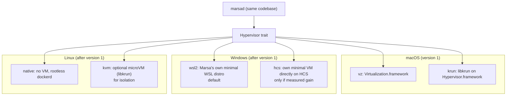

# 14 Future platforms: Windows and Linux

Version 1 is macOS only. This doc records what was decided for the other platforms so the macOS work does not block them.

## One daemon, three backends

## Windows

### Decisions

| Item | Decision | Status |
|---|---|---|
| Default backend | WSL2 with Marsa's own minimal distribution | Decided |
| Second backend | A minimal Linux VM created directly through the Host Compute Service (HCS), the API WSL2 itself is built on | Decided as "later, only if measurements justify it" |
| Guest userland | The same Alpine-based root filesystem as macOS, packaged as a WSL distribution | Decided |
| Kernel | Microsoft's WSL2 kernel under WSL2; Marsa's own under HCS | Decided |
| Data | Kept inside the Linux filesystem, never on the Windows drive | Decided |

### Why WSL2 first

- WSL2 is itself a lightweight Hyper-V VM; the advice that "WSL2 beats Hyper-V" compares it with Docker Desktop's legacy full-VM backend, which is not what either Marsa option uses.
- WSL2 is low effort, works wherever it is enabled, and is where most Windows developers keep their code.
- The case for HCS rested on one project's self-reported numbers (much lower idle memory and faster start). That is a target to reproduce, not a basis for a default.

### Known Windows concerns to design for

| Concern | Note |
|---|---|
| Bind mounts from the Windows drive | Cross a slow 9P share under WSL2; guide users to keep code in the Linux filesystem |
| `wsl --shutdown` and WSL updates | Stop Marsa's distribution; the supervisor must detect and recover |
| Integration with the user's own WSL distributions | Expose the Docker socket into them |
| HCS on Windows Home and locked-down machines | Unverified; test early if the HCS backend is pursued |
| Networking | WSL2's built-in networking is the fast path; mirrored mode is the likely choice. Verify |
| Control channel | Hyper-V sockets in place of vsock |
| Signing | Authenticode certificate, or users see security warnings |

### What the macOS work must not assume

- `marsa-core` paths, the launch mechanism, the tray and keychain access sit behind platform traits.
- The guest root filesystem contains nothing that depends on Marsa's own kernel.
- The control protocol is transport-agnostic (vsock today, Hyper-V sockets later).
- The GUI uses no macOS-only API outside a thin platform module.

## Linux

| Item | Decision | Status |
|---|---|---|
| Default | No VM. The engine runs natively, rootless | Decided |
| Optional | A KVM microVM (libkrun) for users who want the same isolation as the other platforms | Decided |
| Guest image | Not used in native mode | Decided |

Design notes:

- The `native` backend implements the Hypervisor trait as a process supervisor for rootless dockerd; "VM" lifecycle maps to engine lifecycle.
- Networking and file sharing are direct; the port forwarder and share manager are no-ops in native mode.
- Rootless matters here because there is no VM boundary.
- GUI concerns specific to Linux (Wayland and X11, the system webview, input methods) must be evaluated when Linux work starts.

## Order after version 1

**Proposed:** Windows before Linux, because Linux users already have a fast native engine and gain least from the VM work, while Windows shares the Docker Desktop pain that motivates Marsa. Revisit when version 1 ships.
