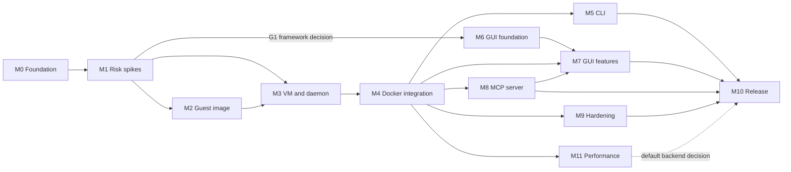
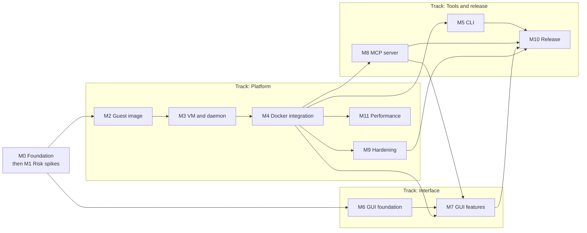

# Implementation plan

This plan turns the design in [`docs/`](../README.md) into ordered, checkable tasks for version 1 (macOS on Apple silicon). Agents: follow [AGENTS.md](../../AGENTS.md) for how to pick and run a task.

## Milestones

| ID | Milestone | Outcome | Tasks |
|---|---|---|---|
| M0 | [Foundation](M0-foundation.md) | A workspace that builds, lints and tests in CI | 10 |
| M1 | [Risk spikes](M1-risk-spikes.md) | The four biggest unknowns answered with evidence | 6 |
| M2 | [Guest image](M2-guest-image.md) | A reproducible minimal Linux image that boots to a healthy engine | 10 |
| M3 | [VM and daemon](M3-vm-and-daemon.md) | `marsad` boots, supervises and stops the VM through the `vz` backend | 19 |
| M4 | [Docker integration](M4-docker-integration.md) | The standard `docker` CLI and tools work against Marsa | 27 |
| M5 | [CLI](M5-cli.md) | The `marsa` command-line tool | 12 |
| M6 | [GUI foundation](M6-gui-foundation.md) | Design system, direction, i18n, themes and the app shell | 14 |
| M7 | [GUI features](M7-gui-features.md) | Every "must have" screen, in four variants | 53 |
| M8 | [MCP server](M8-mcp.md) | Agents can operate containers under permission tiers | 11 |
| M9 | [Hardening](M9-hardening.md) | Security, reliability and recovery proven by tests | 19 |
| M10 | [Release](M10-release.md) | Signed, notarized, auto-updating distribution | 15 |
| M11 | [Performance](M11-performance.md) | Benchmarks, the `krun` backend and the default-backend decision | 6 |

The [Apple silicon acceptance report](../spikes/apple-silicon-reverification.md#local-acceptance-audit-after-the-packaged-conformance-run) records local verification and outstanding gates across all milestones.

## Milestone dependencies



## Parallel tracks

After M1, three tracks can run at the same time with different agents.



The diagram shows ordering only. No durations or calendar dates are implied.

| Track | Milestones | Needs a Mac with virtualization |
|---|---|---|
| Platform | M2, M3, M4, M9, M11 | Yes |
| Interface | M6, M7 | For final checks only; most work runs against the fake backend or a bootstrap engine |
| Tools and release | M5, M8, M10 | M10 yes; M5 and M8 mostly no |

## Gates

Work stops at a gate until its condition is met.

| Gate | Condition | Decided in |
|---|---|---|
| G1 GUI framework | The owner selects the desktop framework after RTL and input qualification | M1-05, [D-023](../15-decisions.md#d-023-choose-gpui-for-the-desktop) |
| G2 Apple bridge | The owner approved direct Rust bindings for Virtualization.framework | M1-05, [D-024](../15-decisions.md#d-024-use-direct-rust-bindings-for-virtualizationframework) |
| G3 Signed VM | A signed build with the virtualization entitlement boots a VM on a second Mac | M3-10 |
| G4 Compatibility | The conformance suite passes with the real `docker` CLI, Compose and at least one Testcontainers suite | M4-14 |
| G5 Four variants | Every "must have" screen passes the four-variant audit and Arabic review | M7-14 |
| G6 Security | Security test suite green and external review findings resolved or accepted | M9-11 |
| G7 Release | Release checklist dry run completes on the beta channel, including update and rollback | M10-10 |

## Task format

Every task in the milestone files has the same fields.

```markdown
### M3-06 Title

- **Status:** todo
- **Depends on:** M3-01, M3-05
- **Docs:** links to the design sections this task implements
- **Do:** what to build
- **Deliver:** the files, crates or artifacts that must exist afterwards
- **Accept when:** checkable conditions; all must hold
```

## Owner decisions needed early

These open questions block specific tasks. See [16 Risks and open questions](../16-risks-and-open-questions.md).

| Question | Blocks |
|---|---|
| Q-03 Name clearance | M10-10 |
| Q-04 Apple developer account and keys | M3-10, M10 |
| Q-09 Governance and contribution terms | First public release |

## After version 1

Not planned in detail here. Order proposed in [14 Future platforms](../14-future-platforms.md): the "should have" GUI features, Windows (WSL2), Linux (native), then Kubernetes, the in-app assistant and the rest of the "later" list.
